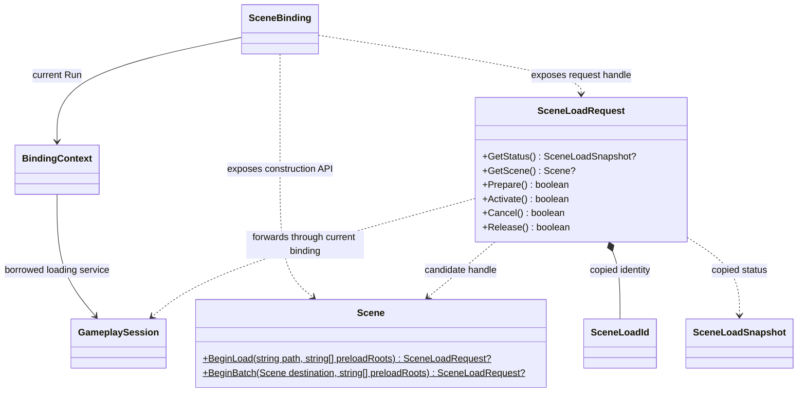
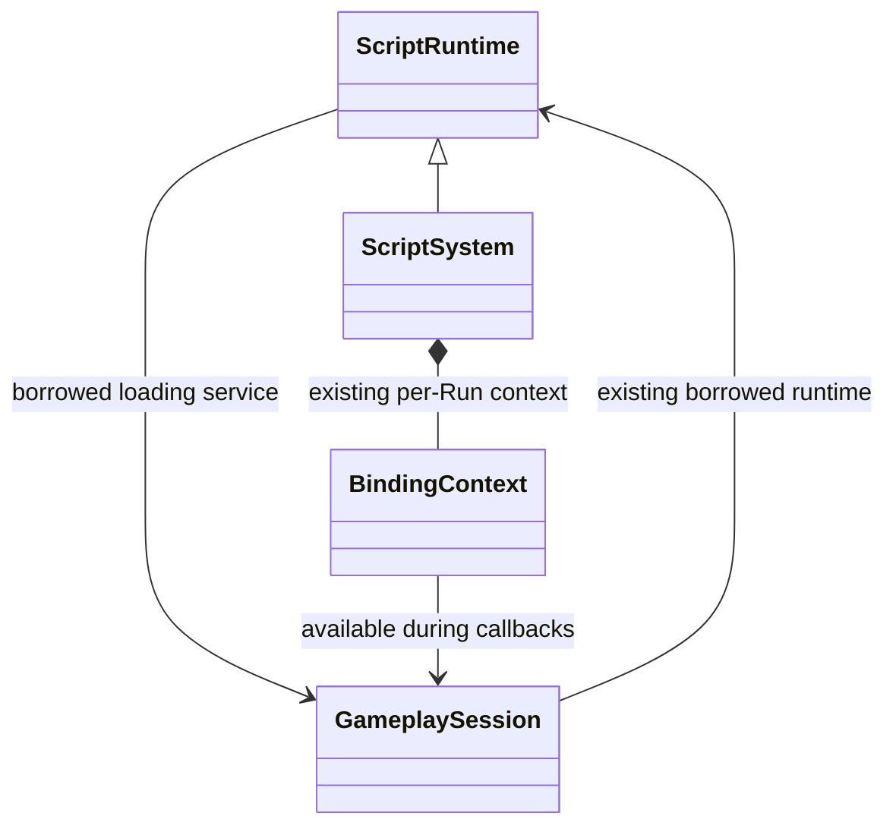

# 场景加载的脚本业务接口

[类图索引](../../../class-diagrams/index.md) · [原生加载协调](../../../runtime/class-diagrams/scene-loading.md) · [脚本绑定](script-bindings.md) · [玩法会话](../../../runtime/class-diagrams/gameplay-session.md)

状态与方法按本页契约实现；平台验证与限制集中见[测试文档](../../../testing.md)。

## 调用接口

- BeginLoad 创建 replace_scene 请求，BeginBatch 创建 append_batch 请求；preloadRoots 可省略，默认空。返回 null 代表未受理，已受理的失败通过 GetStatus 报告。
- SceneLoadRequest 是同一个原生请求的身份包装，不拥有第二份场景或计数。保存当前绑定 Run 及 SceneLoadId；每次调用校验两者，停止、重开或热重载后旧包装失效。
- GetStatus 返回独立只读数据及请求 id；对应原生 SceneLoadSnapshot，字段以 TS lowerCamelCase 表示，状态枚举使用英文字符串。所有 64 位身份使用字符串，不经 number 转换，不再另设 GetId。
- GetScene 在 staged 返回候选 Scene 的受限句柄，在 active 返回已发布的正式场景（追加批次返回目标场景），其他状态或目标已失效时返回 null。候选继续使用原有 Node、Component、Material 接口；只有创建此请求的活动回调可以修改它，普通活动场景查找看不到候选。发布后重新通过 GetScene 取得正式句柄，不复用已失效的候选权限。
- 业务可在 staged 配置镜头、角色出生点、组件和预制体，再调用 Prepare。Prepare 后候选不可写；等待 ready 后才可 Activate。active 表示目标首帧提交和范围激活已完成。
- Cancel、Release 与原生语义一致。Release 不卸载已激活场景；仍在准备时需要先 Cancel。Run 关闭负责取消和释放该 Run 拥有的操作，不依赖 JS GC 时机，也不影响编辑器或其他调用方的操作。
- 逐帧查询不会同步等待。Gameplay.Update 中可继续更新加载 UI、处理退出和取消；游戏自己的计时、AI 调度和伤害逻辑在 active 后启用。
- 原生 Physics/Animation 按范围激活，不需要业务手工为每个组件恢复暂停。已有场景是否暂停由业务明确决定。
- 独立动态资源读取仍使用 Resources.BeginLoad。给已运行对象更换纹理等参数不要求重新进入整个场景；创建新资源对象或需要一起出现的对象使用批次。
- 业务加载只维护这一套请求语义，不提供旧参数转换或双版本包装；原生模块层操作由同一个加载协调使用。

## 会话注入

- [ScriptRuntime.bind_gameplay_session](../../../runtime/class-diagrams/script-runtime.md) 是普通运行契约，标注 nodiscard，只允许在没有活动/候选 Run 时设置或清空。它只绑定借用，不加载资源，不启停会话。
- RuntimeHost 先装配脚本系统和 GameplaySession，再在运行脚本前绑定；关闭时先结束各 Run，再清空借用，最后销毁会话。无脚本配置照常使用原生加载接口。
- 同一 gameplay 模块内部的双向借用不改变所有权：宿主拥有会话，WorldSystem 仍拥有 ScriptRuntime；核心没有包含具体 ScriptSystem。BindingContext 只在正常回调权限窗口内使用会话。
- SceneBinding 仅转发普通加载服务及包装结果；VM 预检阶段不能发起场景请求。候选 Run 和活动 Run 的权限、拥有请求及清理集合分别维护。

## 业务使用顺序

1. 调用 BeginLoad，保留请求；每帧读取 GetStatus。
2. staged 时用 GetScene 完成项目初始化，然后 Prepare。
3. preparing 时继续显示加载提示或旧场景；ready 时按项目条件 Activate。
4. activating 时仍等待首帧；active 后才开始该关卡的业务计时。
5. active 后通过 GetScene 取得正式场景，保存所需有效句柄，再 Release 请求记录。

动态批次采用相同顺序：BeginBatch 指定目标场景和资源根，staged 中创建一个或多个对象，Prepare 封存整批，ready 后 Activate。单个对象就是一个只有一项的批次。

业务无需知道 GPU 上传队列、命令通道或截图 API；加载 UI 可以显示各阶段进度及失败原因。测试通过 MCP 读取同一请求状态，不要求项目额外维护测试用的布尔变量。
