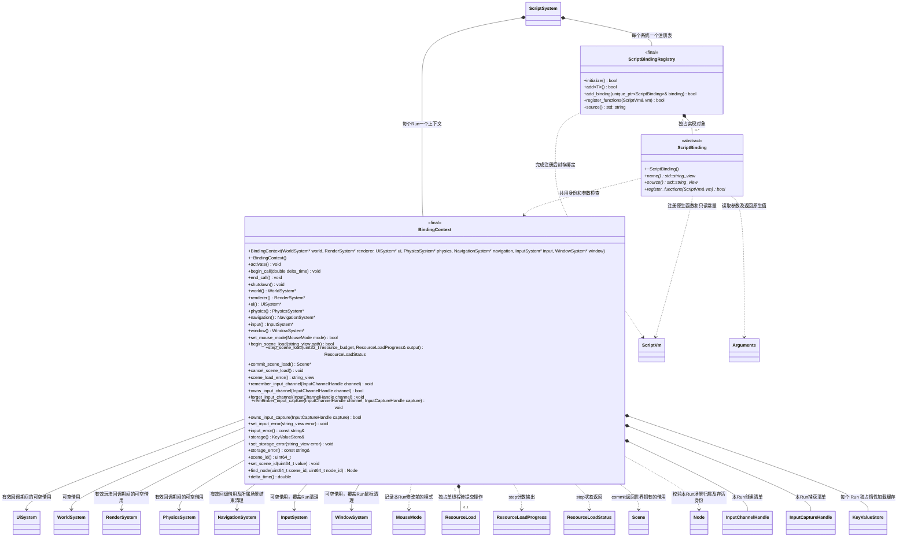
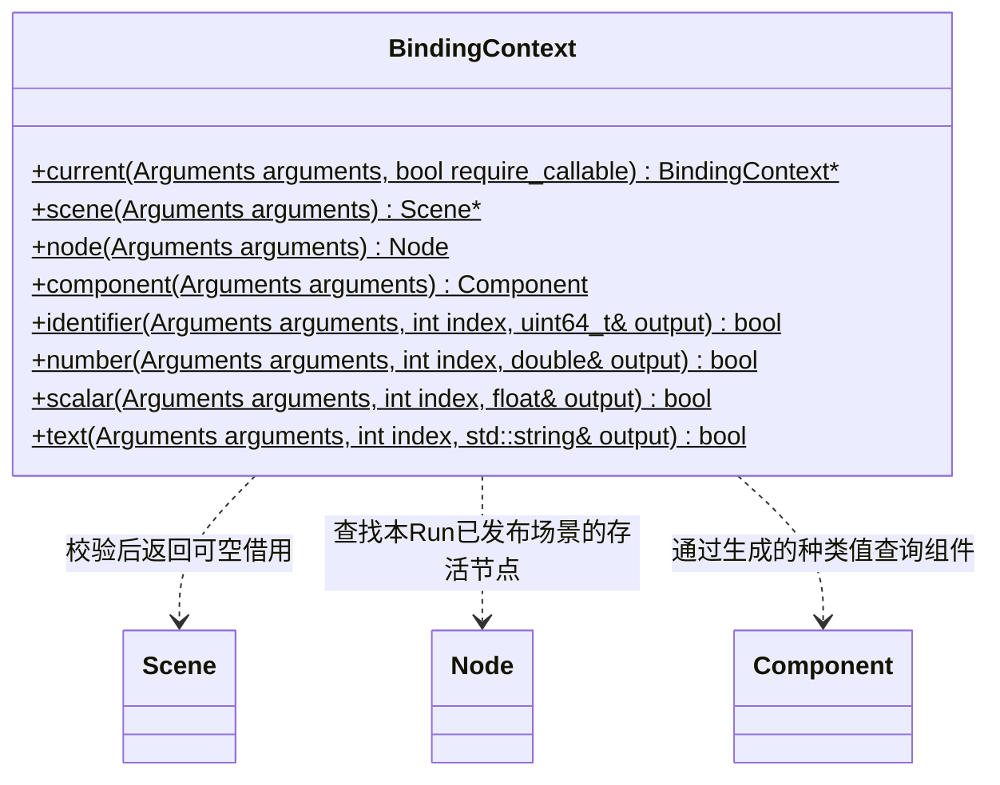
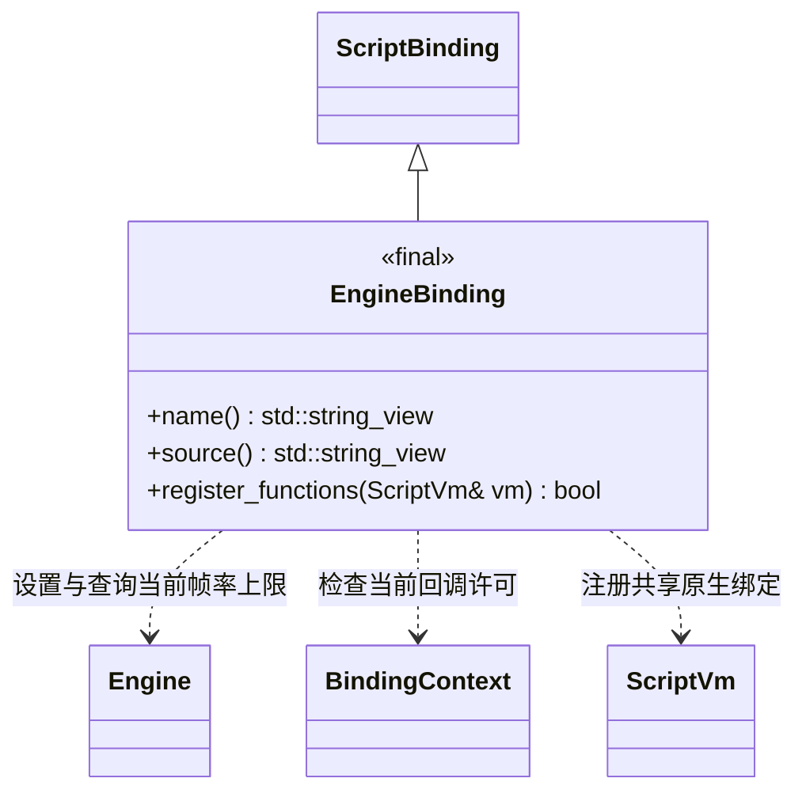
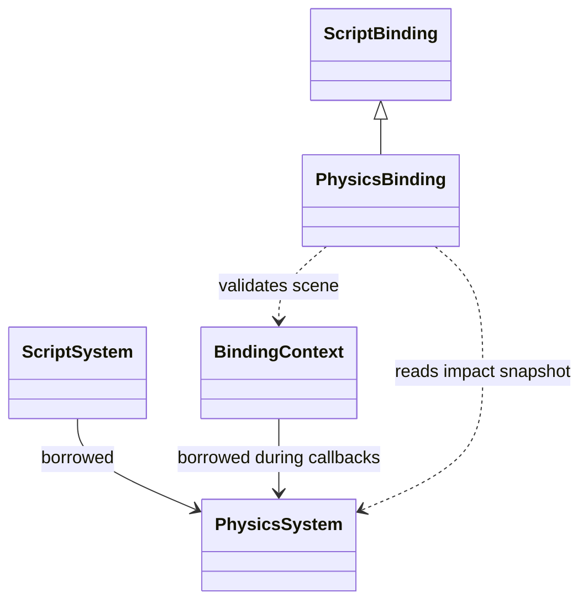
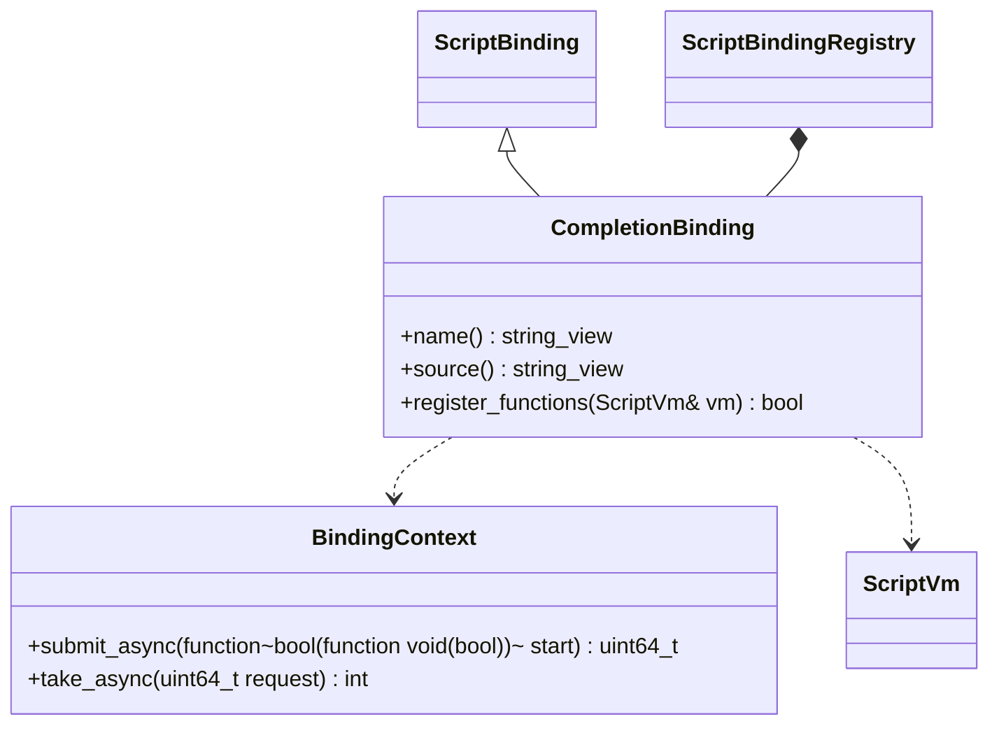

# 脚本绑定接口与实现

[脚本系统](script-system.md) · [渲染组件脚本接口](render-script-api.md) · [类图索引](../../../class-diagrams/index.md)

以下类型为脚本插件内部实现，通过 [ScriptVm](script-vm.md) 的原生调用契约工作，不包含具体虚拟机头文件。构建宏互斥选择 QuickJS 或 V8；逐类绑定在两种构建中复用。

绑定类型统一位于 `engine::plugins::script::bindings`，包含 `ScriptBinding`、`ScriptBindingRegistry`、`BindingContext` 及各模块绑定类；它们通过 `engine` 中的核心公开接口实现脚本操作。

InputBinding 提供统一输入能力，BindingContext 借用 InputSystem 并清理本 Run 创建的通道与捕获；公开方法、数据依赖与失败语义见[输入脚本接口](input-script-api.md)。

JSON 扩展：下方登记关系中的 JsonBinding 为本轮新增实现，公开方法与 `Json.Load(path): unknown` 门面只在 [JSON 资源脚本接口](json-script-api.md)定义。它复用 BindingContext 的活动回调检查和 ResourceSystem 的标准加载能力，不增加上下文服务、字段或第二套 JSON 值模型；已按评审契约实现。

运行控制继续复用现有系统，窗口绑定、退出入口和生命周期见
[运行时控制脚本接口](runtime-controls-script-api.md)。单线程场景操作由已有 SceneBinding 转发，
世界暂停不增加 ScriptRuntime 方法或第二套脚本更新框架。

已选角色插件登记独立 CharacterControllerBinding，方法与关系见[角色输入脚本接口](character-input-script-api.md)。它只提交瞬态意图，运动与相机计算保留原生。插件未选时不创建该绑定，也不强制启用角色插件。

`ScriptBinding` 的三个查询/注册方法为纯虚 `const` 方法，其中 name 和 source 为 `noexcept`；析构为公共虚析构且 `noexcept`。`ScriptBindingRegistry::register_functions` 和 `source` 为 `const`；`BindingContext::world`、`renderer`、`ui`、`physics`、`navigation`、`input`、`scene_id`、`delta_time` 为 `const noexcept`，服务返回可修改对象的可空借用。构造的服务指针默认空；除 world 外，服务查询在非生命周期及绑定回调期间返回空。输入句柄归属与失败语义见[输入脚本接口](input-script-api.md)。

上图新增 window 参数/查询、鼠标与场景操作方法已按评审契约实现；旧方法不变。window 构造参数默认
nullptr，查询为 const noexcept；窗口必须覆盖当前 Run 和清理过程。set_mouse_mode 在首次尝试
前查询并记录原模式，调用已有 WindowSystem；即使 SDL 部分操作失败，也在本 Run 停止时尝试
恢复该快照，失败记录日志。未激活的候选不能记录或恢复窗口状态。它不管理输入动作或宿主。

begin/step/commit/cancel 只协调该 Run 的一项加载请求，实际读取和依赖策略仍交给 ResourceLoader；
不引入自动队列或新资源系统。cancel 为 noexcept 且幂等，scene_load_error 为 const noexcept 的
本上下文错误借用；其余返回值标 nodiscard。操作先于目录换代和加载器关闭清理，成功提交后 Scene
接管根资源；候选预检、旧句柄和其他 Run 不可取消活动请求。具体边界只在[玩法入口](../../../runtime/class-diagrams/gameplay.md#暂停与后台资源加载)维护。

以下是同一个 `BindingContext` 的静态帮助入口；生命周期与借用方法仅在上图定义。`Arguments` 是 `const vm::Arguments&`，由本次原生回调临时借用；通过 owner 访问当前 Run 的绑定上下文，参数与返回值不暴露 JS 句柄。

以上帮助入口全部为静态方法，返回值均不可忽略；数字和文本读取失败将输出重置为零值或空字符串。`current` 的 `require_callable` 默认 true；只有 Debug 日志使用 false，允许当前活动模块顶层记录日志。上下文必须 active，操作场景还必须处于可调用作用域。停止 Run 时先执行关闭回调和绑定清理，再释放 VM 与任务队列，随后撤销上下文活性并仅清理其拥有的场景。

原生注册由 `ScriptVm::function/integer/string` 完成；回调参数可携带 int32 标签供同类操作区分。所有 native 属性只读、不可删除，已有名称直接失败；注册表完成全部绑定后调用 `seal_bindings`。`Arguments::set_return` 只接收原生 `NativeValue`，其中 uint64 标识转换成 BigInt，Object/Array 用于 UI 事件及值对象，默认空值返回 null；具体 VM 负责临时值的创建与回收。

```mermaid
classDiagram
    direction TB
    class ScriptBinding {
        <<abstract>>
    }
    class AppBinding
    class WindowBinding
    class StorageBinding
    class JsonBinding
    class EngineBinding
    class DebugBinding
    class GameplayBinding
    class TimeBinding
    class RenderBinding
    class SceneBinding
    class NodeBinding
    class ComponentBinding
    class TransformBinding
    class CameraBinding
    class EnvironmentComponentBinding
    class PostProcessComponentBinding
    class LightBinding
    class MeshRendererBinding
    class MaterialBinding
    class ColliderBinding
    class RigidBodyBinding
    class CharacterMotorBinding
    class AudioSourceBinding
    class AudioListenerBinding
    class AnimatorBinding
    class TerrainBinding
    class NavigationBinding
    class UiComponentBinding
    class UiElementBinding
    class UiControllerBinding
    ScriptBinding <|-- AppBinding
    ScriptBinding <|-- WindowBinding
    ScriptBinding <|-- StorageBinding
    ScriptBinding <|-- JsonBinding
    ScriptBinding <|-- EngineBinding
    ScriptBinding <|-- DebugBinding
    ScriptBinding <|-- GameplayBinding
    ScriptBinding <|-- TimeBinding
    ScriptBinding <|-- RenderBinding
    ScriptBinding <|-- SceneBinding
    ScriptBinding <|-- NodeBinding
    ScriptBinding <|-- ComponentBinding
    ScriptBinding <|-- TransformBinding
    ScriptBinding <|-- CameraBinding
    ScriptBinding <|-- EnvironmentComponentBinding
    ScriptBinding <|-- PostProcessComponentBinding
    ScriptBinding <|-- LightBinding
    ScriptBinding <|-- MeshRendererBinding
    ScriptBinding <|-- MaterialBinding
    ScriptBinding <|-- ColliderBinding
    ScriptBinding <|-- RigidBodyBinding
    ScriptBinding <|-- CharacterMotorBinding
    ScriptBinding <|-- AudioSourceBinding
    ScriptBinding <|-- AudioListenerBinding
    ScriptBinding <|-- AnimatorBinding
    ScriptBinding <|-- TerrainBinding
    ScriptBinding <|-- NavigationBinding
    ScriptBinding <|-- UiComponentBinding
    ScriptBinding <|-- UiElementBinding
    ScriptBinding <|-- UiControllerBinding
```

实现均为 final，分别保存于 `src/engine/plugins/runtime/script/bindings/` 下的 `app_binding`、`debug_binding`、`gameplay_binding`、`time_binding`、`scene_binding`、`node_binding`、`component_binding`、`transform_binding`、`camera_binding`、`light_binding`、`mesh_renderer_binding`、`material_binding` 头文件与实现文件。接口、注册表和公共上下文同目录独立维护。

- `ScriptBinding` 定义名称、JS 门面和原生函数注册；具体实现不重复持有 Run 或世界。`add<T>()` 通过普通模板创建并登记一个实现，默认绑定在初始化入口逐类列出。注册表独占绑定对象，拒绝空绑定和重复名称，失败不转移调用者所有权。原生属性注册拒绝已有名称，不能覆盖其他绑定函数。
- 每个组件绑定自行注册工厂和组件种类值；Node 的 AddComponent 根据注册表调用相应工厂，新增组件绑定无需修改 Node 或全局业务 switch。
- BindingContext 的共享静态帮助方法负责数值/字符串/64位标识校验与场景/节点查找；所有失败返回状态或空借用。
- 绑定上下文借用 World，保存 Run 所属场景 ID 和本帧时间，不持有原生 Node/Component 指针。组件包装统一捕获 Component 的非零实例身份，共享句柄查询逐次校验 scene/node/kind/instance；组件删除后重建不会复活旧引用，附属于 MeshRenderer 的 Material 同样校验拥有组件的身份。失效句柄沿原生操作返回 false/null，不为每个组件维护专用验证闭包。虚拟机回调借用对应 Run 的 owner，上下文活性与回调许可全部匹配后才允许访问；上下文存活期覆盖 VM，VM 释放后撤销活性并仅清理自己的场景。
- `AppBinding` 读取 App 现有三种路径；`DebugBinding` 转发日志；`TimeBinding` 仅在有效生命周期回调内返回时间；GameplayBinding 只有 JS 基类。
- `StorageBinding` 提供字符串 KV 与显式保存；BindingContext 独占缓存，只在有效回调首次访问时读取 App 持久根。接口和失败语义见 [KV 脚本接口](storage-script-api.md)。
- `EngineBinding` 独立提供 `Engine.SetTargetFrameRate(fps): boolean` 与 `Engine.GetTargetFrameRate(): number | null`，调用核心 Engine 的帧调度接口。设置只接受 `-1` 或正 int32 整数；无效参数不改变当前值。两者只允许活动 Run 的生命周期或组件回调使用，模块顶层、构造和候选预检阶段不能读取或修改运行中的上限。编辑器限帧的保存、解除与恢复由编辑器会话负责，绑定不读项目配置。

`EngineBinding` 方法均为 `const`、`override` 和 `[[nodiscard]]`；name/source 为 `noexcept`。脚本门面为冻结的静态类，不拥有 Engine。
- `RenderBinding` 独立复用 RenderSystem 的设置查询与提交；BindingContext 接受宿主注入的可空渲染器，不查找进程全局实例、不持有所有权，也不负责渲染帧或样例策略。公开静态门面见[渲染脚本接口](render-script-api.md)。
- MaterialBinding 将 SetType/SetShader/SetTexture 的资源路径与 SetFloat/SetV2/SetV3/SetV4 交给材质接口校验。材质门面保存槽号，每次调用按场景与节点身份解析当前槽，失效槽不访问原生对象；GetTexture 返回已解析的路径。
- MaterialBinding 的 SetCullMode/GetCullMode 使用 back/front/none 字符串对应生成的 CullMode，不向脚本泄漏 GPU 状态位；alphaCutoff 继续通过 SetFloat 操作。
- CameraBinding 提供透视与正交设置，以及屏幕/归一化视口到世界射线的查询，返回普通射线值或 null；LightBinding 提供方向、点和聚光设置；MeshRendererBinding 提供资源网格切换与材质槽访问。所有范围、射线计算及资源匹配由对应原生组件负责，接口见[渲染脚本接口](render-script-api.md)。
- ColliderBinding、RigidBodyBinding、AudioSourceBinding、AudioListenerBinding 各有独立文件，提供[物理与音频组件接口](physics-audio-script-api.md)。几何、质量、速度、冲量、音频设置与播放请求交原生组件处理，不在绑定中实现仿真或混音。
- AnimatorBinding 独立提供[动画脚本接口](animation-script-api.md)，动作选择、播放设置与定位交 Animator 处理；不在原生脚本回调中采样、解析骨架或创建渲染资源。
- NavigationBinding 独立提供[导航脚本接口](navigation-script-api.md)，只收集调用方明确提交的静态网格，将构建、局部替换和完整路径查询交核心 NavigationSystem。
- 构造和清理不抛 C++ 异常；虚拟机调用通过返回值报告错误。全部借用仅在引擎主线程有效。

SceneBinding 提供 Scene.Load 与 FindNode：Load 仅可替换当前 Run 拥有的场景，失败保留原场景；FindNode 委托 `Scene::find_node(name)` 按节点顺序查首个同名节点，缺失返回 null。`Node.FindChild(path)` 委托 `Node::find_child(path)`，绑定只处理参数、返回身份与 Run 检查；精确名称、路径歧义和候选可见性见[场景查询契约](../../../runtime/class-diagrams/scene.md#场景查询收敛契约)。场景字节来自已激活 ResourceCatalog，不直接访问可变项目缓存或 SQLite。

BindingContext 在成功 Create/Load/Commit 后记录 Scene ID，活动 Scene ID 与仍存活的所属容器分开保存；场景变化时裁剪已释放记录。`find_node(scene_id, node_id)` 为 `const noexcept`，只在活动回调内返回本 Run 所属场景中精确匹配的存活节点。Scene 句柄仍只代表当前关卡；Node/Component 句柄可访问同一 Run 的常驻节点。`Scene.Destroy()` 卸载关卡并保留常驻子树；关闭 Run 先取消自身请求，再按记录的 Scene ID 完整销毁，候选 Run 和旧 Run 不能清理其他调用方的场景。

NodeBinding 提供 `SetPersistent(value)` 与 `IsPersistent()`，语义见[常驻节点](../../../runtime/class-diagrams/persistent-nodes.md)。只允许根节点设置，重复设置幂等；子节点继承祖先标记；常驻根先取消标记才能重新设置父节点。绑定不维护另一份常驻状态。

NodeBinding 提供 `Node.FindChild(path)`：从当前实例逐段匹配直接子节点，例如 `Assembly/Body`，不会使用场景全局同名查找。空路径、`.`、`..`、首尾斜线、连续斜线、缺失节点、任一层同名歧义或失效句柄均返回 null。绑定以既有 `parent()` 和 `name()` 过滤节点实际所属场景，不向核心 Node 增加脚本专用接口。

CharacterMotorBinding 独立提供胶囊移动设置、水平速度请求、实际速度查询、地面状态和跳跃；仅转发 CharacterMotor，不读取键鼠或设置相机。第一/第三人称控制器属于另一个可选插件，未在通用脚本插件中声明未实现的绑定。

UI 绑定见 [UI 脚本与 MVC](ui-script-api.md)。绑定模块可登记事件与停止清理 hook；ScriptSystem 只调用注册表导出的统一派发/清理入口，不逐个判断业务模块。UiSystem 为宿主注入的可空借用；关闭时先停止脚本及清理订阅，再销毁文档。

TerrainBinding 在 `ENGINE_HAS_TERRAIN_PLUGIN=1` 时登记，脚本插件的地形依赖由插件清单显式声明；关闭时不生成该门面或引用地形符号。公开契约见[地形脚本接口](terrain-script-api.md)。

宿主注入可空 `PhysicsSystem*`，其有效期覆盖玩法。绑定仅在有效回调中访问本 Run 存活对象的只读撞击快照，包含常驻对象；不推进物理、不在 Jolt 回调里执行脚本。

步骤 4：宿主额外注入可空 NavigationSystem 借用。BindingContext 在自己拥有的场景切换/停止时 clear 导航；候选 Run 预检不修改活动导航。导航仅接受调用方明确提交的网格与范围，失败路径不能继续使用受影响旧 tile。

## 原生异步完成委托

`CompletionBinding` 是插件内部绑定，复用每个 Run 的事件派发钩子，无公开线程或任务类。`BindingContext::submit_async(start)` 接收立即返回是否排队成功的启动函数，返回非零请求身份；`take_async(id)` 返回 pending/成功/失败/失效。每个 Run 最多 128 个未领取结果。原生完成委托只保存弱结果引用，不持有 VM 或 BindingContext；Run 停止、场景更换时失效。JS 闭包在下一次绑定事件阶段调用一次，拒绝 Promise 回调，取消不会调用旧场景委托。

`TerrainComponent.DigSphereAsync/FillSphereAsync(..., completed)`、`DestructionComponent.DamageSphereAsync(..., completed)` 返回是否接收请求；完成布尔值表示候选是否成功提交。同步方法保留。脚本不等待 future，也不接触工作线程。
