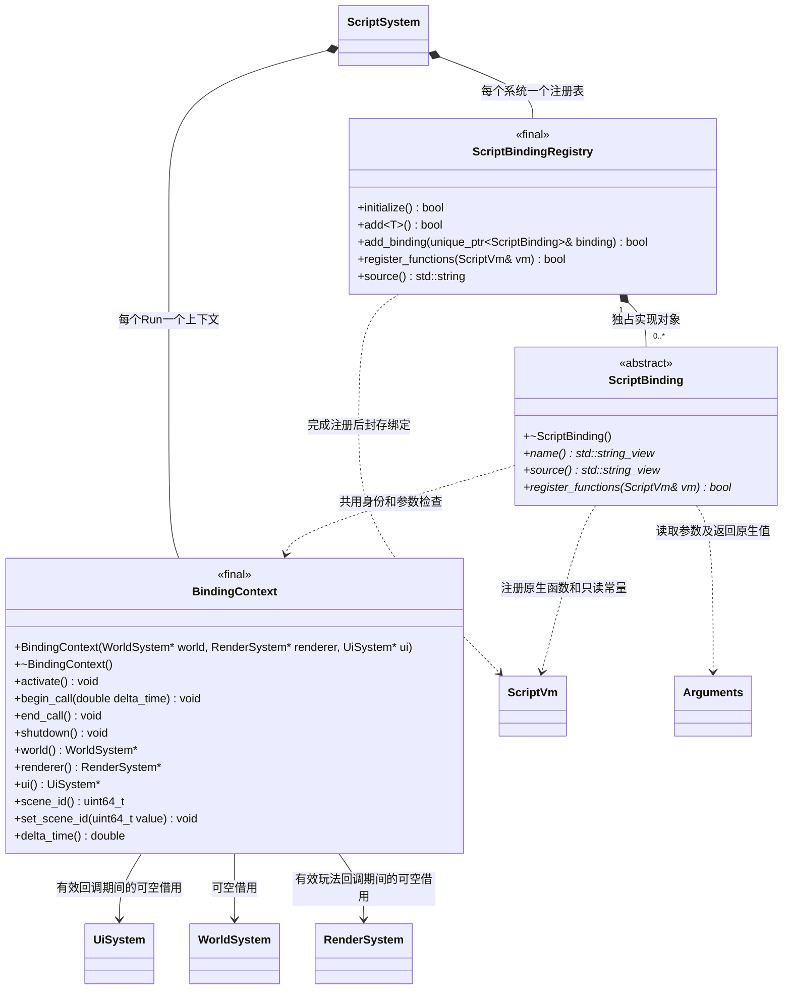
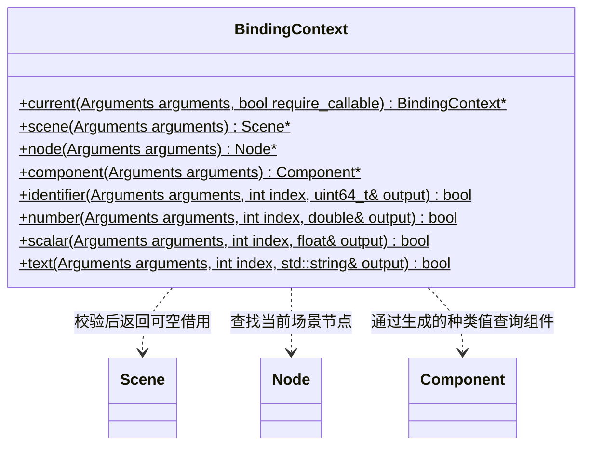
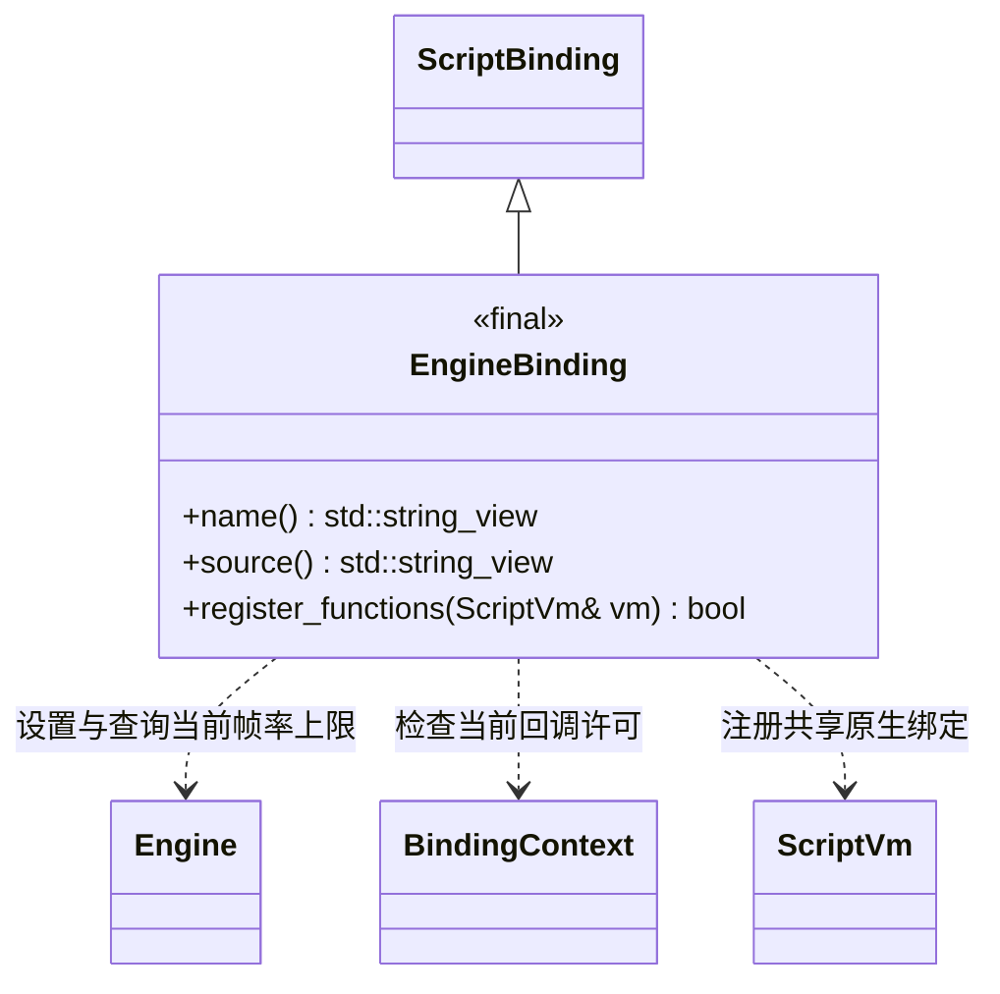

# 脚本绑定接口与实现

[脚本系统](script-system.md) · [渲染组件脚本接口](render-script-api.md) · [类图索引](../../../class-diagrams/index.md)

以下类型为脚本插件内部实现，通过 [ScriptVm](script-vm.md) 的原生调用契约工作，不包含具体虚拟机头文件。构建宏互斥选择 QuickJS 或 V8；逐类绑定在两种构建中复用。

绑定类型统一位于 `engine::plugins::script::bindings`，包含 `ScriptBinding`、`ScriptBindingRegistry`、`BindingContext` 及各模块绑定类；它们通过 `engine` 中的核心公开接口实现脚本操作。

`ScriptBinding` 的三个查询/注册方法为纯虚 `const` 方法，其中 name 和 source 为 `noexcept`；析构为公共虚析构且 `noexcept`。`ScriptBindingRegistry::register_functions` 和 `source` 为 `const`；`BindingContext::world`、`renderer`、`scene_id`、`delta_time` 为 `const noexcept`，其中 world 和 renderer 返回可修改服务的可空借用。构造的 renderer 和 ui 默认空；renderer / ui 查询在非生命周期及绑定回调期间返回空。成员函数的 `const` 在此说明，不写入返回类型。

以下是同一个 `BindingContext` 的静态帮助入口；生命周期与借用方法仅在上图定义。`Arguments` 是 `const vm::Arguments&`，由本次原生回调临时借用；通过 owner 访问当前 Run 的绑定上下文，参数与返回值不暴露 JS 句柄。

以上帮助入口全部为静态方法，返回值均不可忽略；数字和文本读取失败将输出重置为零值或空字符串。`current` 的 `require_callable` 默认 true；只有 Debug 日志使用 false，允许当前活动模块顶层记录日志。上下文必须 active，操作场景还必须处于可调用作用域。停止 Run 时先执行关闭回调和绑定清理，再释放 VM 与任务队列，随后撤销上下文活性并仅清理其拥有的场景。

原生注册由 `ScriptVm::function/integer/string` 完成；回调参数可携带 int32 标签供同类操作区分。所有 native 属性只读、不可删除，已有名称直接失败；注册表完成全部绑定后调用 `seal_bindings`。`Arguments::set_return` 只接收原生 `NativeValue`，其中 uint64 标识转换成 BigInt，Object/Array 用于 UI 事件及值对象，默认空值返回 null；具体 VM 负责临时值的创建与回收。

```mermaid
classDiagram
    direction TB
    class ScriptBinding {
        <<abstract>>
    }
    class AppBinding
    class EngineBinding
    class DebugBinding
    class GameplayBinding
    class TimeBinding
    class RenderBinding
    class SceneBinding
    class NodeBinding
    class ComponentBinding
    class TransformBinding
    class CameraBinding
    class EnvironmentComponentBinding
    class PostProcessComponentBinding
    class LightBinding
    class MeshRendererBinding
    class MaterialBinding
    class ColliderBinding
    class RigidBodyBinding
    class CharacterMotorBinding
    class AudioSourceBinding
    class AudioListenerBinding
    class AnimatorBinding
    class UiComponentBinding
    class UiElementBinding
    class UiControllerBinding
    ScriptBinding <|-- AppBinding
    ScriptBinding <|-- EngineBinding
    ScriptBinding <|-- DebugBinding
    ScriptBinding <|-- GameplayBinding
    ScriptBinding <|-- TimeBinding
    ScriptBinding <|-- RenderBinding
    ScriptBinding <|-- SceneBinding
    ScriptBinding <|-- NodeBinding
    ScriptBinding <|-- ComponentBinding
    ScriptBinding <|-- TransformBinding
    ScriptBinding <|-- CameraBinding
    ScriptBinding <|-- EnvironmentComponentBinding
    ScriptBinding <|-- PostProcessComponentBinding
    ScriptBinding <|-- LightBinding
    ScriptBinding <|-- MeshRendererBinding
    ScriptBinding <|-- MaterialBinding
    ScriptBinding <|-- ColliderBinding
    ScriptBinding <|-- RigidBodyBinding
    ScriptBinding <|-- CharacterMotorBinding
    ScriptBinding <|-- AudioSourceBinding
    ScriptBinding <|-- AudioListenerBinding
    ScriptBinding <|-- AnimatorBinding
    ScriptBinding <|-- UiComponentBinding
    ScriptBinding <|-- UiElementBinding
    ScriptBinding <|-- UiControllerBinding
```

实现均为 final，分别保存于 `src/engine/plugins/runtime/script/bindings/` 下的 `app_binding`、`debug_binding`、`gameplay_binding`、`time_binding`、`scene_binding`、`node_binding`、`component_binding`、`transform_binding`、`camera_binding`、`light_binding`、`mesh_renderer_binding`、`material_binding` 头文件与实现文件。接口、注册表和公共上下文同目录独立维护。

- `ScriptBinding` 定义名称、JS 门面和原生函数注册；具体实现不重复持有 Run 或世界。`add<T>()` 通过普通模板创建并登记一个实现，默认绑定在初始化入口逐类列出。注册表独占绑定对象，拒绝空绑定和重复名称，失败不转移调用者所有权。原生属性注册拒绝已有名称，不能覆盖其他绑定函数。
- 每个组件绑定自行注册工厂和组件种类值；Node 的 AddComponent 根据注册表调用相应工厂，新增组件绑定无需修改 Node 或全局业务 switch。
- BindingContext 的共享静态帮助方法负责数值/字符串/64位标识校验与场景/节点查找；所有失败返回状态或空借用。
- 绑定上下文借用 World，保存 Run 所属场景 ID 和本帧时间，不持有原生 Node/Component 指针。虚拟机回调借用对应 Run 的 owner，上下文活性与回调许可全部匹配后才允许访问；上下文存活期覆盖 VM，VM 释放后撤销活性并仅清理自己的场景。
- `AppBinding` 读取 App 现有三种路径；`DebugBinding` 转发日志；`TimeBinding` 仅在有效生命周期回调内返回时间；GameplayBinding 只有 JS 基类。
- `EngineBinding` 独立提供 `Engine.SetTargetFrameRate(fps): boolean` 与 `Engine.GetTargetFrameRate(): number | null`，调用核心 Engine 的帧调度接口。设置只接受 `-1` 或正 int32 整数；无效参数不改变当前值。两者只允许活动 Run 的生命周期或组件回调使用，模块顶层、构造和候选预检阶段不能读取或修改运行中的上限。编辑器限帧的保存、解除与恢复由编辑器会话负责，绑定不读项目配置。

`EngineBinding` 方法均为 `const`、`override` 和 `[[nodiscard]]`；name/source 为 `noexcept`。脚本门面为冻结的静态类，不拥有 Engine。
- `RenderBinding` 独立复用 RenderSystem 的设置查询与提交；BindingContext 接受宿主注入的可空渲染器，不查找进程全局实例、不持有所有权，也不负责渲染帧或样例策略。公开静态门面见[渲染脚本接口](render-script-api.md)。
- MaterialBinding 将 SetType/SetShader/SetTexture 的资源路径与 SetFloat/SetV2/SetV3/SetV4 交给材质接口校验。材质门面保存槽号，每次调用按场景与节点身份解析当前槽，失效槽不访问原生对象；GetTexture 返回已解析的路径。
- MaterialBinding 的 SetCullMode/GetCullMode 使用 back/front/none 字符串对应生成的 CullMode，不向脚本泄漏 GPU 状态位；alphaCutoff 继续通过 SetFloat 操作。
- CameraBinding 提供透视与正交设置；LightBinding 提供方向、点和聚光设置；MeshRendererBinding 提供资源网格切换与材质槽访问。所有范围及资源匹配由对应原生组件负责。
- ColliderBinding、RigidBodyBinding、AudioSourceBinding、AudioListenerBinding 各有独立文件，提供[物理与音频组件接口](physics-audio-script-api.md)。几何、质量、速度、冲量、音频设置与播放请求交原生组件处理，不在绑定中实现仿真或混音。
- AnimatorBinding 独立提供[动画脚本接口](animation-script-api.md)，动作选择、播放设置与定位交 Animator 处理；不在原生脚本回调中采样、解析骨架或创建渲染资源。
- 构造和清理不抛 C++ 异常；虚拟机调用通过返回值报告错误。全部借用仅在引擎主线程有效。

SceneBinding 提供 Scene.Load 与 FindNode：Load 仅可替换当前 Run 拥有的场景，失败保留原场景；FindNode 按节点顺序查首个同名节点，缺失返回 null。场景字节来自已激活 ResourceCatalog，不直接访问可变项目缓存或 SQLite。

CharacterMotorBinding 独立提供胶囊移动设置、水平速度请求、实际速度查询、地面状态和跳跃；仅转发 CharacterMotor，不读取键鼠或设置相机。第一/第三人称控制器属于另一个可选插件，未在通用脚本插件中声明未实现的绑定。

UI 绑定见 [UI 脚本与 MVC](ui-script-api.md)。绑定模块可登记事件与停止清理 hook；ScriptSystem 只调用注册表导出的统一派发/清理入口，不逐个判断业务模块。UiSystem 为宿主注入的可空借用；关闭时先停止脚本及清理订阅，再销毁文档。
