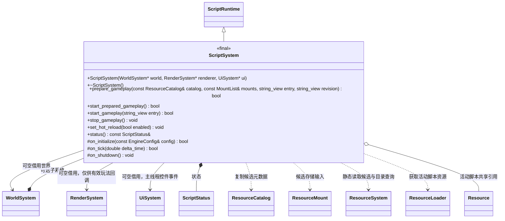
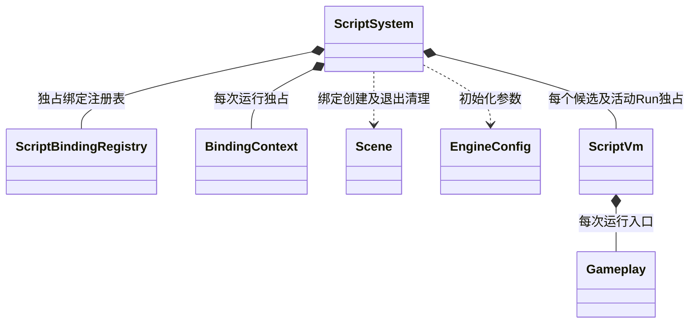

# 脚本系统

[类图索引](../../../class-diagrams/index.md) · [玩法会话](../../../runtime/class-diagrams/gameplay-session.md) · [脚本绑定](script-bindings.md)

ScriptSystem 属于 `plugins/runtime/script/`，实现核心 [ScriptRuntime](../../../runtime/class-diagrams/script-runtime.md) 契约并通过 [ScriptVm](script-vm.md) 管理模块预检与执行、玩法回调和脚本运行资源；资源部署选择及清单切换由 GameplaySession 调用。

C++ 类型为 `engine::plugins::script::ScriptSystem`；核心契约和借用对象保留在 `engine`。宿主直接引用插件命名空间，核心不提供插件类型别名。

- `world`、`renderer` 和 `ui` 默认空指针；非空世界必须比本系统存活更久。渲染器必须覆盖全部玩法回调，调用方在销毁渲染器前停止玩法；停止后上下文清理不访问渲染器。初始化准备绑定注册表，并创建临时 VM 验证所选后端能够初始化，随后释放；不启动项目，也不读取资源部署文件。
- `prepare_gameplay()` 接收调用方提供的目录和挂载，入口默认 `scripts/game.js`，修订默认目录修订。只沿静态 import 图读取候选 JS、编译和链接，不执行模块或用户回调、不更新核心目录、不停止旧玩法。失败保留旧运行。
- 宿主预检成功后停止旧玩法及 GPU、更新资源目录，再调用 `start_prepared_gameplay()`。启动核对活动资源与预检脚本的内容及模块身份，取得共享引用，然后执行模块并创建入口。执行失败停止本次玩法，不承诺撤销外部副作用。
- `start_gameplay()` 是从已经提交的活动目录直接准备并启动的入口；目录未提交或模块缺失时返回失败，不回退物理脚本目录。
- 每个 Run 独占 ScriptVm 环境、模块缓存、任务队列、Gameplay、BindingContext 以及实际加载脚本的 ResourcePtr；目录只复制元数据，脚本实体按 import 读取。只接受相对导入与虚拟 `engine` 模块，不支持 Node.js、动态 import 或顶层 await；传递依赖和循环依赖同样执行预检。
- 生命周期 `OnInitialize/Update/OnShutdown` 同步调用；初始化必须返回 true。回调结束后排空该 Run 的普通 Promise jobs，同次 checkpoint 内已处理的拒绝不误停；未处理拒绝、异步生命周期或动态 import 均报告失败。Update 失败停止玩法但仍执行 OnShutdown，Engine 帧仍返回成功。C++ 不使用异常。
- 停止先在场景仍有效时调用 OnShutdown 并清理 UI 订阅，再释放虚拟机与任务队列，随后销毁属于此 Run 的场景及脚本引用。部分初始化、重复停止和关闭均安全；不清理其他运行者的场景。
- 原生包装通过 Run 的 BindingContext 活性、Scene generation、Node id 和调用阶段检查有效性；模块顶层、构造及预检阶段不能修改场景。Time.deltaTime 仅在 Update 有效。
- `set_hot_reload()` 只修改脚本重载开关。调用方按该开关决定是否应用已发布候选；ScriptSystem 不轮询 available.json、控制文件或编辑器目录，也不自动激活资源。
- `ENGINE_SCRIPT_BACKEND` 在编译期选择 `quickjs`（默认）或 `v8`，只编译所选后端；不提供运行时切换。QuickJS 的 runtime/context 与 V8 的 isolate/context 都由各 Run 独占，V8 platform 每进程共享。所有平台的 V8 默认关闭 WebAssembly、Intl/ICU、Temporal、系统 instrumentation，保留 JIT，默认无 ICU 数据部署。
- `status()` 返回只读借用，下一次运行操作可更新内容。`entry` 默认空、`revision` 默认空；MountList 为标准容器别名。构造、析构、停止、查询及关闭为 noexcept，返回状态与重要查询标注 nodiscard，钩子标注 override。

- 可执行宿主按插件清单向 RuntimeHost 提供创建工厂；工厂接收 WorldSystem 和 RenderSystem 借用，返回未初始化实例。世界独占插件并统一调度；核心只包含 ScriptRuntime/ScriptStatus 头文件，不链接具体虚拟机或本插件。RuntimeHost 在关闭渲染器前通过 GameplaySession 停止玩法。
