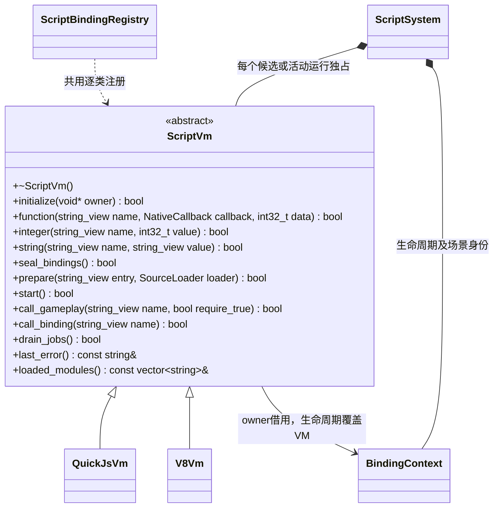
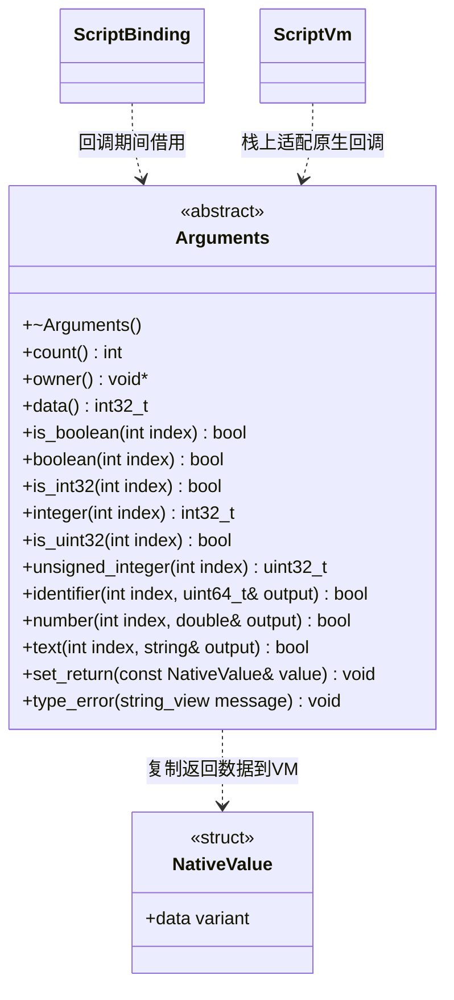

# 脚本虚拟机中间层

[脚本系统](script-system.md) · [逐类绑定](script-bindings.md)

中间层只属于脚本插件内部，不改变核心 ScriptRuntime 契约。参考 PuerTS 的
[PESAPI](https://github.com/Tencent/puerts/tree/master/unity/native/pesapi) 将原生调用与虚拟机隔离的思路，
只实现当前绑定需要的参数读取、标量及对象返回、模块预检和同步生命周期调用。

每次构建只选择一个后端。CMake 的 `ENGINE_SCRIPT_BACKEND` 默认 `quickjs`，生成互斥的
`ENGINE_SCRIPT_BACKEND_QUICKJS` / `ENGINE_SCRIPT_BACKEND_V8` 宏，只加入选中后端的源码和依赖。
不提供运行时切换，也不同时部署两套虚拟机。QuickJS 使用固定版本 quickjs-ng；默认产物不含 V8/ICU。

`ScriptVm` 和 `Arguments` 均有公共虚析构，且析构为 `noexcept`。两者的查询返回值均不可忽略；
`ScriptVm::last_error/loaded_modules` 为 `const noexcept`，`Arguments` 的全部方法为 `const`，
其中 `count/owner/data` 额外标注 `noexcept`。`function` 的标签 `data` 默认 0。
`NativeCallback` 是 `void(const Arguments&)` 函数指针，`SourceLoader` 是返回 `bool`、
接收模块路径和字符串输出参数的函数；注册与读取不把 VM 句柄传入业务模块。

- `NativeValue` 仅用于返回临时标量、字符串、数组和命名对象；uint64 身份保持 BigInt，
  不把任意 JavaScript 对象或 GC 句柄交给业务绑定。读取严格检查类型，失败清空输出。
- 每个 Run 独占模块环境、Gameplay 和任务队列。候选只编译和链接静态 import 图，
  不运行用户代码；导入不存在的命名导出和传递依赖的顶层 await 在预检阶段失败，旧玩法继续运行。
  入口默认导出是否为 Gameplay 派生类在启动时验证，失败停止本次运行。
- 后端负责 GC、句柄、异常文本和模块执行；ScriptSystem 负责资源清单、生命周期顺序、
  场景调用权限和重载策略。JavaScript 异常变为 bool 与错误文本，C++ 不使用异常。
- 停止先调用 OnShutdown、清理 UI 订阅，再释放 VM 和本 Run 的场景；异步任务不能跨 Run。
  两后端共享 engine 模块的 JS 外观，保留 UI MVC 和 V8 热重载。
