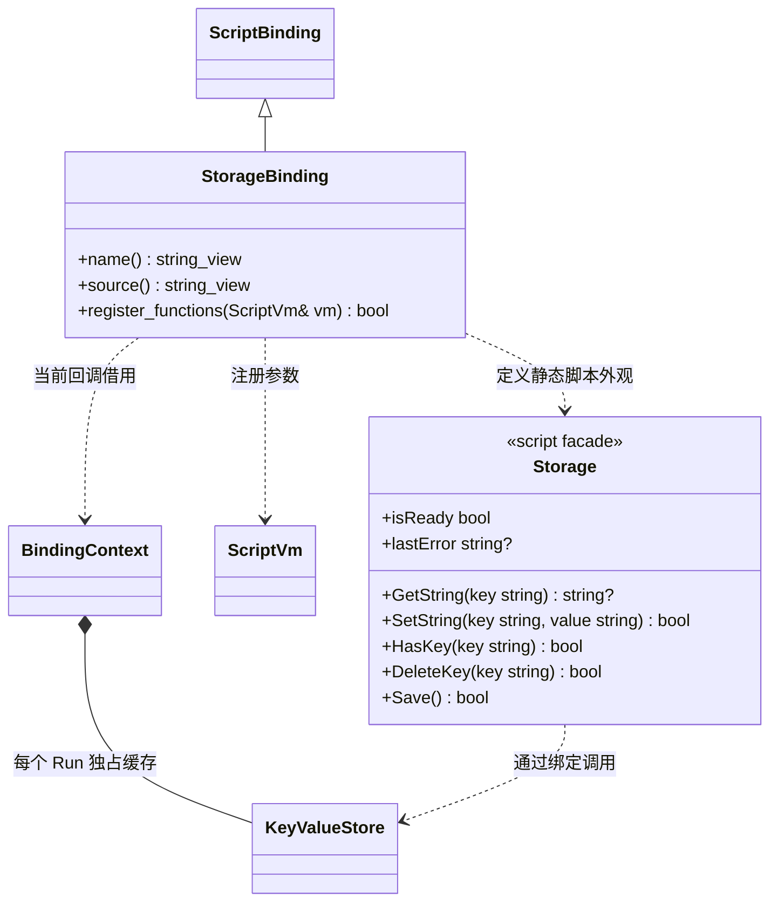

# 字符串 KV 脚本接口

[原生存取](../../../runtime/class-diagrams/key-value-store.md) · [绑定注册](script-bindings.md)

- `StorageBinding` 的方法均为 `const`、`override` 和 `[[nodiscard]]`，name/source 为 `noexcept`；由统一注册表登记，QuickJS 与 V8 复用同一实现。原生存储不依赖脚本插件。
- `Storage` 不可构造，为冻结的静态门面；`isReady` 与 `lastError` 只读。仅活动 Run 的 Gameplay / UI 生命周期回调可调用。模块顶层、构造及候选预检调用不读取或写入磁盘，返回 false 或 null；`lastError` 此时为 null。
- 首次有效访问惰性载入 KV，包括读取状态属性。GetString 缺 key 返回 null 且 lastError 为空字符串；读取失败返回 null，isReady 为 false，lastError 保留原因。后续写操作不能将损坏文件当空数据覆盖；下次 Run 才重新尝试加载。
- 有效回调中的参数数量、类型或超过 VM 4 MiB 文本桥限制时，返回 false / null，并在当前 Run 的 BindingContext 记录参数错误。`set_storage_error` / `storage_error` 管理该错误通道，方法定义随[绑定上下文](script-bindings.md)维护；不修改原生 KV 的数据或加载状态。`lastError` 优先报告参数错误，`isReady` / `lastError` 查询不清除它；下一次参数合法的数据操作清除参数错误，再报告原生存取结果。缺少 key 仍是 null 且错误为空，不与输入失败混淆。
- SetString / DeleteKey 仅修改当前 Run 的缓存，Save 明确报告是否保存成功。不存在的 key 可以重复删除；空字符串 value 可正常保存。停止与重载不隐式保存，项目可在 OnShutdown 检查 Save 的返回值。
- 保存字段、JSON 内容、业务数据版本、迁移和保存时机属于项目；常规低频序列化可在脚本完成，批量世界状态由原生游戏模块整理。

原生方法与数据边界见 [KeyValueStore](../../../runtime/class-diagrams/key-value-store.md)，脚本声明统一位于 `include/engine.d.ts`。
