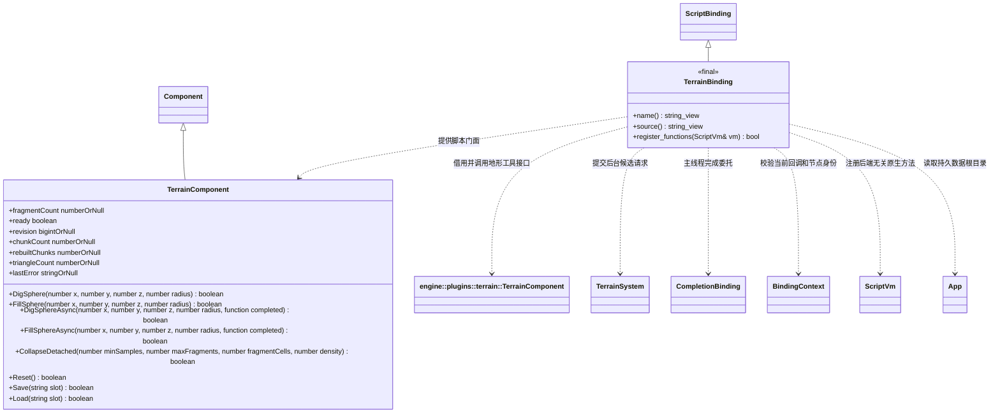

# 地形脚本接口

[绑定实现](script-bindings.md) · [运行时地形](terrain.md)

- `TerrainBinding` 属于脚本插件；只有构建期启用地形插件并定义 `ENGINE_HAS_TERRAIN_PLUGIN=1` 时编译与登记，不向脚本核心加入具体地形算法。方法均为 `const override`，`name/source` 为 `noexcept`，不持有组件所有权。
- 脚本通过 `Node.GetComponent(TerrainComponent)` 取得已配置组件；`AddComponent` 只创建组件，未绑定资源时 `ready` 为 false。门面按场景、节点与统一组件实例身份重新解析组件，不保存原生指针。
- 球形笔刷坐标为地形节点局部空间，半径须为正且有限；同步挖掘、填充直接调用原生 `apply_sphere`，复用块缓存局部重建。`Reset`/`Load` 从初始资源或快照重新初始化并全块重建，同步返回状态，失败返回 false。
- `DigSphereAsync/FillSphereAsync(..., completed)` 返回是否排队成功；拒绝时不调用委托。候选生成在后台，完成委托在主线程绑定事件阶段调用一次，`true` 表示 Mesh/Jolt 已成功发布，`false` 表示失败或同场景 Reset/禁用等取消。场景更换与脚本停止丢弃旧委托；回调不得返回 Promise。调用方应在成功回调之后刷新支撑、导航或运行后续同步修改，不能以请求接收作为碰撞已更新的依据。
- `Save/Load` 只接受长度 `1..48` 的 ASCII `[A-Za-z0-9_-]` 槽名，定位到 `App::persistent_data_path()/terrain/<slot>.bin`。固定目录、目标文件和规范路径逐项检查，拒绝符号链接、路径越界和非普通文件；不向脚本开放任意路径。保存只创建固定 terrain 目录，加载不创建目录。
- `ready` 为布尔值；失效句柄返回 false。`revision` 保持 uint64 对应的 BigInt；块数、重建块数和三角形数为 Number，失效句柄返回 null；`lastError` 返回原生诊断，失效句柄返回 null。

步骤 4：`CollapseDetached(minSamples, maxFragments, fragmentCells=4, density=1600)` 显式提取脱离下/侧边界的土石并交给动态凸形复合碰撞。预算/计算失败不删除待转化土石；`fragmentCount` 查询活动土石数量。存在动态土石时 Save/Load 目前明确失败，Reset 清理土石并恢复地形，不宣称完整世界存档。
