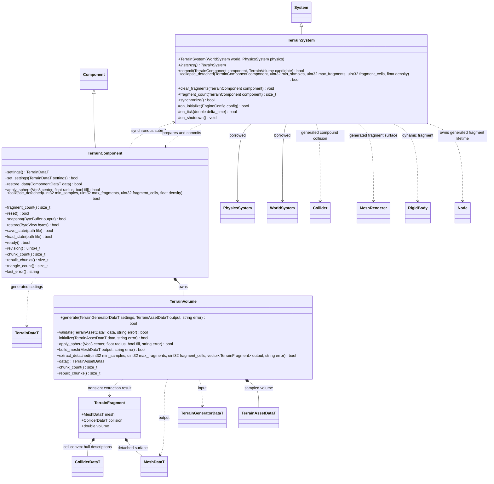

# 同步体积地形

步骤 1/4 的公开契约。插件命名空间 `engine::plugins::terrain`；`System`、`Component`、世界和物理只跨图引用，核心不引用地形插件。

`TerrainVolume` 独占 FlatBuffers 体积和按块网格缓存，只做计算。`TerrainComponent` 保持初始资源引用、修改副本与状态；保存绑定初始 GUID 和内容指纹。`TerrainSystem` 借用世界和物理，先准备候选、同步提交，失败保留旧结果。生命周期由宿主放在物理前驱动；正常 `on_tick()` 与编辑器预览均调用显式 `synchronize()`，预览不直接调用子系统的生命周期入口。

每个地形为一个正常节点；插件为它附加通用瞬时 MeshRenderer 和 Collider，标记为 transient，不写入场景。场景只保存 TerrainComponent 的资源和材质设置；地形修改通过独立状态文件保存。移除地形组件时系统回收自身生成的组件，不接管项目原有组件。

首版 `TerrainComponent::apply_sphere` 复制并复用当前块缓存，按 16/32 单元块重算脏网格；脚本球形笔刷直接走此路径。`restore` 与 `reset` 则从体积数据重新初始化，当前会重建全部块；MCP 的 `TerrainStateEdit` 候选提交、撤销/重做与加载/重置使用该恢复路径。最终均合并提交一个渲染网格和静态碰撞形状，仍是全量 GPU 上传和碰撞构建。`apply_sphere` 使用资源局部坐标；场景节点变换由核心 Transform 处理，不在插件里判断平台或调用者身份。

状态文件写入临时文件后发布，恢复先验证版本、初始资源身份、尺寸和密度；通过后才替换当前有效体积。脚本仅暴露安全存档槽，编辑器命令由自己的路径边界约束调用原生路径接口。

## 步骤 4：同步土石塌方

调用方显式执行 `collapse_detached(min_samples, max_fragments, fragment_cells, density)`。六邻域连通域只识别不再连接体积下边界或侧边界的负密度样本。有限体积的最外圈是封口空气，因此锚定判定使用边界内一层；顶面不锚定。达不到最小样本数的孤岛保留原状，不默默删除。悬空岛按调用方的 1–8 单元尺寸分组，分组各自成为通用瞬态 Node + MeshRenderer + Collider + RigidBody。渲染继续使用官方 Transvoxel regular cells；碰撞将各有实体的单元角点和零面边交点交给现有 Jolt 凸包/compound，不用动态三角网格或整个凹岛的单一凸包。

同步入口限制每次及每个地形至多 128 个活动碎块；超出调用预算或任一候选无效时整次保留原地形和旧碎块。候选网格、刚体与碰撞全部准备后，才从静态体积去掉已经转换的样本。碎块质量为近似样本体积乘调用方密度，并考虑正等比缩放；第一版只接受根节点、正等比缩放。`fragment_cells`、密度及最小岛大小由项目选择；不是引擎里的项目特判。

碎块跟随真实刚体模拟。继续挖/填只修改剩余静态体积，不吞掉已有碎块；禁用地形同时隐藏/禁用碎块，重新启用保留其姿态。Reset 成功后恢复源体积并清理所有碎块；清资源、移除组件、删除源节点、切场景、关闭系统均清理生成物。普通场景保存排除瞬态节点。当前 `TerrainStateData` 只支持静态密度，发生过塌方后直到显式 Reset/更换基础资源，`snapshot`、`save_state`、`restore`、`load_state` 明确失败（即便外部删除碎块节点也不放行）；不得保存一份丢失动态土石的“成功”快照。综合运行存档留待独立 schema 扩展。

算法依据：[Godot Voxel Tools island_finder](https://github.com/Zylann/godot_voxel/blob/045ff9326a32fd10ac6fdac6357b5a098aaf2093/util/island_finder.h) 及 [floating_chunks](https://github.com/Zylann/godot_voxel/blob/045ff9326a32fd10ac6fdac6357b5a098aaf2093/edition/floating_chunks.cpp)，固定版本 MIT。复用其“六邻域标记→排除边界连接→隔离密度→生成动态体”思路，按本引擎现有 schema、Transvoxel、Jolt 接口实现；未引入 Godot 类或运行框架。当前没有颗粒堆积求解、土壤应力、异步任务和 LOD。
