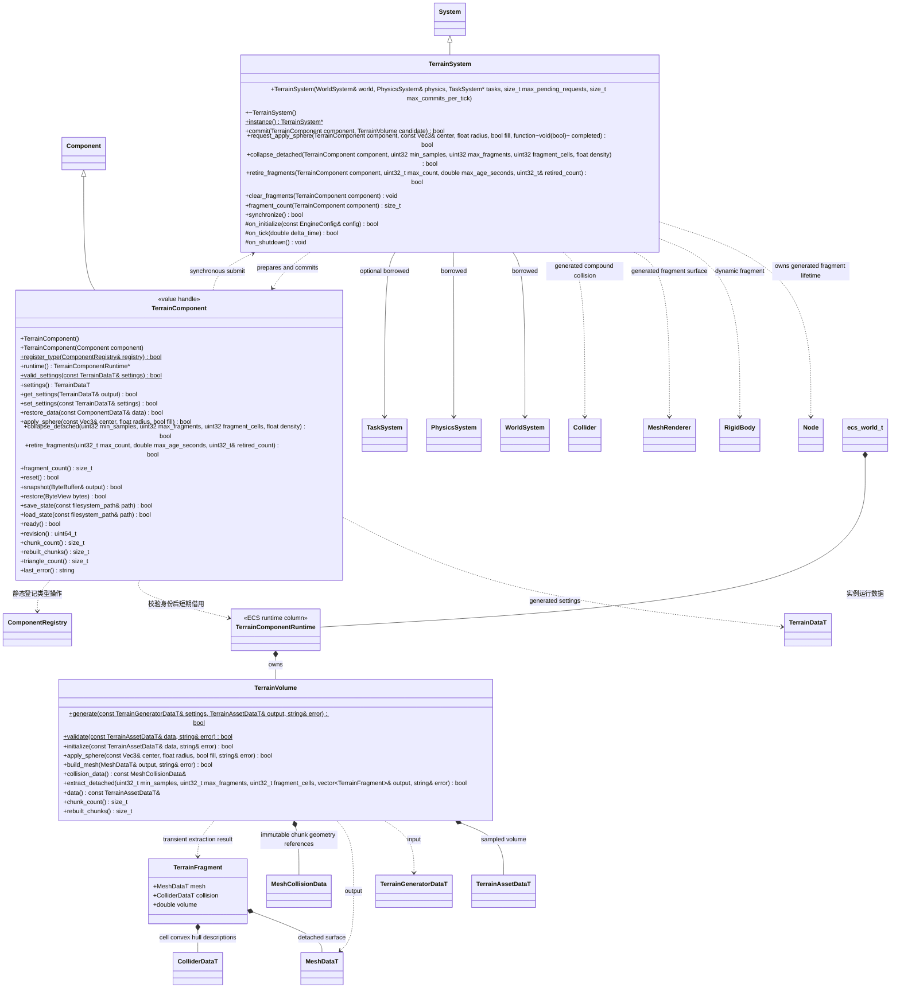

# 体积地形

插件命名空间 `engine::plugins::terrain`；`System`、`Component`、世界、任务与物理只跨图引用，核心不引用地形插件。

`TerrainVolume` 独占 FlatBuffers 体积和按块网格缓存，只做计算。`TerrainComponentRuntime` 在 ECS 列保持初始资源引用、修改副本与状态；保存绑定初始 GUID 和内容指纹。`TerrainSystem` 借用世界和物理，先准备候选、同步提交，失败保留旧结果。生命周期由宿主放在物理前驱动；正常 `on_tick()` 与编辑器预览均调用显式 `synchronize()`，预览不直接调用子系统的生命周期入口。

`request_apply_sphere` 是独立异步入口，原有同步修改与存档契约保留。需要已初始化的任务域与非空完成委托；返回 true 只表示请求进入有界队列，默认最多 64 个未完成请求，每 tick 最多提交 1 个候选，可由宿主配置。每个地形按请求顺序执行，轮到时才复制当前体积；不同地形可并行准备。worker 只访问独占候选、设置值快照和输出网格，不保存组件、场景、物理或脚本借用。完成委托只在主线程 `synchronize`/tick 发布或取消后执行。

异步请求记录场景身份、节点身份、组件独立生命周期 token 和当前 revision。组件删除重建、普通节点卸载、禁用或同步 Reset/Restore/修改使旧候选与尚未执行的同批请求失效，完成委托收到 false；插件关闭直接丢弃委托，worker 只释放其候选。自身成功提交推进该地形队列的 revision，连续挖填不会从同一旧体积覆盖彼此。后台槽位受任务域并发与总队列限制，域满时请求保留到后续帧重试，不在主线程执行重建或等待 future。暂停世界时保持请求，不发布地形修改。

网格生成与顶点颜色/UV在后台准备，主线程只调用既有 MeshRenderer/Jolt 发布和回退链路。单次发布仍是原子工作，`max_commits_per_tick` 限制提交次数而不是对单次发布做时间抢占。塌方 `extract_detached` 当前仍由同步入口执行，未把同步函数改成提前返回的假异步。

不同地形在现有 owner 表上分别轮转后台投递与主线程发布起点；同一地形仍按请求顺序执行。并发或每帧发布额度为 1 时，持续编辑低 ID 节点不会使高 ID 节点已经接收的请求饥饿，不增加调度器或第二份任务队列。

每个地形为一个正常节点；插件为它附加通用瞬时 MeshRenderer 和 Collider，标记为 transient，不写入场景。场景只保存 TerrainComponent 的资源和材质设置；地形修改通过独立状态文件保存。移除地形组件时系统回收自身生成的组件，不接管项目原有组件。

首版 `TerrainComponent::apply_sphere` 复制并复用当前块缓存，按 16/32 单元块重算脏网格；脚本球形笔刷直接走此路径。`restore` 与 `reset` 则从体积数据重新初始化，当前会重建全部块；MCP 的 `TerrainStateEdit` 候选提交、撤销/重做与加载/重置使用该恢复路径。最终仍提交一个合并渲染网格；GPU 上传保持原路径，静态碰撞使用下述分段形状复用。`apply_sphere` 使用资源局部坐标；场景节点变换由核心 Transform 处理，不在插件里判断平台或调用者身份。

块缓存共享不可变 MeshDataT，候选仅替换变化块；`build_mesh` 后 `collision_data` 返回稳定槽位的完整列表，供通用 `PhysicsSystem::set_mesh_parts` 提交。持久 `chunk_cells` 仍为 16/32；每个块内部按 4³ 单元拆分碰撞叶子，槽位按大块索引、块内 z/y/x 顺序排列，空叶子保留 nullptr。单次官方 Transvoxel 提取同时输出原渲染网格和碰撞叶子，密度、三角形、顶点位置与法线不变，不进行第二次表面提取。渲染仍使用原合并网格，物理复用未变叶子的 Jolt Shape。几何实际相同的叶子保留原快照身份，避免只有法线变化也重建碰撞。分段几何契约见[核心类图](../../../runtime/class-diagrams/mesh-collision-data.md)，不改变密度和地形状态 schema；细分尺寸是地形插件内部策略，不进入通用物理接口。

状态文件写入临时文件后发布，恢复先验证版本、初始资源身份、尺寸和密度；通过后才替换当前有效体积。脚本仅暴露安全存档槽，编辑器命令由自己的路径边界约束调用原生路径接口。

## 步骤 4：同步土石塌方

调用方显式执行 `collapse_detached(min_samples, max_fragments, fragment_cells, density)`。六邻域连通域只识别不再连接体积下边界或侧边界的负密度样本。有限体积的最外圈是封口空气，因此锚定判定使用边界内一层；顶面不锚定。达不到最小样本数的孤岛保留原状，不默默删除。悬空岛按调用方的 1–8 单元尺寸分组，分组各自成为通用瞬态 Node + MeshRenderer + Collider + RigidBody。渲染继续使用官方 Transvoxel regular cells；碰撞将各有实体的单元角点和零面边交点交给现有 Jolt 凸包/compound，不用动态三角网格或整个凹岛的单一凸包。

碎块碰撞只扫描已知负密度样本包围盒及相邻单元，包含高低两侧的表面单元；不扫描仅为网格分块补齐的空气区域。纯空气单元不分配凸包，实体角点及零面交点仍按原顺序提交，保留原碰撞边界、凹形、子凸包数量和质量计算。

静态源地形在所有候选碎块准备成功后，仅按实际抽走样本标脏所在块及相邻梯度法线范围，和球形笔刷共用内部标脏方法。每轴受影响单元仍为样本坐标 −2 至 +1（裁剪到体积），不把整张源地形标脏；远处块及碰撞叶子保持共享。定向验证将局部更新结果与同密度全量重建的顶点、三角形和法线比较，覆盖跨粗块边界的法线变化。

同步入口限制每次及每个地形至多 128 个活动碎块；超出调用预算或任一候选无效时整次保留原地形和旧碎块。候选网格、刚体与碰撞全部准备后，才从静态体积去掉已经转换的样本。碎块质量为近似样本体积乘调用方密度，并考虑正等比缩放；第一版只接受根节点、正等比缩放。`fragment_cells`、密度及最小岛大小由项目选择；不是引擎里的项目特判。

碎块跟随真实刚体模拟。继续挖/填只修改剩余静态体积，不吞掉已有碎块；禁用地形同时隐藏/禁用碎块，重新启用保留其姿态。Reset 成功后恢复源体积并清理所有碎块；清资源、移除组件、删除源节点、普通源节点卸载、关闭系统均清理生成物。普通场景保存排除瞬态节点。当前 `TerrainStateData` 只支持静态密度，发生过塌方后直到显式 Reset/更换基础资源，`snapshot`、`save_state`、`restore`、`load_state` 明确失败（即便外部删除碎块节点也不放行）；不得保存一份丢失动态土石的“成功”快照。综合运行存档留待独立 schema 扩展。

调用方通过 `retire_fragments(max_count, max_age_seconds, retired_count)` 显式回收本组件的动态土块；脚本对应 `RetireFragments(maxCount, maxAgeSeconds)`，成功返回实际退休数量，失败返回 null。先删除达到模拟寿命的土块，再按发布时间和稳定节点 ID 从旧到新裁到数量预算；数量 0 删除全部，年龄 0 不按年龄筛选。年龄只在未暂停的 `tick` 累计，`synchronize()` 不推进年龄。缺失或替换生成组件、非法参数、同 owner 仍有排队/在途/未派发完成项时整次拒绝；最后一项完成委托内可调用。退休不重建静态网格、不填回密度、不改变剩余土块的节点、姿态和速度，仅实际删除时推进 revision。全部退休仍保留上述塌方存档限制；Reset 才恢复源体积。完整契约见[动态碎片退休](fragment-retirement.md)。

算法依据：[Godot Voxel Tools island_finder](https://github.com/Zylann/godot_voxel/blob/045ff9326a32fd10ac6fdac6357b5a098aaf2093/util/island_finder.h) 及 [floating_chunks](https://github.com/Zylann/godot_voxel/blob/045ff9326a32fd10ac6fdac6357b5a098aaf2093/edition/floating_chunks.cpp)，固定版本 MIT。复用其“六邻域标记→排除边界连接→隔离密度→生成动态体”思路，按本引擎现有 schema、Transvoxel、Jolt 接口实现；未引入 Godot 类或运行框架。当前没有颗粒堆积求解、土壤应力、异步塌方和 LOD；球形编辑已有上述异步入口。

常驻地形保留原 Scene 中的源组件、体积、revision、瞬态 MeshRenderer/Collider 与在途候选；发布仍校验原 Scene、Node、组件生命周期与 revision。独立根土块不自动继承源节点常驻标记：未被调用方单独保留的土块在卸载时删除，插件清理其记录，源体积与显示/碰撞继续有效。发生过塌方的存档限制保持不变。

本页组件均为可复制值句柄，生成设置唯一存于 `ComponentStorage<Data>` 的 ECS 列；`settings()` 返回独立值，`get_settings(output)` 明确返回失败。Runtime 为 ECS 中的领域运行列，资源引用、请求和缓存归该列或所属 System；句柄不拥有这些数据。`runtime()` 指针仅在当前结构稳定阶段有效，不能跨 ECS 结构修改留存。类型注册、失效身份与查询规则见 [ECS 场景](../../../runtime/class-diagrams/ecs-scene.md)。
