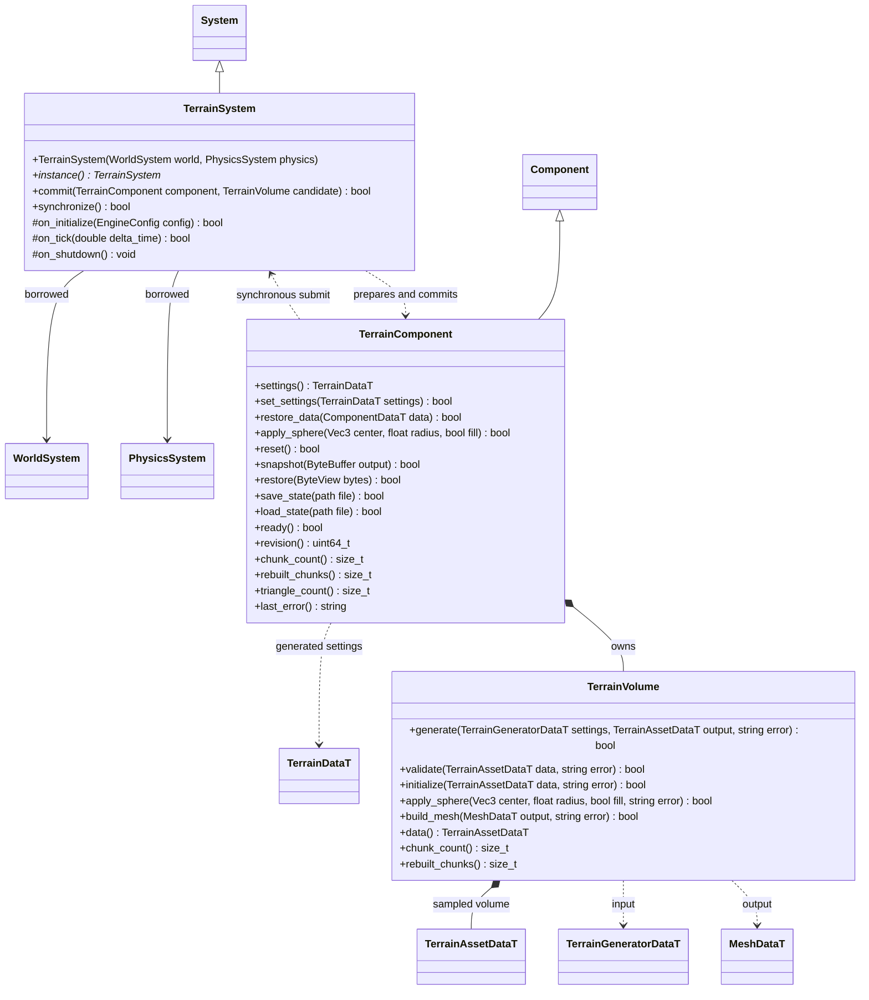

# 同步体积地形

步骤 1 的最小公开契约。插件命名空间 `engine::plugins::terrain`；`System`、`Component`、世界和物理只跨图引用，核心不引用地形插件。

`TerrainVolume` 独占 FlatBuffers 体积和按块网格缓存，只做计算。`TerrainComponent` 保持初始资源引用、修改副本与状态；保存绑定初始 GUID 和内容指纹。`TerrainSystem` 借用世界和物理，先准备候选、同步提交，失败保留旧结果。生命周期由宿主放在物理前驱动；正常 `on_tick()` 与编辑器预览均调用显式 `synchronize()`，预览不直接调用子系统的生命周期入口。

每个地形为一个正常节点；插件为它附加通用瞬时 MeshRenderer 和 Collider，标记为 transient，不写入场景。场景只保存 TerrainComponent 的资源和材质设置；地形修改通过独立状态文件保存。移除地形组件时系统回收自身生成的组件，不接管项目原有组件。

首版 `TerrainComponent::apply_sphere` 复制并复用当前块缓存，按 16/32 单元块重算脏网格；脚本球形笔刷直接走此路径。`restore` 与 `reset` 则从体积数据重新初始化，当前会重建全部块；MCP 的 `TerrainStateEdit` 候选提交、撤销/重做与加载/重置使用该恢复路径。最终均合并提交一个渲染网格和静态碰撞形状，仍是全量 GPU 上传和碰撞构建。`apply_sphere` 使用资源局部坐标；场景节点变换由核心 Transform 处理，不在插件里判断平台或调用者身份。

状态文件写入临时文件后发布，恢复先验证版本、初始资源身份、尺寸和密度；通过后才替换当前有效体积。脚本仅暴露安全存档槽，编辑器命令由自己的路径边界约束调用原生路径接口。
