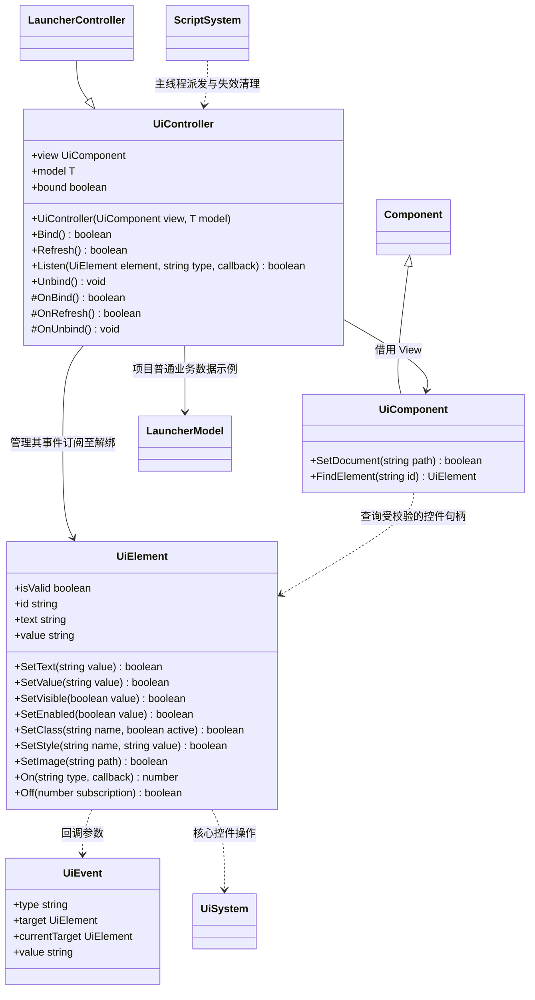

# UI 脚本与 MVC

[核心 UI](../../../runtime/class-diagrams/ui-system.md) · [绑定登记](script-bindings.md)

Model 是项目普通 TypeScript 数据，View 是 Node 上的 UiComponent 及其 RmlUi 文档，
Controller 是脚本插件提供的 UiController。项目派生控制器处理事件、修改 Model 并刷新 View。
核心不保存脚本对象，不决定场景跳转，也不自动轮询项目数据。

- 这是 UI 绑定步骤的公开契约；Controller 可先由 Gameplay 持有，后续脚本组件复用同一套接口。
- FindElement 和控件文本读取失败返回 null；修改失败返回 false；On 失败返回 0。C++ 使用 snake_case，TS 使用上述脚本外观。
- 控件句柄包含所属场景、节点、文档与控件身份，不保存裸指针；所属节点销毁、文档替换或控件移除后失效。同名控件重建不复活旧句柄。
- Listen 属于已绑定控制器，Unbind 自动移除订阅。文档失效或 Run 停止/重载时也移除订阅；回调中解绑或销毁目标后不继续投递旧事件。
- UI 根通过 `Node.SetPersistent(true)` 常驻后，同一 Run 的场景切换保留原 Controller、Model、View 与订阅；没有活动玩法场景时也可交互。无需 Unbind/重建/Bind，销毁节点或替换文档仍按原规则解绑。
- 支持 click/change/input 事件及事件发生时的 value 快照。脚本系统每帧自动派发，业务不通过 Tick 轮询 UI。
- 事件按目标到祖先顺序冒泡；target 保持事件目标，currentTarget 是当前订阅的控件。每个事件开始时固定订阅快照，回调内解绑立即生效，新订阅从后续事件开始接收。目标被删除或文档替换时停止旧事件分发。
- UI 事件回调必须同步完成；返回 Promise 会报告脚本错误并停止当前玩法，与 Gameplay 回调保持一致。
- Model 变化由控制器显式调用 Refresh；不引入代理反射、通用状态管理器或 C++ 业务 Model。
- UiComponent 的 SetVisible/visible 与激活状态继承统一 Component 契约；本地开关可在文档尚未就绪或没有 UiSystem 时设置，文档显示由 UiSystem 合并节点父链状态后同步，不维护第二份可见状态。UiElement.SetVisible 仍只改变文档内单个控件。
- Node 或 UiComponent 停用、隐藏时保留 Controller、文档身份和订阅，暂停自动事件派发；回调内改变自身或祖先状态后，立即停止当前事件的剩余投递。重新启用并显示后，原有订阅继续接收后续事件。
- Showcase 的 LauncherController 只提交 Model 中的导航请求并切换 View 状态类；入口 Gameplay 在 Update 中消费请求、配对子玩法初始化与关闭。子玩法在初始化前登记所有权，初始化失败恢复菜单；抛错时入口关闭仍清理部分初始化对象，关闭钩子先移出引用以避免重复调用。
- SetText 写入纯文本；图片只使用文档已声明的纹理资源。原生 RmlUi 类型不进入公开 SDK。
- UI 绑定分别放 UiComponentBinding、UiElementBinding、UiControllerBinding 文件，并登记到 ScriptBindingRegistry。
- 停止或热重载先调用 OnShutdown、清理订阅，再释放 VM 与本 Run 全部所属场景（包括常驻内容）；新 Run 重新创建并绑定 View，不保留旧 JS 对象。GameplaySession 负责目录切换与完整会话清理。
