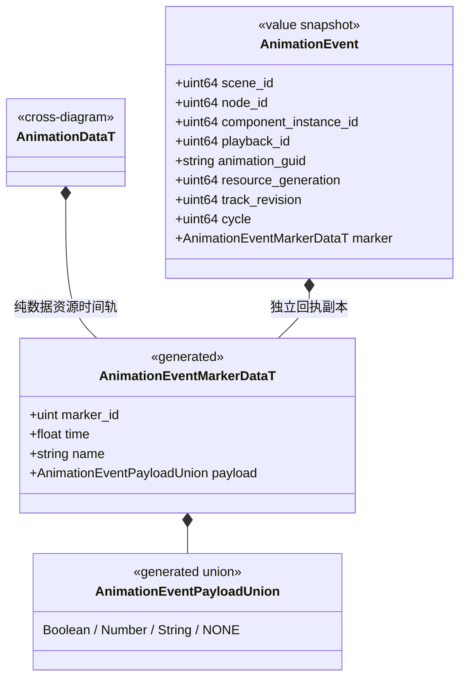
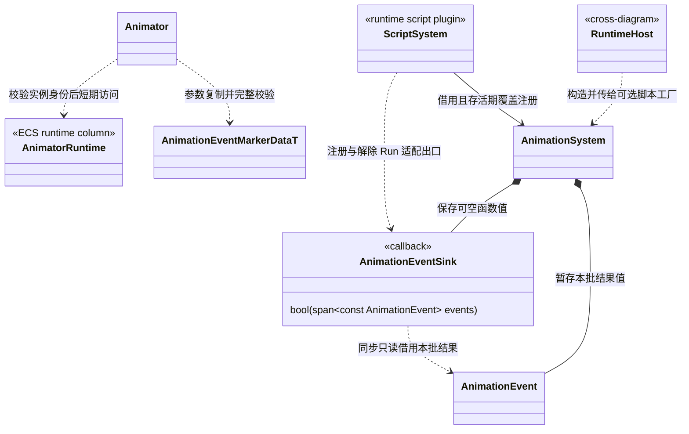

# 动画时间事件与注入契约（接口已确认）

[类图索引](../../class-diagrams/index.md) · [整体方案](../scripted-animation-controller.md#动画事件与注入) · [动画系统](animation-system.md)

本页是已确认的公开契约。资源事件、组件覆层、身份校验及主线程注入分发已接入；构建与功能证据以测试文档为准。

## 事件数据

生成数据是唯一持久模型。载荷只支持本次需要的有限标量，不序列化函数、任意脚本对象或 VM 句柄。资源中 marker_id 非零且唯一；时间为动作秒数，范围 `[0,duration]`，同名或同时间的不同 marker_id 合法。完整事件身份包含播放、资源/轨代际、标记与周期，不能仅按事件名或时间去重。

Animator 完整公开方法见[动画组件](animator.md)，AnimationSystem 完整公开方法见[动画系统](animation-system.md)。本页维护事件数据、依赖和分发时序。

## 组件与执行出口

- `AnimationEventSink` 为 `std::function<bool(std::span<const AnimationEvent>)>`。空函数表示不订阅；核心不根据其来源或事件名分派项目策略。失败必须传播；回调不得抛出 C++ 异常。
- `set_event_markers` 为 `[[nodiscard]]`，仅提交当前 Animator 的额外只读标记轨，失败保留旧覆层。相同静态资源轨及可复用覆层可共享不可变定义，播放游标和回执独立；clear 仅清实例覆层，不改变资源标记。
- RuntimeHost 的既有 ScriptRuntimeFactory 增加 AnimationSystem 借用参数，供已选择的脚本插件登记出口；不是向 ScriptRuntime 基类积累项目事件方法。未选择脚本仍可在原生宿主注入 sink，普通动画不依赖任何事件接收者。
- 核心先完成本批采样、最终姿态、挂点和 palette 提交，结束 ECS 遍历及任务等待后才在主线程安全点调用 sink。未成功提交姿态的事件不发布；回调返回前其 span 有效，不得留存或转交异步任务。
- 事件接收者执行前再检查对象/组件/播放/资源身份，脚本适配器另检查 Run；回调可以通过正常安全点修改场景，但不能重入采样。脚本参数变化在下一次机器求值生效。
- ScriptSystem 结束 Run 时清理订阅，关闭时解除出口；AnimationSystem 停止/关闭前先完成任务并清空队列，不调用失效借用。资源换代、重播、Seek、组件重建和对象池重用都不能令旧回执进入新播放。

## 时间语义与脚本外观

正向区间采用 `(previous,current]`，新播放的零时刻标记另发一次；周期/未取模推进区间须保留。循环末帧属于结束的那一圈，零时刻属于开始的新圈；两个合法标记同一绝对时间发生时按周期、标记登记顺序稳定排序。超出显式事件预算或时间/周期表示范围返回失败并清空本批，不静默截断。

暂停与零速无新跨越，保持末帧不重复通知；Seek 默认只定位并更新基线，不补发跳过的标记；重播使用新 playback_id。首期不扩展负速播放。双动作过渡默认由目标播放实例发业务标记，来源仅混合姿态；后续多层明确事件所有权再开放，不从“所有输入都采样”推导“都应发副作用”。

TS 通过 Animator 暴露追加标记、订阅与解除；监听令牌校验 Scene、Node、组件实例与 Run。回调接收值对象，动作别名、事件名及载荷由项目解释。具体脚本名称与状态机绑定图同步，声明只随已实现绑定加入 `include/engine.d.ts`。

编辑器 `animation_tools` 提供时间线与标记编辑，复用统一导入、GUID、meta、依赖和事务；MCP 只转发现有命令服务。编辑器不向运行时注入制作对象、源格式解析器或业务回调。
