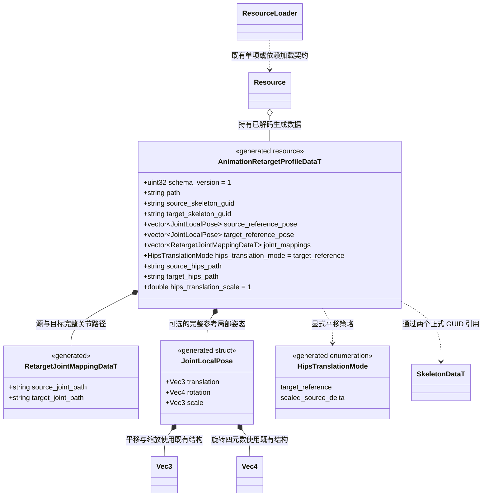
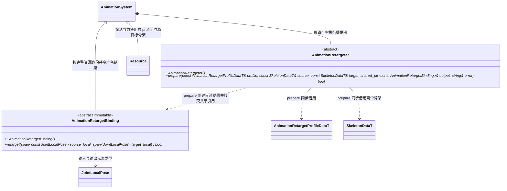
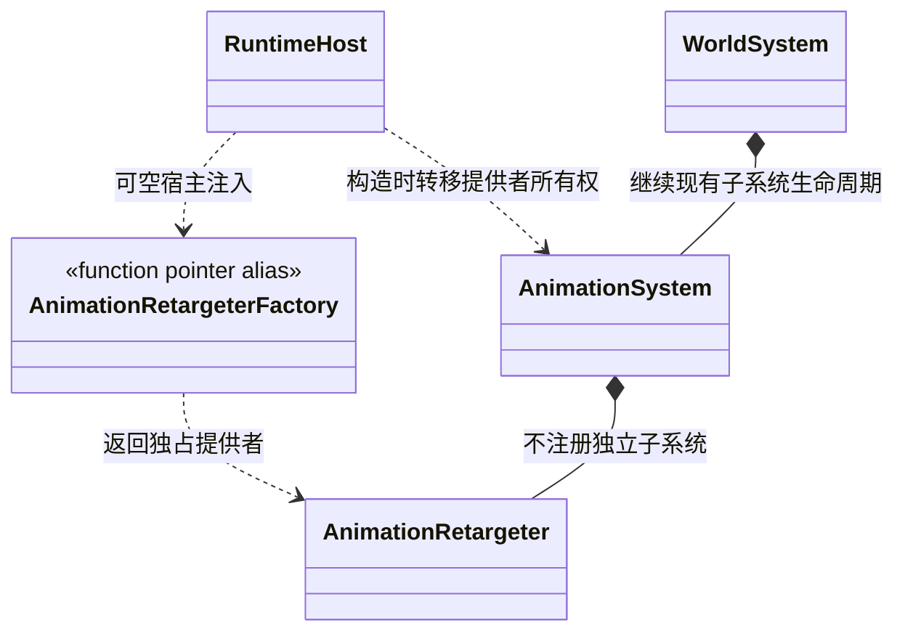

# 动画资源与重定向契约

[类图索引](../../class-diagrams/index.md) · [动画系统](animation-system.md) · [具体重定向插件](../../plugins/runtime/class-diagrams/animation-retarget.md) · [三层职责](../scripted-animation-controller.md)

本页定义跨骨架重定向的公开契约。资源、独立 TS 状态机脚本和业务仍按各自职责组合；本页只定义跨骨架姿态转换，不定义待机、移动、攻击等状态规则，也不建立原生 Graph、System 或 Manager。

## 独立资源与姿态数据

- 源描述使用纯 ASCII 后缀 `.retarget` 和 TOML 内容，邻接唯一 `.meta`；schema 来源为 `include/schemas/runtime/animation_retarget.fbs`，生成独立 `AnimationRetargetProfileData` FlatBuffers 实体，经正常 GUID、目录、`cache/gen/<GUID>` 和依赖管线使用。必要依赖只有显式引用的源、目标 Skeleton，不因同源模型分组引入 Mesh、Material 等无关资源，也不反向依赖项目脚本。
- `JointLocalPose` 是本次需要的最小 schema struct，只组合既有 `Vec3`、`Vec4`，不另建向量、矩阵或第三方姿态模型。四元数采用引擎既有 `(x,y,z,w)` 顺序；数组按 **Skeleton 原始关节索引** 排列，不能传 Ozz DFS／SoA 索引。
- 两份参考姿态数组分别为空时使用各自 Skeleton 的默认局部 TRS；非空时必须覆盖该骨架的全部关节。它们是校准参考姿态，不替换 Skeleton 的绑定姿态、inverse bind、Mesh 权重或源动作。
- 映射使用与现有骨架路径解析一致的完整关节路径，不选择同名首骨。准备时解析为索引；源／目标路径存在且无歧义，每个目标最多一个来源。未映射目标骨使用目标参考局部姿态；额外目标辅助骨不会被静默套用同索引的源骨。
- 首期面向普通人形、有限的正向均匀缩放及显式映射。双方参考姿态和完整父链参与模型空间参考方向／骨轴修正；**不将单关节 `reference.local` 差值视为已经解决跨层级、A/T pose 与体型差异**。不支持的层级／缩放形式必须准备失败，不能静默降为简单复制轨道。详细可支持的父链、附加骨和误差阈值随具体算法适配与样例验收确认。
- 首期普通关节保留目标参考平移与缩放，避免源平移覆盖目标骨长；映射旋转按双方完整参考姿态对齐。`target_reference` 使 hips 也保留目标参考平移。`scaled_source_delta` 要求显式指定且已映射的源／目标 hips，源 hips 相对参考姿态的模型空间位移差，经准备好的源／目标参考基转换至目标骨架模型空间，再乘明确的正数 `hips_translation_scale`，最终转换回目标父空间；不按模型名称猜比例、不混用双方父局部坐标。
- hips 位移策略只改变骨骼姿态，不移动角色 Node。首期默认 `target_reference`，沿用 InPlace 与物理／导航控制角色位置；RootMotion、脚锁、手部握持和地面接触不包含在此契约中。普通绝对姿态先重定向再混合；Additive 必须另有明确的参考／差值语义，不能直接把差值当绝对局部姿态交给本接口。

## 核心最小执行接口

拟公开头文件为 `runtime/animation/animation_retargeter.hpp`，类属于 `engine`。两个类均有公共虚析构，析构为 `noexcept`；返回状态的方法标注 `[[nodiscard]]`。`AnimationRetargetBinding::retarget` 是 `const`，不保存可变采样缓存、当前时间、源／目标输出指针或脚本回调。

`prepare` 在协调线程执行。输入仅在调用期间借用；生成的 binding 必须拥有之后执行所需的不可变映射、参考姿态和补偿数据，不保留 schema 数组的裸借用。成功输出非空 binding 并清空 `error`；失败清空 `output`，填写能定位资源／关节的错误，不修改已有活动 binding。无单独 `initialize`、缓存管理或每帧更新接口。

`retarget` 可由现有动画任务域并行调用同一个 binding。输入与输出不得重叠，数量必须分别精确匹配准备时的源／目标关节数；仅接受有效、有限且符合所支持缩放与旋转约定的局部姿态。成功提交完整目标局部姿态；失败返回 `false`，输出保持调用前内容。临时工作数据属于当前调用／采样任务，不能存在共享 binding 的可变字段中；不访问 ResourceLoader、ECS、TS、场景或 GPU。

`AnimationSystem` 在调用 `prepare` 前，校验 profile 两个 GUID 与当前动作引用的源 Skeleton、目标 Mesh 引用的目标 Skeleton 精确一致。binding 缓存身份包含 profile、源 Skeleton、目标 Skeleton 的 GUID 与资源代际；目录更新、参考姿态或映射变化不能复用旧准备结果。资源共享只读，每角色的源采样上下文、局部姿态、目标输出和混合状态独立。

播放源通过 Animator 的资源属性显式选择 profile，默认空引用表示不开启该功能；具体播放源字段由[动画组件总契约](animator.md)维护。本页不增加全局场景开关，也不将所有播放源强制绑定到同一个 profile。没有显式 profile 时继续已有兼容骨架播放；显式要求重定向而 provider 缺失、profile 不匹配或准备失败时必须失败，不能回退为未重定向播放。

执行顺序固定为源动作采样 → 重定向至目标局部姿态 → 同目标骨架下的转换／普通／Mask／Additive 混合 → IK → 最终模型矩阵及既有 palette。任务先在候选缓冲完成，失败不发布半成品；准备失败保持原播放请求和状态，已接纳运行任务失败沿用动画系统当前的错误返回路径。`clear()` 清除 binding 与采样缓存，不改变已注入 provider 的装配选择。

## 可选插件装配与关闭

`AnimationRetargeterFactory` 是 `std::unique_ptr<AnimationRetargeter> (*)()` 的类型别名。RuntimeHost 的初始化参数新增可空工厂，放在现有参数之后并默认 `nullptr`；AnimationSystem 构造参数新增可空 `std::unique_ptr<AnimationRetargeter>`，由宿主转移所有权。上述已有类的完整方法仍分别由[运行宿主](runtime-host.md)和[动画系统](animation-system.md)的所属图维护。

- **工厂为空**表示未选择实现，普通动画和引擎仍可启动；请求重定向明确不可用。
- **工厂非空而返回空**表示已选择实现但创建失败，RuntimeHost 初始化失败并按现有路径回滚，不能当成未启用成功启动。
- 核心 RuntimeHost／AnimationSystem 不 include、链接或按宏判断具体插件。只有可执行宿主在选中清单后包含插件工厂；编辑器与运行包通过同一核心构造契约装配。
- provider 没有独立 System 生命周期。关闭先等待 AnimationSystem 已接纳任务结束，再清理实例缓冲、binding 和资源引用；最后在 AnimationSystem 析构时销毁 provider。不跨关闭、Run 或资源代际保留裸姿态引用。
