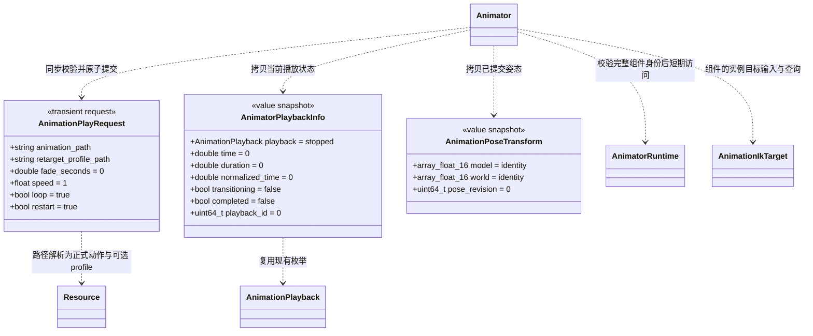
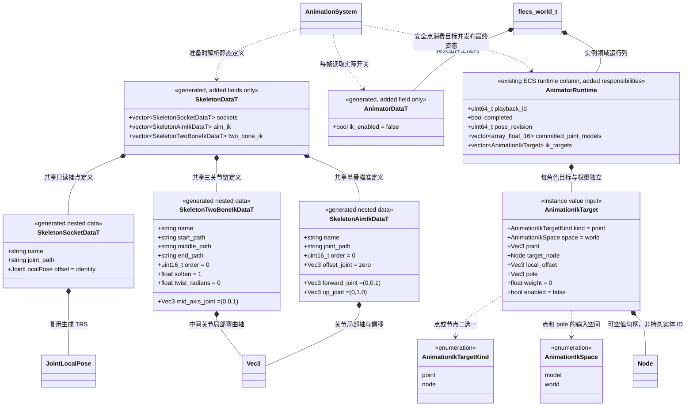
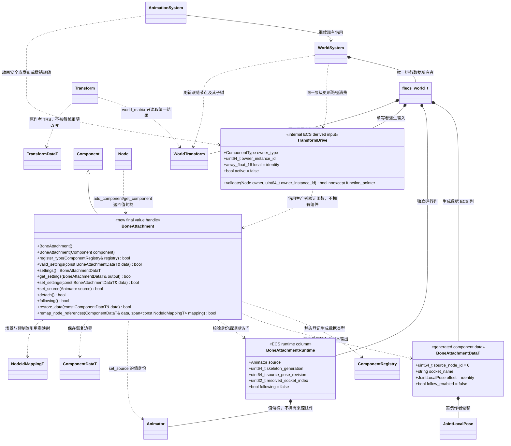

# 动画播放、IK 与骨骼挂点（接口已确认）

[类图索引](../../class-diagrams/index.md) · [既有 Animator](animator.md) · [动画系统](animation-system.md) · [资源与重定向](animation-retargeting.md) · [分层方案](../scripted-animation-controller.md)

**本页维护已确认并已实现的公开契约，实际验证范围见[测试文档](../../testing.md)。** 扩展现有 `Animator`、`AnimationSystem`、Skeleton 生成数据及一个 `BoneAttachment` 值句柄组件，不新增动画 System、Manager、播放器或 Ozz 包装框架。Animator 当前完整公开方法统一由[动画组件](animator.md)定义；本页维护请求、值快照与执行关系，跨图不重复定义方法。

`Animator`、请求和查询值属于 `engine`；`*DataT` 与 `JointLocalPose` 属于 `engine::schema`。`JointLocalPose` 的字段由[资源与重定向图](animation-retargeting.md)定义，本页直接复用。文中的 `array_float_16` 表示 `std::array<float, 16>`，不是另一种矩阵类。

## 原子播放与值查询



所有新增返回状态的方法为 `[[nodiscard]]`；查询为 `const`。查询不加载资源、不推进时间、不执行 IK、不调用脚本；失败将输出复位为图示安全默认值。矩阵按现有引擎约定使用列主序 float，平移单位与场景一致。没有 Ozz 对象、内部数组指针或跨结构修改的借用输出。

`play_animation` 的规则：

- 动作路径必须非空；profile 路径为空表示不请求重定向。动作、源/目标骨架、Mesh 绑定、profile 及所需提供者均先校验和准备，任何失败都保持原动作、时间、播放身份、profile、速度、循环和过渡状态。它不是先改设置再尝试加载的一组独立 setter。
- `fade_seconds` 有限且非负；`speed` 沿用现有 `0..16` 范围。成功请求进入 `playing`；目标播放源保存自己的动作与 profile 引用，过渡来源继续保留自己的绑定，不把唯一全局 profile 套给所有来源或角色。
- `restart=true` 即使动作路径相同也从零秒开始，生成新的非零 `playback_id`；过渡从当前已显示姿态开始，沿用已有打断时冻结当前混合姿态的规则。
- `restart=false` 且动作、profile 与相关资源代际均相同，保留播放时间与当前过渡进度，只更新本请求的速度和循环，并恢复播放；不因相同路径误判新资源。绑定不同则从零秒开始并生成新的播放身份。
- 保留既有 `cross_fade` 的相同 GUID/代际时不重启、不解除暂停的兼容语义；新状态进入使用原子请求，不修改旧调用的含义。没有新增平行的全局播放配置。

`AnimatorPlaybackInfo` 报告当前目标播放源；时间和时长单位为秒，不以过渡来源的时长替代。`completed` 只表示当前非循环播放实例自然到达终点，显式暂停、Seek 到末尾和停止本身不构成完成。自然完成后继续保留 `paused + completed=true`，不得只用 `isPlaying` 判断完成。新播放、停止、Seek 或资源绑定重置会失效旧完成状态与播放身份；标识在同一 Animator 实例内不复用，删除重建仍须结合组件实例身份判断。`time`、完成标志与事件按同一份时间推进结果提交，不能在姿态任务失败后提前报告成功完成。

骨查询使用目标 Skeleton 的完整关节路径，拒绝歧义或未知路径；socket 查询使用该 Skeleton 内唯一 socket 名。`get_bone_pose` 的 `model` 是最终关节模型矩阵；`get_socket_pose` 的 `model` 已乘资源 socket 偏移。`world` 使用同一安全阶段的来源 Mesh 世界变换换算。`pose_revision` 标识已提交关节姿态，不能将两次不同时机查询的 world 视为同一变换快照。

未发布节点、失效组件、缺少合法目标 Skeleton、尚无可用提交、骨架换代后尚未重新发布时返回失败，不能返回上一角色或旧骨架的数组。`stop()` 立即失效旧动作姿态查询，下一次动画安全点发布目标绑定姿态后查询恢复；暂停保留最终模型姿态，角色根或父级变化仍刷新 world 与挂点。可见性不参与身份校验。

## Skeleton 内的静态定义与实例 IK 目标



本图仅拟在现有 `skeleton.fbs` 与 `scene.fbs` 扩展生成数据；不新增 Socket、IK、骨链的独立资源类或单独导入插件。导入与作者编辑由统一资源管线及动画制作插件组织；保留原资产身份，Skeleton 版本与导入指纹变化进入正常增量和依赖失效。

- socket 名在一个 Skeleton 内唯一；两类 IK 定义的名称在同一 Skeleton 内共同唯一。完整关节路径使用既有骨架路径规则，运行索引只在准备时解析，不写进作者配置。`order` 较小者先执行，同值按类型与原数组顺序确定稳定次序，不依赖哈希表遍历顺序。
- Aim 首期是一根关节的 Ozz `IKAimJob`；多个显式定义可以组合，但不自动生成脊柱链。forward/up 为有效单位方向且不得退化平行，offset 是该关节局部点。TwoBone 指定按祖先顺序排列的三关节链，middle 的弯曲轴为关节局部单位方向；退化长度、坏链、非法 soften/twist 或不可处理的缩放在准备时失败。
- 项目通过 `Animator::get_settings/set_settings` 控制持久 `ik_enabled`，默认 `false`。静态链的存在、设置目标或把权重设为 1 均不会隐式开启总开关；每个运行目标还须 `enabled=true` 且权重在 `(0,1]`。目标默认禁用、权重为零。
- `set_aim_ik_target` 和 `set_two_bone_ik_target` 按唯一名称及类型校验；成功只替换该实例对应目标。未知名称、类型错误、非有限值、权重越界或不支持的目标依赖失败，保留原请求；显式禁用目标会清理其节点借用和待求解值。`get_ik_target` 输出当前请求副本，不输出 Ozz 状态。
- `kind=point` 时只使用 `point`，节点必须为空、local_offset 为零；`space=model` 表示目标骨架模型空间，`space=world` 表示世界空间。`kind=node` 时必须提供同一 World 的有效 Node 值句柄，point 为零值；目标由节点原点加其局部 local_offset 得到。Node 是运行请求，不能把其实体 ID 写入源资源或场景。
- `pole` 与 point 共用 `space`；node 模式下 `space` 仍用于 pole。坐标值在原生协调阶段转换；**Ozz 的目标点与 pole 使用目标骨架模型空间**，forward/up/mid 仍为关节局部方向，求解所得修正写回局部旋转。业务无需自行执行逐骨矩阵换算。
- 若 node 目标位于本 Actor 的跟随挂点子树，原生从已完成的上游关节姿态、socket 偏移和该子树作者变换推导本帧目标，不能只读取尚未刷新的上一帧 `Transform::world_matrix`。目标不得依赖本次仍将改写的骨链及其祖先；无法满足显式 order 的反馈依赖、跨角色动画输出依赖及递归挂点目标首期明确拒绝。独立的普通节点目标可在收集阶段读取有效世界变换。
- 目标 Node 删除、换 World 或身份失效时不保留其旧坐标冒充有效目标，不按相同名字重新绑定。源目标骨架、定义或组件换代后重建索引并失效旧目标请求；不能把旧骨索引用于新 Skeleton。动作在同一目标骨架内切换不重建整套链定义。

IK 只改骨骼姿态，不写角色根 Node 的移动或旋转。普通播放、重定向和混合先得到同一目标骨架下的局部姿态，再执行有序 IK；权重为零应与无该约束的姿态一致。两段位置 IK 不自动完成末端手掌旋转、脚锁、攀爬或全身约束；本图不把这些功能算作已覆盖的握持效果。

## BoneAttachment 与世界变换的唯一来源



`BoneAttachment` 与其他组件相同，为可复制、无逐实例虚函数表的身份值句柄，使用 `Node::add_component<BoneAttachment>() / get_component<BoneAttachment>()`。实际数据只存当前 World 的 ECS。查询为 `const`；可能失败的方法标注 `[[nodiscard]]`，非分配的身份、开关查询为 `noexcept`。`settings()` 返回独立副本，`get_settings` 失败清空输出。

持久 `source_node_id` 是**同 Scene 的局部节点 ID**，不是 ECS 实体 ID；0 表示未绑定。Scene 加载／候选发布与 prefab 实例化继续使用现有 `Component::remap_node_references`，不能把模板局部引用直接指向另一实例。来源必须具有 Animator，且来源和附属节点不能相同。跨 Scene 作者引用首期不支持，不为此增加全局节点查找。

`set_source` 接受当前有效 Animator，保存其场景局部 Node 引用，并把完整 World/Node/组件实例身份复制到 Runtime；不会自动打开 follow_enabled。直接 `set_settings` 的来源更改与 `restore_data` 同样在现有提交阶段解析一次完整身份。已绑定来源被移除后再添加 Animator 不复活旧运行绑定；必须显式重新设置来源或通过新的场景恢复流程绑定。

`socket_name`、各偏移数值和引用在开启跟随前完整验证；失败保留原 Data、运行绑定和有效变换。follow 关闭时允许尚未配置来源，方便创建默认组件。来源、socket 或骨架定义变化须重新验证；可见性不等同于禁用。

`TransformDrive` 属于 `engine::ecs_detail`，仅是 World 与动画提交之间的内部 ECS 值，没有公开 setter、继承层次或注册门面。其 owner_type 与 owner_instance_id 明确唯一驱动者；失效组件不能清除新实例的驱动。生产者同时提交可空 `noexcept` 只读有效性函数指针；空函数或校验失败时使用作者 TRS。函数代码借用须覆盖 drive 存活期，先校验 owner 完整组件实例身份，再读取本领域状态；不得修改 ECS、刷新缓存或重入 World。挂点生产者在该函数中检查跟随设置、Animator 身份、姿态及来源祖先状态，World 不认识这些具体类型。World 在原有层级派生阶段以有效 drive.local 替代作者 local，写入同一个 `WorldTransform` 并刷新后代，因此渲染、子节点、射线起点和 `Transform::world_matrix` 得到同一份世界变换，不另存一个只供挂点查询的平行世界矩阵。

作者 `TransformData`、资源 socket 偏移与组件实例偏移均保持独立；每帧跟随只更新 Runtime/派生缓存。场景保存、prefab override 和撤销不得把当前动作造成的跟随结果烘焙进作者 Transform 或偏移。关闭 follow、停用或移除跟随组件时撤销其 drive，派生缓存恢复由原作者 TRS 计算；不隐式生成作者修改。

`detach()` 是明确的作者状态变更：在安全阶段取得当前有效世界姿态，精确转换到当前父空间并写入作者 Transform，然后关闭 follow、清除来源绑定和该实例的 drive，保持调用返回时的世界姿态。无法精确表达、父矩阵不可逆、存在其他位置写入者或来源身份失效时失败并保持原状。此方法不自动改 ChildOf，也不自动添加刚体；项目按自身玩法决定后续重设父级和物理移交，编辑器操作复用同一 EditorCommands 事务。

`following()` 仅在本组件启用、follow_enabled 开启、来源身份有效且当前派生驱动已成功提交时为 true。来源 Animator 停用或销毁、来源未发布新骨架姿态时不继续沿用旧动作矩阵；撤销本实例 drive 并报告不可跟随。原来源只是暂时停用时可在同一组件身份恢复且取得新姿态后恢复；组件被替换时需要显式重绑。

## 空间与同帧提交

设 `W` 为来源 Mesh 节点世界矩阵，`B=mesh_to_skeleton`，`G` 为最终目标关节模型矩阵，`S` 为 Skeleton socket 偏移，`I` 为 BoneAttachment 实例偏移，`P` 为附属节点当前父世界矩阵：

```text
BoneWorld       = W * inverse(B) * G
SocketWorld     = BoneWorld * S
AttachmentWorld = SocketWorld * I
AttachmentLocal = inverse(P) * AttachmentWorld
```

无父节点时 `P=identity`。Bone 与 socket 矩阵不乘 inverse-bind，不能从 skinning palette 反推出挂点。逆矩阵失败、非有限结果及无法按现有 Transform 精确表达的剪切必须失败；缩放与镜像不能通过丢弃分量近似成成功。

执行仍由现有 World/AnimationSystem 安全点组织：

1. 读取已发布组件，快照作者变换、明确目标和资源身份。验证同一 Node 的动态刚体、导航、角色控制等位置写入冲突；不在 worker 访问 Node、ECS 或脚本。
2. 源动作采样 → 可选重定向 → 同一目标 Skeleton 下混合 → 必要 FK → 按显式 order 执行 IK；每次校正后更新受影响模型姿态。
3. 本 Actor 的上游骨挂点目标从本次已完成的临时姿态推导；下游约束不得改写它依赖的祖先。双手持物选择主从或独立道具目标；不能让目标反向依赖自身，也不引入通用依赖调度框架。
4. 已接纳任务全部完成，检查来源与组件身份仍匹配后提交最终目标骨模型矩阵、播放状态和 pose_revision；失败不发布候选或部分挂点。
5. 从同一最终姿态生成 palette 与跟随 drive，调用原有层级派生路径刷新挂件子树，再允许渲染、骨查询和动画事件接收端读取本帧结果。不以固定一帧延迟替代正确的同帧顺序。

暂停不推进动作、过渡或 IK，保留最后最终模型姿态；显式 Seek 可请求一次新姿态，根/父变换仍参与挂点换算。停止时不继续施加 IK，发布与显示绑定姿态一致的骨结果。独立停用跟随与 `detach()` 不同，前者恢复作者变换，后者明确保留当前世界姿态并改变作者设置。

带碰撞的 kinematic 跟随需要在正式物理同步阶段消费同一派生结果；首期不能仅写 Transform 就宣称已同步碰撞。掉落要先解除跟随、按玩法处理父级且保留世界姿态，再把唯一位置控制权交给物理。挂件/父链环、重复写入者与未支持的跨 Actor 约束明确拒绝。

预览、编辑命令和 MCP 均复用上述核心契约；骨链、挂点、目标与权重的制作界面留在可选 `editor/animation_tools`，不把界面或具体插件链接进运行时核心。本页描述接口、职责和实现边界；构建、功能及平台验证结果集中记录在[测试文档](../../testing.md)。
