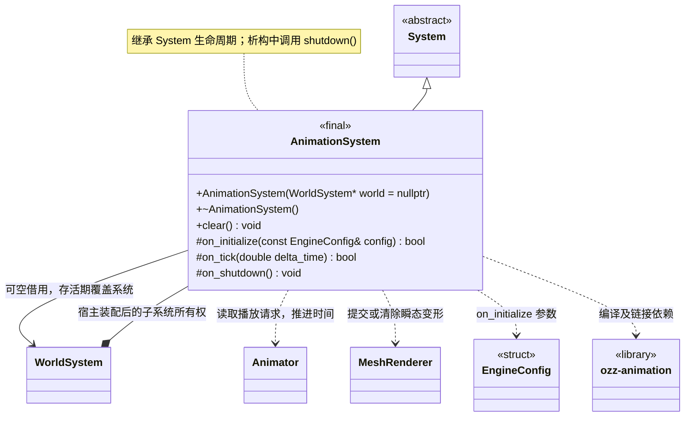

# 动画系统

[类图索引](../../class-diagrams/index.md) · [引擎与系统](engine-system.md) · [完整引用关系](../../class-diagrams/references.md)

本图仅定义 `AnimationSystem` 的方法；其他节点为跨图引用或第三方类型。

- 由 `WorldSystem` 独占，通过父系统统一管理生命周期。
- 同一个普通 `Node` 挂 `Animator` 和 `MeshRenderer`，不另建动画节点继承层次。
- 动画、骨架与 Mesh 是独立 GUID 资源。动画引用源骨架，Mesh 引用目标骨架；按关节完整名称和父层级匹配，再显式映射到 ozz 的 DFS 顺序。
- 私有实现独占 ozz 骨架、动画、采样上下文和蒙皮缓冲，只缓存场景/节点 ID，不保留节点借用。
- 从已校验的 FlatBuffers 数据通过 ozz 纯内存 Builder 建立运行对象；采样使用 `SamplingJob`、`LocalToModelJob`，蒙皮使用 `SkinningJob`。不依赖 FBX 解析器或编辑器模块。
- 法线使用 inverse-transpose 矩阵，切线使用普通线性矩阵；Mesh 的绑定姿态和资源身份保持不变。
- 删除组件、禁用对象和场景替换清理对应变形及缓存。`clear()` 支持重复调用，宿主结束玩法时主动调用。

C++ 限定符：构造、析构、`clear()` 及 `on_shutdown()` 为 `noexcept`；析构和受保护钩子标注 `override`，返回状态的钩子标注 `[[nodiscard]]`。
