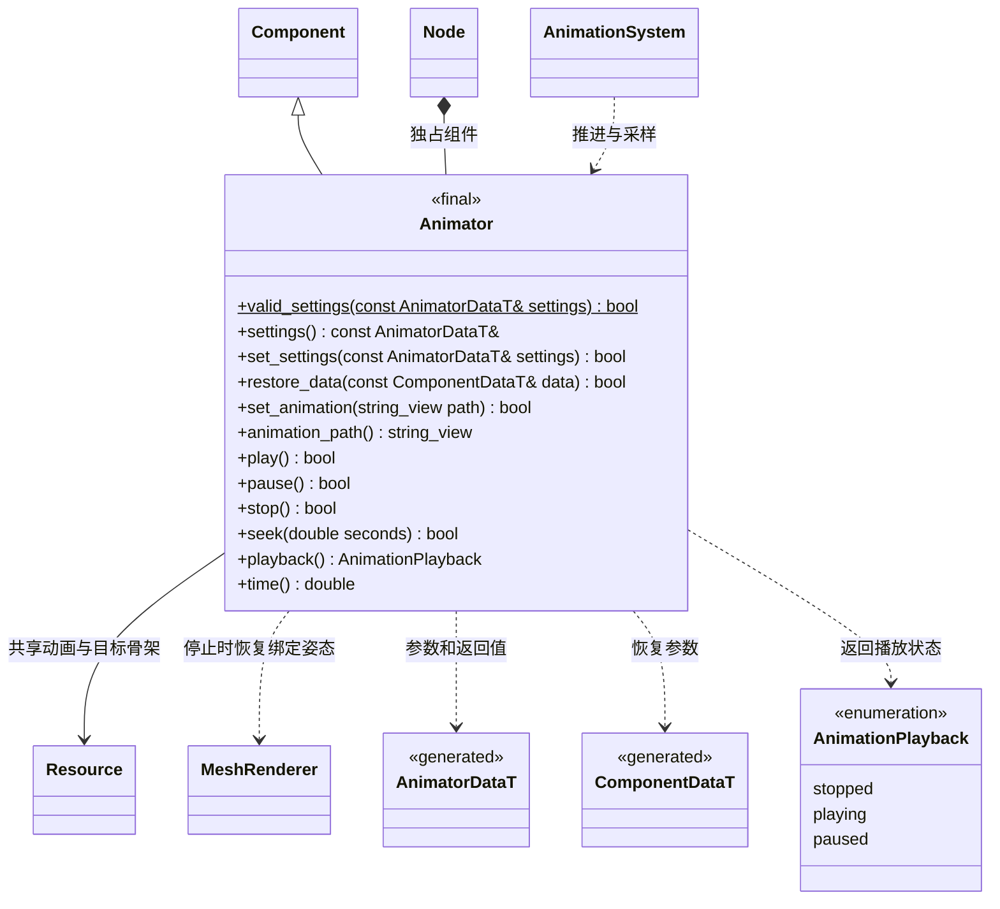

# 动画组件

[类图索引](../../class-diagrams/index.md) · [动画系统](animation-system.md)

- 使用 `Node::add_component<Animator>()` 创建；公开接口无 ozz 类型。
- 持久设置来自 `AnimatorDataT`：独立动画 GUID、速度、循环、自动播放。播放时间、状态和采样缓存不进入场景数据。
- 资源切换或数值校验失败保持原设置与资源；空路径清空动画。
- `play()` 从停止状态重新开始，从暂停状态继续。`pause()` 保留最后姿态；`stop()` 将时间归零并恢复 Mesh 绑定姿态。
- `seek()` 接受当前动画 `[0, duration]` 内的秒数；下一次系统更新提交该姿态。停止时定位会进入暂停以保留该姿态，播放中定位保持播放。速度范围为 `0..16`，零速度保留时间；单次播放到结尾进入暂停并保留最后姿态。
- 可能失败的方法返回 `bool` 并标注 `[[nodiscard]]`；读取方法为 `const`，无外部分配或资源加载的控制方法为 `noexcept`。
