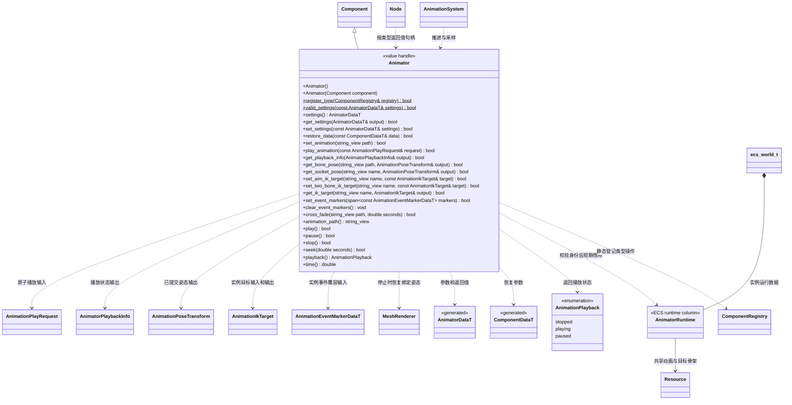

# 动画组件

[类图索引](../../class-diagrams/index.md) · [动画系统](animation-system.md)

- 使用 `Node::add_component<Animator>()` 创建；公开接口无 ozz 类型。
- 持久设置来自 `AnimatorDataT`：独立动画 GUID、速度、循环、自动播放和默认关闭的 IK。播放时间、状态和采样缓存不进入场景数据。
- `set_settings` / `set_animation` 资源切换或数值校验失败保持原设置与资源；空路径清空动画。这两项只检查设置与 Animation 资源，不同步检查 Mesh/骨架绑定，兼容性错误由动画系统准备阶段返回。
- `cross_fade(path, seconds)` 先校验资源、目标骨架层级与蒙皮绑定，再切换目标动作；时长有限且非负，零秒直接切换。目标从零秒播放，来源保留切换时的速度和循环设置。新动作的速度和循环仍通过原有设置调整；相同 GUID 和代际且当前未停止时直接成功返回，不重新开始、不解除暂停，也不改变已有过渡。
- 过渡使用两个局部姿态经 ozz BlendingJob 混合。过渡中再次切换时，以当前混合姿态快照作为新来源，不增长混合树。暂停冻结播放和过渡；停止、直接换动作或定位取消过渡。过渡秒数不受动作速度影响。
- 显式 `set_animation` 即使路径相同也取消过渡，同路径保持原播放时间。打断来源快照由组件暂存，禁用期间释放采样与 GPU 输出，重新启用可恢复同一混合姿态；快照不进入场景持久数据。
- 玩法脚本或插件根据移动、落地和受击选择动作；核心不定义待机、行走、跳跃等业务状态。旧模型与新模型使用同一组件、采样和 GPU 蒙皮路径。
- `play()` 从停止状态重新开始，从暂停状态继续。`pause()` 保留最后姿态；`stop()` 将时间归零并恢复 Mesh 绑定姿态。
- `seek()` 接受当前动画 `[0, duration]` 内的秒数；下一次系统更新提交该姿态。停止时定位会进入暂停以保留该姿态，播放中定位保持播放。速度范围为 `0..16`，零速度保留时间；单次播放到结尾进入暂停并保留最后姿态。
- 可能失败的方法返回 `bool` 并标注 `[[nodiscard]]`；读取方法为 `const`，无外部分配或资源加载的控制方法为 `noexcept`。

本页组件均为可复制值句柄，生成设置唯一存于 `ComponentStorage<Data>` 的 ECS 列；`settings()` 返回独立值，`get_settings(output)` 明确返回失败。Runtime 为 ECS 中的领域运行列，资源引用、请求和缓存归该列或所属 System；句柄不拥有这些数据。Runtime 定义与可变访问仅供所属模块内部实现使用，公开组件不提供 `runtime()`；原生系统的 ECS 列借用仅在当前结构稳定阶段有效，不能跨结构修改留存。类型注册、失效身份与查询规则见 [ECS 场景](ecs-scene.md)。

本页维护 Animator 当前完整原生公开方法；请求、值快照和执行时序分别见[动画 rigging](animation-rigging.md)与[动画事件](animation-events.md)，专题图只引用本页的方法契约。
