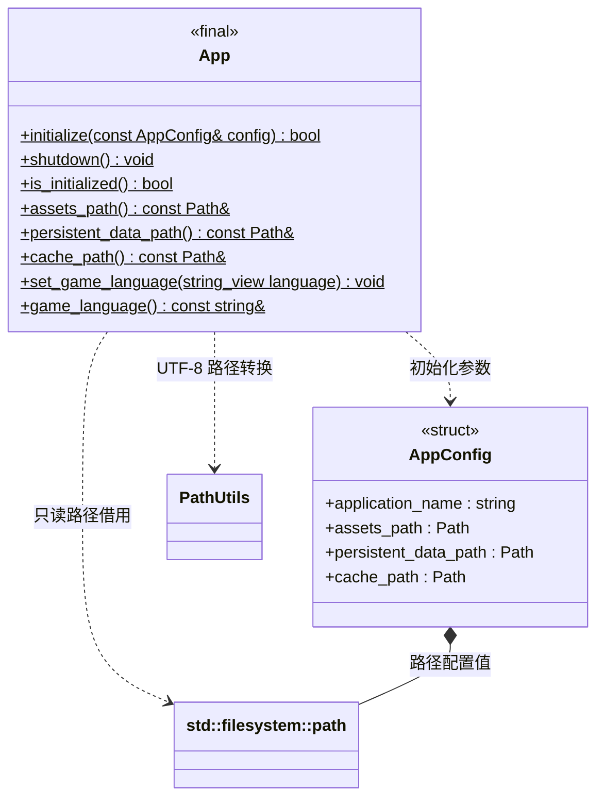

# 应用平台目录

[类图索引](../../class-diagrams/index.md) · [日志系统](log-system.md)

桌面、Android、iOS 与 Web 共用本公开接口。Android 位于 `platforms/android/native/app.cpp`，iOS 位于 `platforms/ios/app.mm`；iOS 的包内、持久和缓存目录见 [iOS 沙盒路径](ios-host.md#沙盒路径)。

- `App` 是不可构造的静态平台门面，不继承 `System`，不拥有项目或引擎。宿主先初始化 App，再初始化日志和引擎；所有使用者退出后关闭 App。
- 游戏语言默认 `en`；宿主加载运行配置后、创建脚本上下文前传给 `set_game_language()`，由 App 保存字符串。TS 通过只读 `App.gameLanguage` 读取，与路径属性一样可在模块顶层使用；具体本地化由项目业务处理。
- `AppConfig::application_name` 默认为 `engine`。三个非空路径配置分别覆盖平台默认值，可供编辑器和测试使用；不推导或依赖项目的 `settings/cache/assets` 结构。
- `assets_path()` 是应用包内资源读取根。桌面默认取 SDL 应用资源目录下的 `assets/`，原生可执行程序为 `<exe>/assets/`，可选 macOS `.app` 为 `Contents/Resources/assets/`；允许目录尚不存在，不在安装位置创建目录。Android 默认返回 `apk:/assets`，直接对应 APK 的 `assets/`，不附加项目名。调用者将该根交给资源系统解释，不执行普通磁盘 canonical 或目录查询。
- 普通逻辑资源路径为 `scenes/main.scene`，相对资源根；引擎定义使用 `builtin://`。逻辑名通过 catalog 定位为 `gen/GUID` 或 `packs/...`，业务不拼接平台物理路径。编辑器可显式覆盖读取根为项目 `cache/`。
- 持久数据默认来自 SDL 用户应用目录；缓存默认使用 macOS 用户 `Library/Caches`、Windows 用户 `LOCALAPPDATA` 下的应用缓存、Linux 的 `XDG_CACHE_HOME` 或用户 `.cache`。
- Android 持久数据来自 `SDL_GetAndroidInternalStoragePath()`，对应应用私有 `files/`；缓存来自 `SDL_GetAndroidCachePath()`，对应应用 `cache/`。日志位于 `files/logs/`，同步版本位于 `files/assets/versions/`；缓存可被系统清理，不能放唯一的可修改脚本版本。
- Android 的内置根覆盖值可以是 `apk:/assets` 或该前缀下的合法子根，也可以是显式磁盘目录。逻辑根拒绝空分量、点号分量、反斜杠、额外冒号与 NUL；持久目录和缓存只接受普通磁盘路径。APK 根不创建目录，也不在 App 初始化时逐项检查包内内容。
- 持久数据和缓存初始化时创建并检查为目录；两者不能相同。初始化失败不发布部分路径，允许修正配置后重试。初始化不成功时路径为空；重复初始化返回失败且保留已发布配置。
- 路径返回值是 App 内部值的只读借用；初始化后稳定，关闭后内容清空。初始化、关闭和路径读取由宿主串行调度，运行中的使用者不得与关闭并发。
- `shutdown()` 可重复调用，不删除磁盘数据。默认日志放在持久目录的 `logs/`，可修改运行内容也必须使用持久目录；缓存允许丢失和重建。

返回状态的方法标注 `[[nodiscard]]`；关闭、状态与借用访问器为 `noexcept`。路径使用 `std::filesystem::path`，文件系统操作通过 `std::error_code` 报告错误。

公共路径编码复用 [PathUtils](path-utils.md)；路径规范化和安全检查仍由本类负责。
