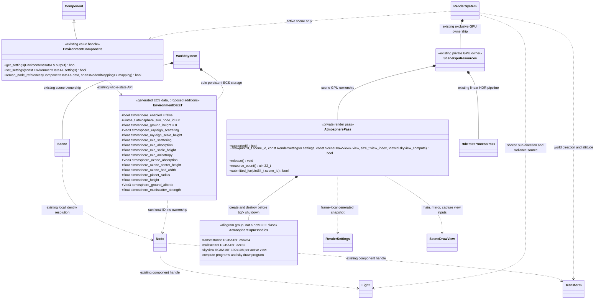
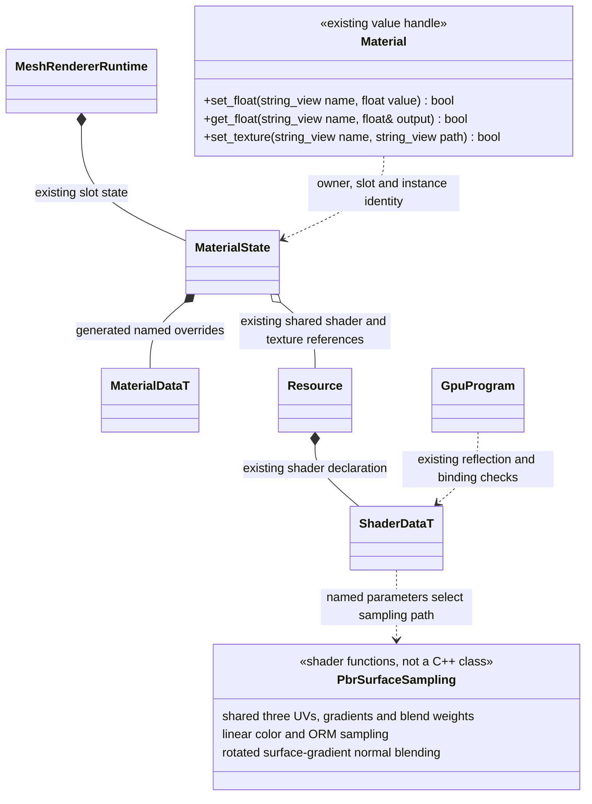

# 大气天空与 Hex-Tiling 材质增量

[类图索引](../../class-diagrams/index.md) · [环境组件](environment-components.md) ·
[材质](material.md) · [接入与验证计划](../atmosphere-hex-plan.md)

**本页接口已评审，代码正在接入与验证；实际验收结果以测试记录为准。** 大气参数扩展已有 `EnvironmentDataT`，Hex-Tiling
扩展已有 PBR Shader 的具名参数；不增加天空系统、材质种类枚举或另一套效果管理器。

## 归属、关系与所有权

`AtmosphereGpuHandles` 仅将图中的资源分组，不要求新增包装类。`SceneGpuResources`
已有完整场景资源释放路径，大气使用与其他效果一致的私有 `AtmospherePass` 执行和释放。GPU 缓存
不得保存跨帧 ECS 列指针或 `Light*`。
`SceneDrawView` 仍是现有视图输入，包含各自 view/projection/world；私有 pass 不构成运行时公开 C++ 接口。

场景停止、场景身份改变、关闭大气、设备丢失或初始化中途失败均释放大气 GPU 资源。
LUT 缓存键包含场景代次与大气参数；相机高度、太阳方向、太阳颜色或强度改变使对应 Sky-view 失效。
反射及烘焙视图不得误用主相机的高度、矩阵或太阳快照。相同物理参数可以共享 Transmittance/
Multiscatter；Sky-view 按所用视图分配或在独立有序视图中更新后消费。

## 大气参数与太阳

所有持久字段直接加到 `include/schemas/runtime/scene.fbs` 的 `EnvironmentData`。
设置、保存、恢复、TS 绑定和 MCP 均操作这一份生成数据，不另写 `SkySettings`。

| 字段 | 初值与单位 | 校验与用途 |
| --- | --- | --- |
| `atmosphere_enabled` | `false` | 开关；旧场景画面不自动改变 |
| `atmosphere_sun_node_id` | `0` | 同场景已有方向 `Light` 的局部 ID；开启时必须有效且启用；复制、预制体和恢复按现有节点引用规则重映射 |
| `atmosphere_ground_height` | `0 m` | 有限值，世界 Y 的海平面基准；相机高度统一换算为 km 后送入上游算法 |
| `atmosphere_rayleigh_scattering` | `(0.00580243, 0.01355776, 0.0331) km^-1` | 上游 Earth 参数的颜色乘强度；逐通道非负有限 |
| `atmosphere_rayleigh_scale_height` | `8 km` | 严格大于零 |
| `atmosphere_mie_scattering` / `atmosphere_mie_absorption` | `0.003996 / 0.000444 km^-1` | 非负有限；extinction 按上游为 scattering + absorption |
| `atmosphere_mie_scale_height` / `atmosphere_mie_anisotropy` | `1.2 km / 0.8` | 前者严格大于零；后者范围 `[0,0.99]` |
| `atmosphere_ozone_absorption` | `(0.0006500736, 0.001881, 0.0000850212) km^-1` | 上游 Earth 参数；逐通道非负有限 |
| `atmosphere_ozone_center_height` / `atmosphere_ozone_half_width` | `25 / 15 km` | 中心非负，半宽严格大于零，密度层与大气高度相交 |
| `atmosphere_planet_radius` / `atmosphere_height` | `6360 / 100 km` | 严格大于零；总半径不得溢出，LUT 输入须有限 |
| `atmosphere_ground_albedo` | `(0.3,0.3,0.3)` | 线性颜色，逐通道 `[0,1]` |
| `atmosphere_multiscatter_strength` | `1` | `[0,5]`，对应上游参数 |

正式参数界限位于 `scene_settings_validation.hpp`：地平面基准 ±10000000 m；散射/吸收
系数逐通道 `[0,1] km^-1`；密度尺度高度及臭氧半宽 `[0.001,1000] km`；臭氧中心
`[0,1000] km`；行星半径 `[100,100000] km`；大气高度 `[1,1000] km`。这些保护数值
稳定的有限界限与设备无关，不直接采用示例 UI 的美术滑条范围。
`set_settings()` 原子校验所有字段；失败保持原值。资源/节点引用校验遵守既有 Scene 恢复与发布边界。
关闭或缺少 EnvironmentComponent 时恢复现有清屏/场景天空网格路径；不继承前场景的大气状态。

太阳不再保存一份 elevation/azimuth/intensity。天空从指定方向灯读取线性颜色、强度及世界方向；
移动/旋转灯光同时改变日盘位置、PBR 直射光和现有级联阴影方向，阴影仍完全归 `Light` 与 `ShadowPass`。
若有另一盏启用且投影的方向灯，开启大气时要求它与指定太阳一致，避免天空与主阴影错位。
`cast_shadows=false` 只关闭原阴影，不关闭天空或阳光。

首期复用同一灯的方向与辐照度配置，不修改现有灯的强度单位，也不引入经验曝光补偿。
天空日盘与散射使用上游太阳参数映射，最终线性结果交给原 HDR 流程；不复制示例地形的 Lambert
着色、三次采样近似环境光或单独 PCF 阴影。逐片元大气透过率、空气透视和天空驱动动态 IBL
留待独立阶段，现有 IBL/lightmap/probe 保持其明确配置，不能把背景变化报告为动态照明已经完成。

## Hex-Tiling 使用既有材质契约

不扩展 Material 类方法或 FlatBuffers 固定材质字段。给 `builtin://shaders/pbr` 声明三个
现有 Float 参数，打包到一个 `vec4 u_hex_tiling`：

| 具名参数 | 默认值 | 范围与语义 |
| --- | --- | --- |
| `hexTilingEnabled` | `0` | 只接受 `0` 或 `1`；`0` 必须走原普通采样分支 |
| `hexTilingRotation` | `0.5` | `[0,1]`，沿上游随机旋转强度 |
| `hexTilingContrast` | `0.7` | `[0.0001,0.9999]`，沿上游 Gain3，避开 log 奇点 |

尺寸与偏移继续用既有 `uvTransform`，不再添加一套互相乘叠的 tile rate。
初版使用 UV0 的静态、不透明 Metallic/Roughness PBR 材质；Hex 开启要求 `blend_mode=opaque`、
`alphaCutoff=0`、`specularWorkflow=0`、`lightingMode=0`。不支持的组合应明确拒绝，保留原材质，
不要静默关闭、改成透明或改变其他材质参数。相应组合校验放现有内置 Shader/材质校验位置，
不能在 MCP 写独有规则。自定义 Shader 仍按自身声明工作，不按名称推断其算法。

颜色、法线和 ORM 采用同一组网格顶点随机数、三组 UV、旋转、显式 UV 梯度与最终混合权重。
BaseColor 的硬件 sRGB 解码先于线性混合；Normal/ORM 保持线性。先将三份切线法线按原版转换
为表面梯度，按对应 UV 旋转转换回一致的切线基，再用同一权重混合和重建单位法线；直接混合
未旋转 RGB 法线不合格。上游颜色/法线各自产生权重的部分要在适配说明中注明本引擎将其
统一为一份 BaseColor 生成的权重，以保持 PBR 贴图对齐；ORM 不从自身亮度重新算权重。
默认平法线、全白/全黑颜色以及权重归一化的零分母都须有确定结果。

相同 Hex 采样进入 `pbr_surface.sh` 的主颜色与 Surface/MRT 公共路径，使 SSR 的法线、粗糙度
和主着色一致。Specular/Emission 若作为开启材质的已声明贴图，也使用同一 UV/梯度/权重，
不得留下会滑动的普通采样。UV2 Lightmap 继续原采样，不能随机旋转烘焙 UV。
初版不做三平面投影或直方图预处理，不引入额外资源格式和贴图槽；之后再独立扩展。

## MCP 与统一功能入口

- 大气配置归 `get/set_render_settings` 的 Environment 部分，字段使用 `atmosphereEnabled`、
  `atmosphereSunNodeId`、`atmosphereGroundHeight` 等同名 camelCase 形式。参数一次验证并保存，
  继续走编辑器现有撤销/重做；无场景时不能配置大气。
- Hex 配置归现有 `set_material_parameter`，必须携带 scene/node/material slot 身份，名称为上表
  具名参数；查询继续读取 Shader 声明和 Material 的实际值。
- 新增的统一功能查询/设置入口由总方案定义，只汇总和转发到这些真实 owner：`atmosphere`
  定位 Environment，`hex_tiling` 定位具体材质槽。不在 RenderSystem、MCP 或设置文件重复保存
  第二份大气/Hex 开关。缺少 owner 明确失败，不在运行时凭空创建业务节点。
- 查询区分请求值、实际生效状态和设备能力。大气至少要求 Compute、RGBA16F 采样及 Compute
  写入；缺少能力明确返回 unsupported。太阳删除/失效时返回具体原因并停止大气提交，不泄漏
  上一帧 LUT 或旧句柄。Hex 的检查包括材质 Shader 支持和当前组合合法性。

## 上游来源与许可证

| 来源 | 固定版本与具体文件 | 复用边界 |
| --- | --- | --- |
| bgfx `53-sky2` | `b2513038f4b753ebeced40821c193978daa0492f`；`atmosphere.sh`、三个 `cs_atmo_*.sc`、`vs_sky2_bg.sc`、`fs_sky2_bg.sc` | 大气模型、LUT 参数化/积分与天空绘制；BSD-2-Clause，保留 Mateusz Kozdrowicki 2026 署名 |
| bgfx `49-hextile` 与 `53-sky2/hextile.sh` | 同上；`fs_hextile.sc`、`hextile.sh` 及 `fs_sky2.sc` 的显式梯度调用 | 三角网格、随机旋转、权重与 `texture2DGrad`；保留 Preetish Kakkar 2022 署名 |
| mmikk `hextile-demo` | `43c3ed7e18e1e4539fa9323f72d5e2a65147ebb3`；`hextile-demo/hextiling.h`、`surfgrad_framework.h` | 法线转表面梯度及正确旋转；MIT，保留 mmikk 2022 版权 |

实际接入将来源、完整许可和兼容改动列入 `third_party/notices/`，不将上游检出/构建缓存提交。
算法论文由示例原注释引用：Sébastien Hillaire，*A Scalable and Production Ready Sky and
Atmosphere Rendering Technique*（EGSR 2020）。引用论文不等于将其全部系统移植。
