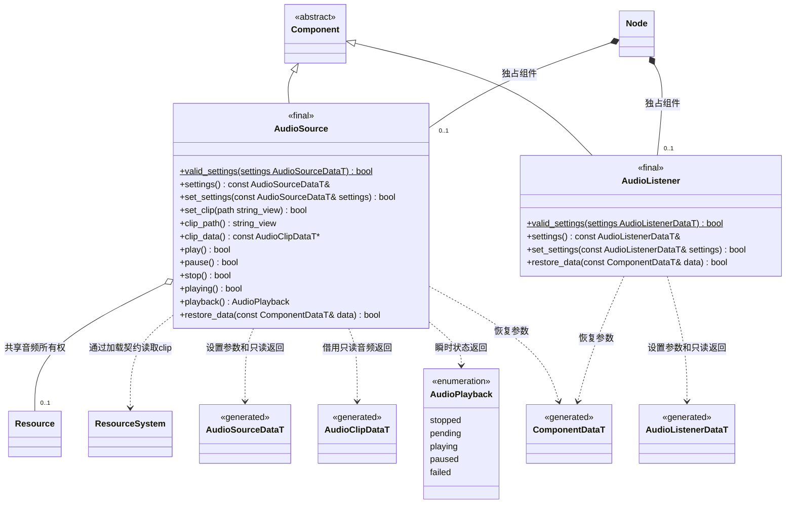

# 音频组件

[类图索引](../../class-diagrams/index.md) · [音频系统](audio-system.md) · [运行时音频](../audio.md)

两个组件由 `Node::add_component<T>()` 创建，命名空间为 `engine`。`settings()` 返回 `const` 引用，`clip_data()` 返回借用的 `const` 指针，修改失败保留旧状态。`valid_settings()` 只检查有限数值、范围和可选 GUID 格式，不要求资源目录存在。播放进度和状态不进入 FlatBuffers 持久模型。

`restore_data()` 与 `set_settings()` 共用校验和资源切换；相同 clip 的音量、音调等修改保留播放或暂停状态，改变 clip 才停止旧播放。恢复启用状态为 false 后，音频系统在下一次更新释放流。

组件目标不包含或链接 SDL。`play()` 表示提交播放请求，真实成功由音频系统将 `pending` 改为 `playing`；失败可观察为 `failed`。详见[音频行为约定](../audio.md)。
