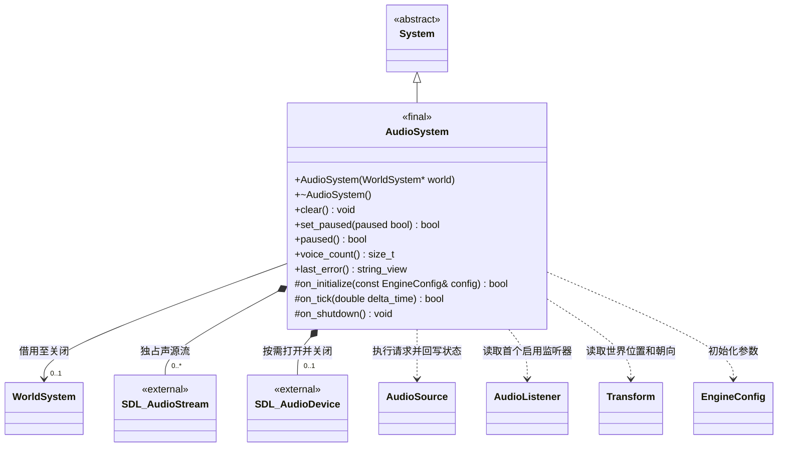

# 音频系统

[类图索引](../../class-diagrams/index.md) · [音频组件](audio-components.md) · [运行时音频](../audio.md)

`AudioSystem` 属于 `engine`，SDL 类型仅出现在私有实现。构造参数允许空世界，此时初始化和空更新不打开音频。设备或流失败通过返回值和 `last_error()` 表达；不会自动选 dummy 输出。所有公开操作由宿主主线程调用，`clear()` 与析构为 `noexcept`。

暂停声源仍占一个 voice；停止、禁用、删除或切场景在音频更新时释放，宿主主动 `clear()` 同步释放。后台暂停保留游标与组件状态。节点引用每帧通过当前场景与节点 ID 查找，系统不持有悬空节点指针。自然播放完毕后保留已打开的设备至场景切换、`clear()` 或关闭，防止截断输出缓冲中的尾音。
