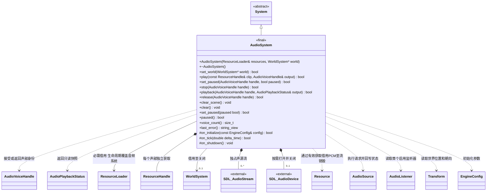

# 音频系统

**资源接入状态：已按用户确认的统一资源契约迁移；验证结果见[测试文档](../../testing.md)。** 音频接收已加载句柄并通过注入的高层接口保活；不直接依赖核心读取或默认资源插件。其他设备、时钟与场景行为沿用既有契约，见[统一资源生命周期](resource-lifecycle.md)。

独立影片声部与场景声部复用同一设备；状态及时间语义见[影片复用音频](movie-audio.md)。本页统一维护 AudioSystem 的公开方法。

[类图索引](../../class-diagrams/index.md) · [音频组件](audio-components.md) · [运行时音频](../audio.md)

`AudioSystem` 属于 `engine`，SDL 类型仅出现在私有实现。世界参数允许为空，此时初始化和空更新不打开音频；ResourceLoader 为必需借用。play 先 get 检查 AudioClip 类型并 retain 声部获取，失败输出空且不读取文件；流销毁并同步回调后才释放该获取。设备或流失败通过返回值和 `last_error()` 表达；不会自动选 dummy 输出。所有公开操作由宿主主线程调用，`clear()` 与析构为 `noexcept`。

暂停或停用声源仍占一个 voice；停用组件或其节点解除设备绑定，保留游标和播放意图，恢复激活后继续。隐藏不影响播放。停止或删除在音频更新时释放，宿主主动 `clear()` 同步释放。后台暂停同样保留游标与组件状态。节点引用每帧通过世界级节点 ID 查找，系统不持有悬空节点指针。Voice 同时校验基类 Component 的实例身份与声源修订号，同节点重新添加组件不能继承旧流或游标。自然播放完毕后保留已打开的设备至 `clear()` 或关闭，防止截断输出缓冲中的尾音。

主线程只处理组件请求、计算空间参数并发布 pitch/gain/pan/loop 快照。每个 voice 通过 `SDL_SetAudioStreamGetCallback` 注册按需补流回调；SDL 设备线程读取 voice 持有的不可变 PCM，完成声道处理、游标回绕和末尾 flush。回调不读取 Scene/Node/AudioSource，不读文件、不等待任务，也不写系统错误字符串；失败状态由主线程更新时读取并报告。

主线程更新 voice 参数与查询完成状态使用 `SDL_LockAudioStream` / `SDL_UnlockAudioStream`，SDL 调用回调时已经持有同一把流锁；不自建音频线程、队列或同步器。销毁流先由 SDL 解绑并等待设备迭代结束，之后释放 voice 的资源引用。主线程短暂停顿不阻止已发布音频继续播放；播放状态仍由下一次主线程更新同步回组件。

普通场景切换通过 `WorldSystem::scenes()` 同步所有已发布声源，常驻声源保留原 SDL 流和播放游标；无活动玩法场景也继续播放。监听器优先取当前活动场景首个启用组件，没有时才取保留容器中的首个有效监听器。场景停止由会话调用 `clear_scene()`；整个服务停止由宿主显式调用 `clear()`。
