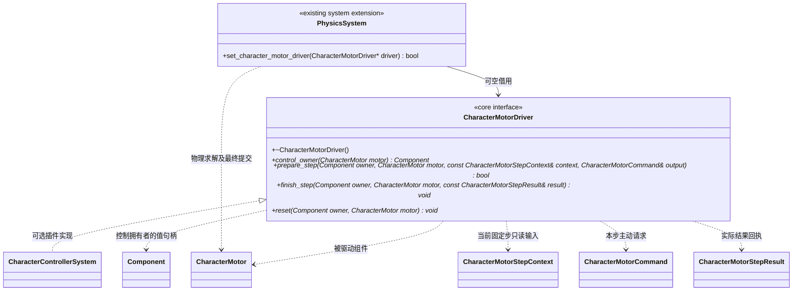
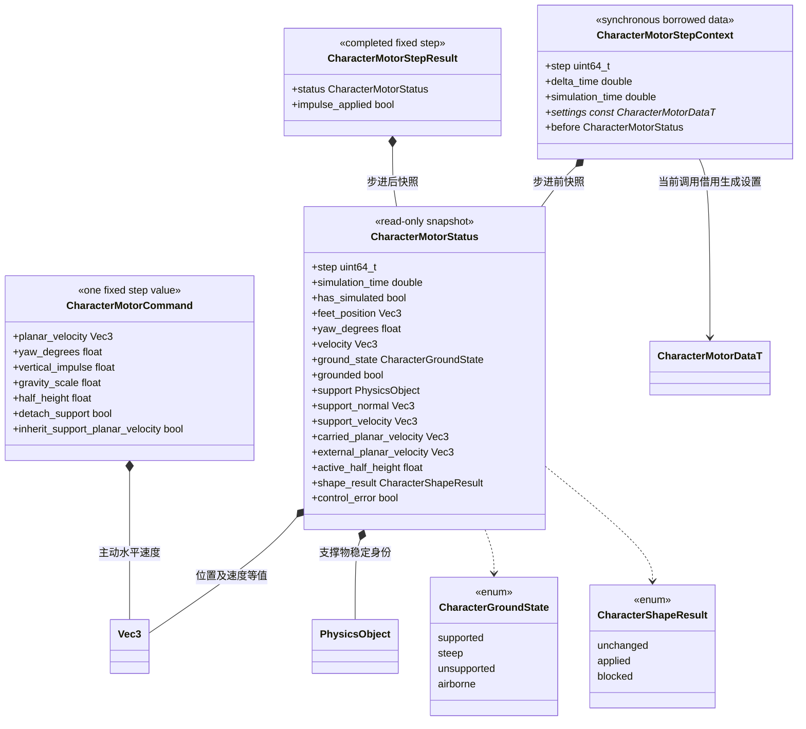

# 角色物理固定步驱动（设计草案）

[类图索引](../../class-diagrams/index.md) · [当前 CharacterMotor](character-motor.md) · [角色控制草案](../../plugins/runtime/class-diagrams/character-control-design.md)

**状态：设计草案，待评审，尚未实现。** 本页只定义角色扩展直接需要的核心契约。当前仍由 `CharacterMotor` 接收水平速度、跳跃及外部速度增量，PhysicsSystem 使用 Jolt CharacterVirtual 求解；新契约不能视为已可调用。

本页新增接口与运行值位于核心命名空间 `engine`，不包含插件或 Jolt 类型。接口基线核对为项目已安装的 Jolt 5.6.0，与[上游正式发布版本](https://github.com/jrouwe/JoltPhysics/releases/tag/v5.6.0)一致。

## 固定步接入与所有权

加速、制动、跳跃宽限与能力计时必须跟随实际执行的物理固定步。宿主向 PhysicsSystem 注入一个可空的领域驱动接口；核心不依赖角色插件，不增加通用固定更新管理器。

图中方法尾部 `*` 表示纯虚方法，`control_owner` 的返回类型是 `Component` 值句柄。只读 `control_owner` 为 const；析构、finish_step 和 reset 不抛异常。驱动接口不拥有逐角色对象。

- 宿主在 PhysicsSystem 初始化之前设置接口，关闭后可以清除；运行中替换或从回调重入设置返回 false。提供者先初始化、后关闭，借用覆盖物理系统整个运行期。
- `control_owner` 返回当前明确接管该 Motor 的启用组件；空句柄表示没有接管。非空拥有者必须与 Motor 属于同一世界，完整组件身份有效。角色插件返回同节点的 CharacterController，核心不认识其具体类型。
- 核心在结构稳定阶段调用接口。回调不能添加／删除组件、调用公共物理查询、重新写 Motor 输入或保存 ECS 指针；本轮所需形状检查由核心在处理 command 时完成。
- 物理层保存上次拥有者的完整身份。接管、失去接管或拥有者替换时，清理旧主动请求并通知 reset；失效旧句柄不会操作同节点的新组件。外部速度增量与击退不因控制权变化而清除。
- `prepare_step` 失败时，本角色使用零主动移动、无一次性动作的安全请求，继续重力与外部运动，并发布控制错误。其他角色继续求解。核心物理求解本身失败仍按 PhysicsSystem 的整体错误契约处理。
- 没有固定步时不调用 prepare/finish，不推进能力时间。每个已成功执行的固定步回执一次，最后统一写场景 Transform；物理是受控角色根节点位置及朝向的唯一持续写入者。

## 请求、物理状态与回执

这些是运行结构，不进入 FlatBuffers 持久数据。速度单位 m/s，位置与尺寸为米，时间为秒；所有值有限。`planar_velocity.y == 0`，基础胶囊半径仍来自 MotorData；half_height 沿用现有有效范围 [0.01,1000]。gravity_scale 范围为 [0,16]，乘在 MotorData.gravity_factor 上，合成值仍须有限。

准备失败时的中性请求明确保留当前 yaw 与有效半高，gravity_scale=1，水平主动速度及竖直增量为零；不能把零初始化的尺寸或重力倍率当成安全请求。输出结构在使用前由核心基于当前有效状态初始化，并在提交前完整验证。

`planar_velocity` 表示角色自身的主动水平速度；核心单独叠加支撑速度、离地携带速度及外部速度。`vertical_impulse` 是本固定步的一次性竖直速度增量，不是每帧重新设置最终竖直速度。驱动完成一个固定步后必须根据回执消费动作，不能在多个子步重复施加同一次起跳。

ground_state 表示接触分类，grounded 还要求角色没有正在离开支撑面；踩到陡面不能直接当作可跳跃的平地。support 是可再次校验的 PhysicsObject 值，不暴露 Jolt BodyID 或指针。没有有效支撑时相关字段清空；历史支撑的失效不能绑定到复用的对象身份。

`CharacterMotor` 拟增加 `get_status(CharacterMotorStatus& output) -> bool`，读取最后已完成的物理状态，失败清空输出；原 velocity/grounded 查询继续作为各自明确用途的简便接口。它们均读取同一 Runtime，不形成另一份运行状态。

## 蹲起与形状切换

根节点仍是脚底，胶囊沿 Y 轴，完整高度为 `2 * (half_height + radius)`。角色模块请求运行半高，不用逐帧改写 MotorData，不通过 set_settings 重建 Jolt 对象来实现蹲起。

核心为确定的半径／半高组合准备足底对齐的形状，在固定步安全点用 Jolt 的形状切换检查。扩张受阻时返回 shape_result=blocked，保留原形状、脚底位置、速度和有效物理对象；预期的站起受阻不属于整个物理步失败。存在 inner body 时，成功后同步其形状。Jolt 5.6.0 的 [SetShape 与 SetInnerBodyShape](https://jrouwe.github.io/JoltPhysicsDocs/5.6.0/class_character_virtual.html)提供这一底层能力，碰撞容差必须显式限定，不能用无限容差绕过检查。

姿态与镜头根据 active_half_height 更新；请求站立不等于已经站立。角色模块在仍为矮胶囊时继续使用相应移动限制。移除调整尺寸的能力后，重新请求基础半高；恢复受阻时保持已验证形状并暂停主动移动，外力与重力仍执行，状态明确报告等待恢复。

禁用控制器会释放主动控制；Motor 自身是否继续模拟由其启用状态决定。未接管的 Motor 尝试恢复基础尺寸；新控制拥有者可以提交明确且有效的运行尺寸。删除／禁用 Motor 才按原物理生命周期移除实体，不为站起失败删除角色。

## 平台、外力与朝向

支撑速度由物理层读取接触点速度，包括旋转刚体在接触点的线速度；控制器不使用“本帧平台 Transform 位移”再叠加一次。地面速度来自已有 Jolt ground velocity 查询，实际平台行为仍需场景验收。

`inherit_support_planar_velocity` 是显式开启的离地水平动量选项：只在有效支撑丢失或主动离地时捕获一次，保存为独立携带速度；空中不重复相加，接触新有效支撑时结束该携带项。竖直速度继续随已有运动、支撑和重力积分，不通过本选项额外反复叠加平台竖直速度。首批不包含随平台自动旋转角色朝向。

加减速及制动只改变主动速度。已有 add_velocity 继续接受世界空间外部速度增量；水平部分沿用 external_damping 衰减，垂直部分进入物理速度。清输入、能力冲突和控制权交接都不能把这些增量当作主动输入删除；也不能把受阻的主动速度反算成新的击退。

yaw_degrees 是本步期望的根节点 Y 轴朝向，转向速度和朝向策略由插件计算，核心只验证并提交。根节点、单位正缩放、仅 Y 轴旋转以及 Motor 与 Collider/RigidBody 不能同时启用的现有限制继续适用。显式传送沿用现有场景修改与物理重同步流程，并通知驱动清除旧支撑、缓冲动作及能力历史。

## 主动输入独占与单一版本更新

Motor 被有效驱动拥有者接管期间，外部直接调用 set_velocity、jump 和 clear_input 均返回 false，不能绕过控制器再写一份主动意图；add_velocity 仍属于允许的外力入口。clear_input 因而由现有 void 调整为 `[[nodiscard]] bool`，未接管时保持原取消语义，所有原生及 TS 调用方一次更新。归属检查复用本世界的核心驱动关联，不向 Motor 加入具体插件类型分支。

Controller.clear_input 清除自己的帧输入、缓冲动作和主动水平速度计划。下一物理步根据空输入继续求解，能力按各自释放规则结束持有阶段；已生效的竖直运动和需要净空检查的姿态恢复仍由物理处理。控制器不调用被独占保护的 Motor.clear_input。禁用或删除拥有者时，核心在结构稳定的同步阶段清掉旧请求；世界暂停不积分，也不积压暂停期间的新输入。

本轮不增加网络回滚、任意重力方向、攀墙碰撞、Root Motion 位移或多物理驱动层。未来需要新的物理请求种类时先评审此接口，不能由能力模块直接写 Transform 绕过求解。
