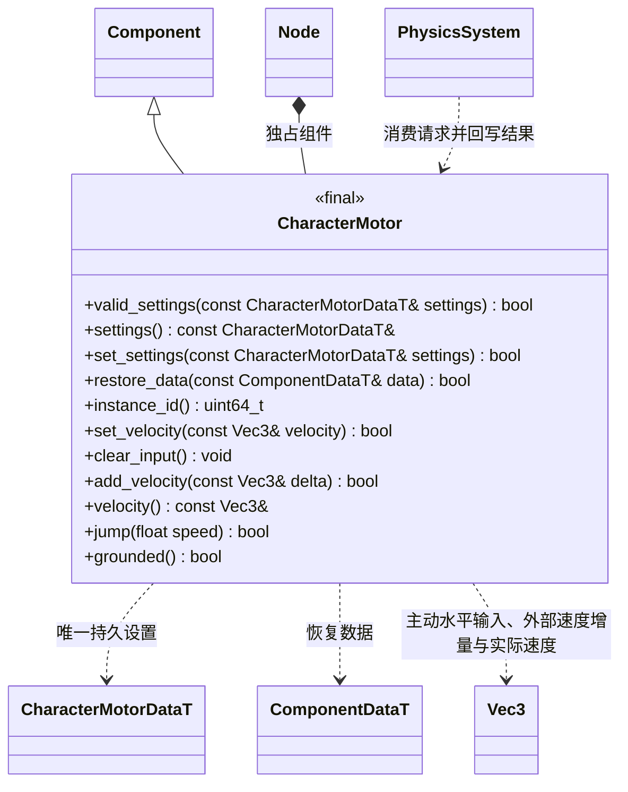

# 角色物理组件

`engine::CharacterMotor` 只表达胶囊移动和物理状态，不解释按键或相机模式。

节点原点是脚底，胶囊沿 Y 轴，要求根节点、单位正缩放与仅 Y 轴旋转；同节点不能同时启用 Collider 或 RigidBody。半高不包括两个半球，完整高度是 `2 * (half_height + radius)`。核心使用 Jolt CharacterVirtual 的 ExtendedUpdate，支持地面判定、重力、坡度、台阶和贴地；没有复制一套碰撞求解器。

`set_velocity` 提交世界空间水平速度（Y 必须为零），`clear_input` 清除主动速度和未消费跳跃，不清除击退；`velocity` 返回物理求解后的速度。`add_velocity` 提交世界空间速度增量，单位 m/s，等价于单位质量冲量；与主动输入分离，下一固定步累计消费一次，无固定步的帧保留请求。水平外部速度按 `exp(-external_damping * dt)` 衰减，`external_damping` 默认为 6/s，取值 0..1000/s；垂直增量交给既有 Jolt 跳跃、重力和碰撞流程。`jump` 仅在地面时接受一次请求。输入、外部速度及请求均不进入持久数据。

`instance_id` 在组件生命周期内稳定且不会复用，供调用者识别同节点上的组件重建。禁用组件或变换在下一次物理同步清除全部瞬态并移除 Jolt 对象；删除和场景切换释放旧对象。恢复数据同时清除全部瞬态，下次同步复位对应 Jolt 速度。通用 Component 开关不提供瞬时通知，同一同步间隔内关闭再开启不视为物理系统已观察到的禁用。当前角色与环境刚体碰撞，角色之间通过 Jolt CharacterVsCharacterCollisionSimple 检测。

`PhysicsSystem::cast_sphere` 使用当前已同步的碰撞世界；返回值表示查询是否有效，输出 0..1 的可通行比例，1 表示没有命中。触发器不阻挡相机；零位移合法。调用者先完成该帧物理同步，再决定相机距离。
