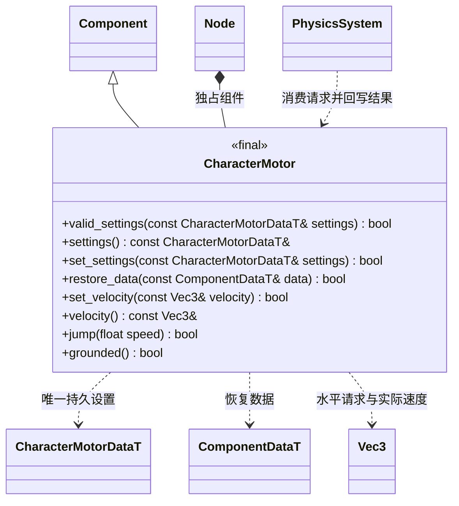

# 角色物理组件

`engine::CharacterMotor` 只表达胶囊移动和物理状态，不解释按键或相机模式。

节点原点是脚底，胶囊沿 Y 轴，要求根节点、单位正缩放与仅 Y 轴旋转；同节点不能同时启用 Collider 或 RigidBody。半高不包括两个半球，完整高度是 `2 * (half_height + radius)`。核心使用 Jolt CharacterVirtual 的 ExtendedUpdate，支持地面判定、重力、坡度、台阶和贴地；没有复制一套碰撞求解器。

`set_velocity` 提交世界空间水平速度（Y 必须为零），`velocity` 返回物理求解后的速度。`jump` 仅在地面时接受一次请求；请求不会序列化。禁用组件清除请求，场景切换/删除组件释放 Jolt 对象。当前角色与环境刚体碰撞，角色之间通过 Jolt CharacterVsCharacterCollisionSimple 检测。

`PhysicsSystem::cast_sphere` 使用当前已同步的碰撞世界；返回值表示查询是否有效，输出 0..1 的可通行比例，1 表示没有命中。触发器不阻挡相机；零位移合法。调用者先完成该帧物理同步，再决定相机距离。
