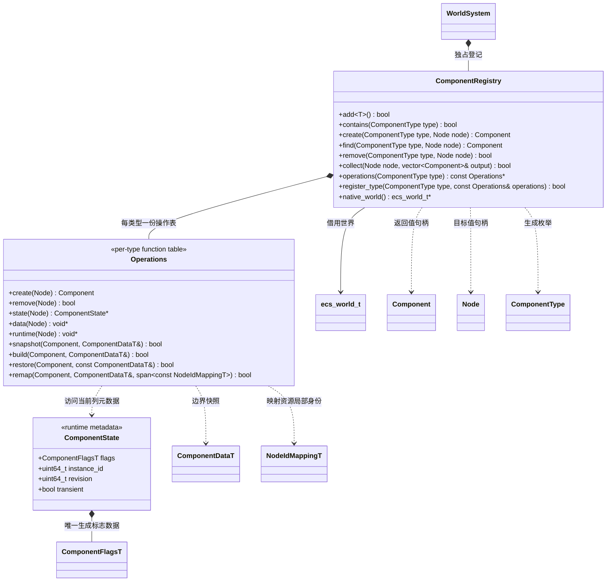

# 组件类型登记

[类图索引](../../class-diagrams/index.md) · [组件](component.md) · [ECS 场景](ecs-scene.md)

`add<T>()` 调用类型自身的登记方法，注册具体生成 Data 的 Flecs 列、可选 Runtime 列及上述静态操作。每类型一份函数表，不为每个实例创建行为对象或虚函数表。表中的条目为函数指针，图中以其签名表示。

重复类型、NONE、无效操作登记失败；未知类型创建返回空 Component。创建先建立列和新实例身份，再执行具名类型初始化；任一步失败删除本次列。删除再添加获得新身份，普通恢复和 ECS 移表不改变实例身份。

ComponentStorage<Data> 含 ComponentState 与 schema 生成 Data；动态 ComponentDataT union 只用于边界快照。Runtime 保留领域缓存和请求，不重复持久参数。具体登记、校验、保存与恢复函数归所属模块；核心不依赖插件，宿主在加载前登记插件，函数地址须活到 WorldSystem 关闭。
