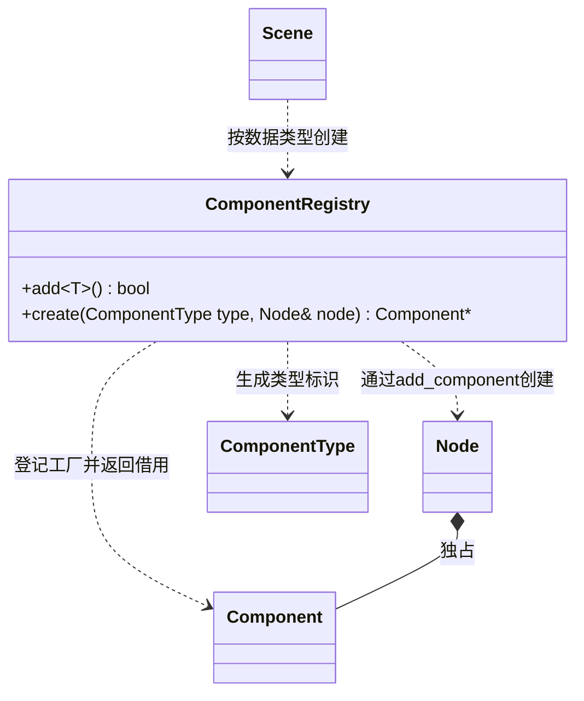

# 组件创建登记

[类图索引](../../class-diagrams/index.md) · [组件](component.md)

登记只保存创建函数，不拥有组件。重复类型与 NONE 登记失败；未知类型返回空。默认登记在一个文件中显式列出，具体组件仍由 Node 的泛型方法创建。Scene 可复用创建节点时已有的 Transform，其他类型按表创建；恢复数据交给组件自己的虚方法，失败场景不会发布给 WorldSystem。
