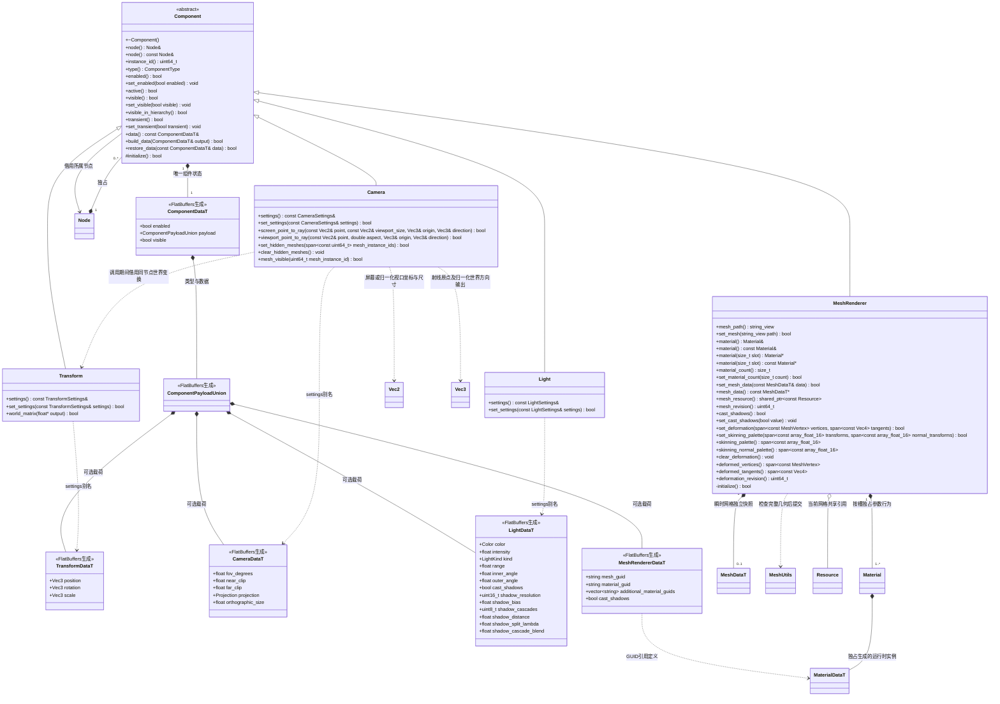

# 节点组件

[类图索引](../../class-diagrams/index.md) · [节点](node.md) · [材质](material.md)

本页定义 Component 基类及变换、相机、灯光、网格组件；[物理组件](physics-components.md)与[音频组件](audio-components.md)独立维护，同样继承 Component 并由 Node 管理。

- 所有状态类型由 FlatBuffers schema 生成。`TransformSettings`、`CameraSettings`、`LightSettings` 是生成类型的别名；Material 是按名字设置参数的行为类；Vec2/Vec3/Vec4/Color 也是生成结构，通过 `x()` / `mutate_x()`、`r()` / `mutate_r()` 访问。没有手写重复字段。
- Component 统一拥有进程内不复用的实例身份，`instance_id()` 为 `const noexcept`，不进入持久数据。Node 在组件进入列表之前拒绝耗尽后产生的零身份，再调用受保护的 `initialize()`；默认实现成功，MeshRenderer 以私有 override 选择 `builtin://materials/default-pbr`。失败销毁未发布组件并返回空指针。删除后重建、恢复新场景都会得到新身份；属性修改和恢复同一实例的数据不改变身份。
- 物理、音频、网格、UI 和可选插件共用此身份；组件内容修订、UI 文档/控件代际和异步系统生命周期仍分别维护。脚本句柄统一核验组件实例，旧句柄不能指向同节点重建的同类组件。
- Component 独占生成的 `ComponentDataT`，包含 enabled 与带类型的 payload；派生组件直接读写自己的 payload，不另保存一份参数。具体组件提供静态 `component_type`，Node 只用通用枚举比较。
- MeshRenderer 的 `cast_shadows` 默认 true，直接存储于生成的组件载荷并随场景保存；false 时仍参与主绘制，但不参与阴影边界拟合和阴影绘制，供天空等表面使用。`visible` 仍为不落盘的瞬态开关，两者不互相替代。
- Transform 是普通组件。Scene 创建 Node 后添加 Transform，变换逻辑全部位于 Transform。位置和欧拉角用 double，角度单位为度，矩阵为 `T * Rz * Ry * Rx * S`，Y 向上、局部前向 -Z。
- 变换必须全部有限，缩放非零，可为负数；失败保持原值。`world_matrix()` 写 16 个列主序 float，父链缺失变换或溢出时返回 false，非空输出保持单位矩阵。
- Camera 从同节点 Transform 获得位置和朝向；视场角在 (0,180)，近裁面大于 0，远裁面大于近裁面。Camera 支持透视与正交投影；orthographic_size 为竖直半高且大于零。Light 支持方向光、点光与聚光；方向使用世界 -Z，强度非负且有限，range 大于零，聚光半角满足 0 <= inner_angle < outer_angle < 90。
- Camera 按 `instance_id()` 保存本镜头隐藏的网格身份，仅影响该视图的主绘制和 AO 深度，不改变网格的 `visible`、`enabled` 或投影。`set_hidden_meshes()` 整批替换列表，任一 ID 为 0 则失败并保留原列表；重复 ID 合并，空列表清空。`mesh_visible()` 为 `const noexcept`，0 返回 false；`clear_hidden_meshes()` 为 `noexcept`。列表只保存 ID，不持有组件借用，不进入生成持久数据；成功恢复 Camera 数据时清空，失败保持原状态。重建网格产生新身份，不继承旧隐藏项。
- Camera 的两种射线查询均为 `const noexcept`、`[[nodiscard]]` 的纯计算，不要求窗口、GPU、启用状态或活动镜头。`screen_point_to_ray` 的点相对视口左上角，尺寸与点使用同一单位；`viewport_point_to_ray` 使用左上 `(0,0)`、右下 `(1,1)`，aspect 是正宽高比。X 向右、Y 向下，有限的视口外坐标允许外推，不截断。
- 射线从近裁剪面出发，方向为归一化世界向量；透视射线发散，正交射线平行。相机与渲染共用场景内部的正交相机基和 bx 投影计算，去掉缩放大小并正交化父链剪切。非有限参数、非正尺寸/宽高比、无法表示的投影或退化世界变换返回 false，两个输出均归零；不自动选择其他相机或修复参数。
- MeshRenderer 默认使用内置 cube，通过 set_mesh 按 GUID 加载并持有 Mesh 资源；成功取得新引用后才替换旧网格，提供 Material 借用。材质先选择类型，再按名称设置带类型参数，具体参数及失败规则见独立材质类图。
- `enabled()` 和 `visible()` 返回组件本地状态；`active()` 合并自身 enabled 与 Node 的有效激活状态，`visible_in_hierarchy()` 合并自身 visible 与 Node 的有效可见状态。两种有效查询互相独立，绘制要求两者都成立。隐藏不停止物理、导航、动画和音频，停用停止系统消费但不销毁组件或改变子级本地标记。Transform 的标记不改变层级空间关系。所有查询为 `const noexcept`，设置为 `noexcept`。
- visible 默认 true，保存在 `ComponentDataT`，与 enabled 一起恢复；MeshRenderer 的可见性直接继承此能力。GPU 缓冲、Shader 和管线仍由 RenderSystem 管理。

- Light 的投影开关默认关闭，当前投影仅支持方向光；阴影分辨率默认 2048，范围 128..8192 且为 2 的幂，深度偏移默认 0.001、范围 0..0.1。[环境与后处理](environment-components.md)使用独立组件承载场景环境与相机画面参数。
- 方向光级联参数由同一 `LightDataT` 保存：`shadow_cascades` 为整数 1、2、4，默认 4；`shadow_distance` 为 `(0, 100000]` 世界单位，默认 150；`shadow_split_lambda` 为 `[0,1]`，默认 0.6；`shadow_cascade_blend` 为 `[0,0.3]`，默认 0.1。分辨率表示完整阴影 atlas 的边长，四级共享 2×2 atlas。非法参数失败并保留原组件，未投影时参数仍保存。

- `data()` 提供生成组件数据的只读借用，调用者不得修改或转移其嵌套载荷；常规变更通过具体组件的方法完成。MeshRenderer 的材质引用由 MeshRenderer::build_data 根据当前材质路径解析 GUID；场景不嵌入整个运行时材质实例。

- `material()` 保留槽 0 的必需引用；按槽查询越界返回空指针，材质槽数量为 1..16。缩减不得丢弃当前子网格引用的槽。扩容先初始化默认材质，全部成功才提交。
- `set_mesh_data()` 接收 FlatBuffers 生成的独立几何快照，校验顶点、索引、UV、切线、颜色与子网格范围后整体替换，并按需扩充材质槽；失败不改变现有几何、槽与修订号。动态数据不注册到资源单例，不伪造 GUID。
- `set_mesh()` 取得完整资源后替换瞬时快照；两种成功提交均递增 mesh_revision。`mesh_data()` 是当前组件持有数据的只读借用，下次成功变更或组件销毁后失效。
- 瞬态蒙皮/GPU 缓存以继承的 `instance_id()` 和 `mesh_revision()` 区分同节点组件重建，不依赖可能重复的内存地址。
- `set_deformation()` 接收与源顶点等长的位置/法线及切线，完整校验后独立保存，仅递增 deformation_revision；失败保留旧输出。源 Mesh、GUID、索引、UV、颜色、子网格与材质均不变。两个 span 查询返回借用，下一次成功提交、清除、源网格变化或组件销毁后失效。
- `clear_deformation()` 恢复源几何，重复调用无副作用；成功更换源网格或恢复组件数据也清除旧变形。变形数据不进入场景快照。清除及只读查询为 noexcept，渲染器同时检查修订号与变形是否存在；修订号到达上限时拒绝新提交，清除仍可执行。
- `set_skinning_palette()` 接收按 Mesh 引用的目标 SkeletonData 原始关节索引排列的列主序 float[16] 位置矩阵与法线逆转置矩阵，不采用源动作索引或 ozz DFS 顺序；完整校验后保存组件独占副本。与直接顶点覆写互斥，共用 `deformation_revision` 和 `clear_deformation`；失败保持旧姿态。两个只读 span 的生命周期与变形查询相同，不暴露 ozz 或 bgfx 类型。`mesh_resource()` 返回共享不可变源资源；动态网格返回空，不能用路径或 GUID 冒充当前资源版本。

- `build_data` 和 `restore_data` 是统一组件持久数据契约；简单组件直接校验生成载荷，MeshRenderer 在自身文件解析 GUID、持有资源和组装材质槽。Scene 只组织节点与层级，不分派具体组件字段。失败快照为空，恢复失败保留组件原状态。

MeshRenderer 隐藏时主通道、反射和阴影通道均不绘制；再次显示按已有几何和当前变形准备 GPU 资源。
