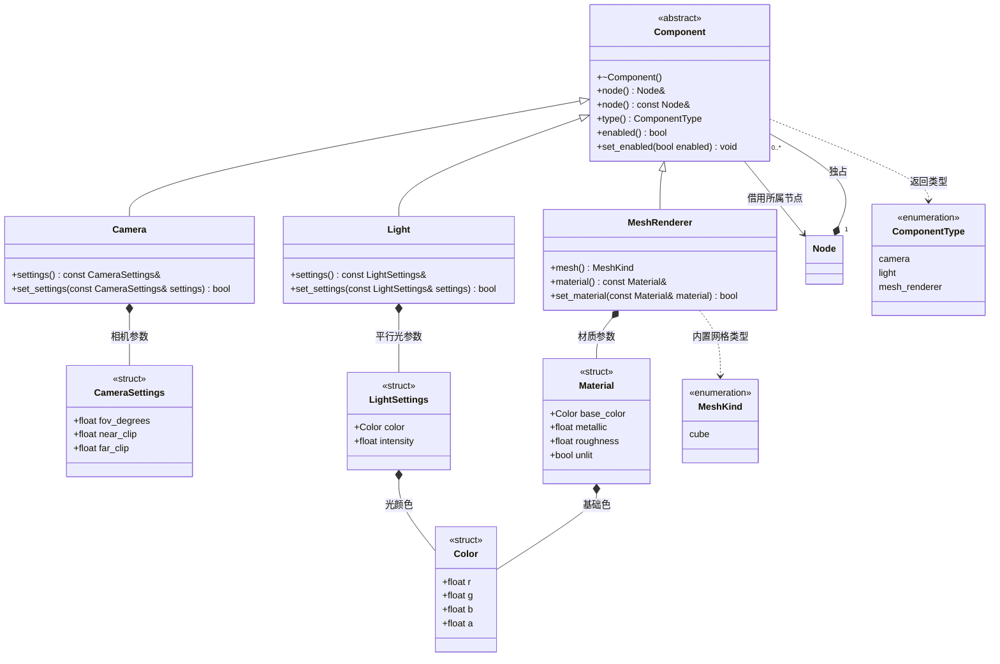

# 节点组件

[类图索引](../../class-diagrams/index.md) · [节点](node.md)

- Component 使用公共虚析构、禁止复制和移动，具体组件只能由 Node 创建；共同状态为所属节点、显式类型和启用状态。
- Camera 位置和朝向来自节点变换。渲染器用世界 -Z 与 +Y 正交化相机基，忽略缩放大小；视场角大于 0 小于 180 度，近裁面大于 0，远裁面大于近裁面。
- Light 当前是平行光，方向取节点世界矩阵的 -Z，位置不影响平行光；颜色各分量为 [0,1]，强度为非负有限数。
- MeshRenderer 当前网格为内置 cube，材质颜色、金属度与粗糙度均为 [0,1]，所有参数必须有限；unlit 支持先验证基础绘制。
- 设置方法失败不改变原参数。只禁用组件不改变所有权；渲染遍历忽略未启用组件。
- GPU 缓冲、Shader 和管线归 RenderSystem 的本次运行资源管理，不放进节点或脚本句柄。
