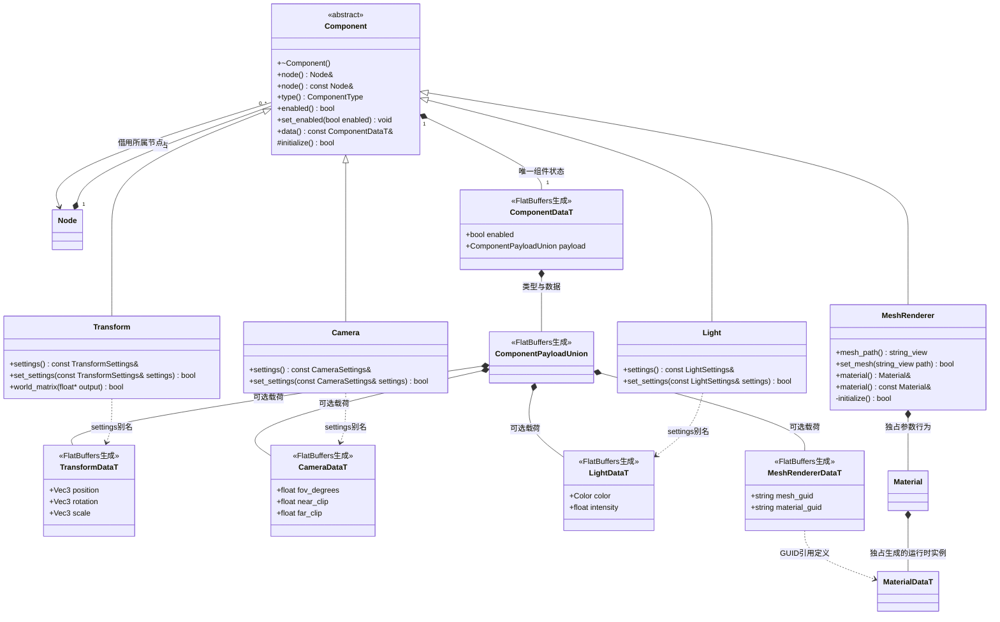

# 节点组件

[类图索引](../../class-diagrams/index.md) · [节点](node.md) · [材质](material.md)

- 所有状态类型由 FlatBuffers schema 生成。`TransformSettings`、`CameraSettings`、`LightSettings` 是生成类型的别名；Material 是按名字设置参数的行为类；Vec2/Vec3/Vec4/Color 也是生成结构，通过 `x()` / `mutate_x()`、`r()` / `mutate_r()` 访问。没有手写重复字段。
- Node 拥有者在组件进入列表之前调用受保护的 `initialize()`；默认实现成功，MeshRenderer 以私有 override 实现该钩子，选择 `builtin/materials/default-pbr`。失败销毁未发布组件并返回空指针。
- Component 独占生成的 `ComponentDataT`，包含 enabled 与带类型的 payload；派生组件直接读写自己的 payload，不另保存一份参数。具体组件提供静态 `component_type`，Node 只用通用枚举比较。
- Transform 是普通组件。Scene 创建 Node 后添加 Transform，变换逻辑全部位于 Transform。位置和欧拉角用 double，角度单位为度，矩阵为 `T * Rz * Ry * Rx * S`，Y 向上、局部前向 -Z。
- 变换必须全部有限，缩放非零，可为负数；失败保持原值。`world_matrix()` 写 16 个列主序 float，父链缺失变换或溢出时返回 false，非空输出保持单位矩阵。
- Camera 从同节点 Transform 获得位置和朝向；视场角在 (0,180)，近裁面大于 0，远裁面大于近裁面。Light 表达平行光，使用世界 -Z，强度非负且有限。
- MeshRenderer 默认使用内置 cube，通过 set_mesh 选择已注册且具有 GUID 的 Mesh 资源，提供 Material 借用。材质先选择类型，再按名称设置带类型参数，具体参数及失败规则见独立材质类图。
- 禁用不改变所有权；Transform 的启用标记不改变层级空间关系。GPU 缓冲、Shader 和管线仍由 RenderSystem 管理。

- `data()` 提供生成组件数据的只读借用，调用者不得修改或转移其嵌套载荷；常规变更通过具体组件的方法完成。MeshRenderer 的材质引用由 Scene::build_data 根据当前材质路径解析 GUID；场景不嵌入整个运行时材质实例。
