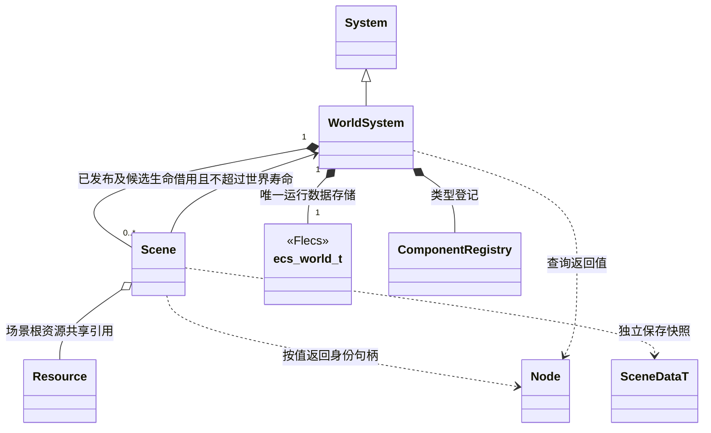
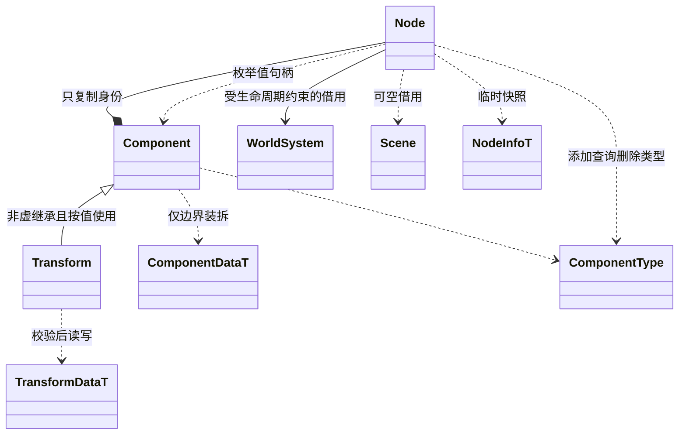
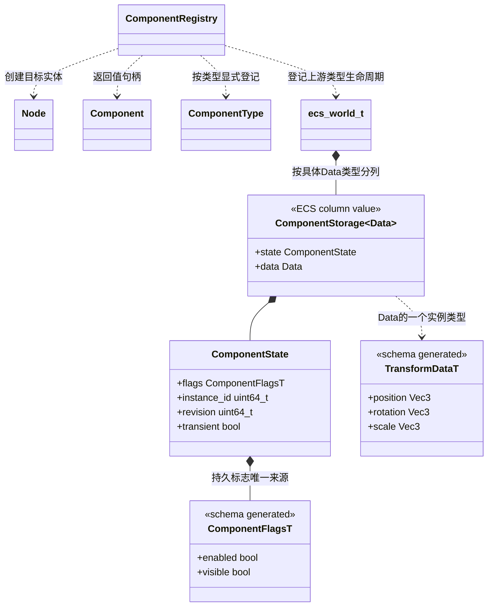
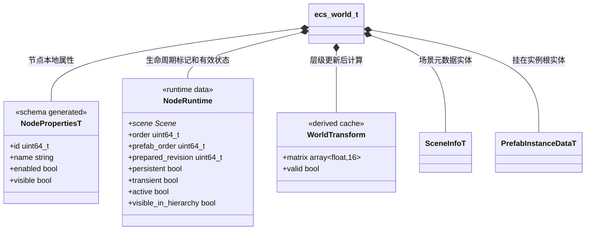

# ECS 场景与虚拟节点

[类图索引](../../class-diagrams/index.md) · [当前场景](scene.md) · [当前节点](node.md) · [当前组件](component.md)

> 状态：2026-11-03 用户已批准实施。Node/Component 值句柄、Flecs 存储与系统查询已接入；验证结果统一记录在[测试与范例](../../testing.md)。

已替换原来的 `Scene -> unique_ptr<Node> -> unique_ptr<Component>` 存储及各系统逐节点扫描。Node/Component 保留为可复制的值句柄；Flecs 保存唯一运行状态，既有 System 直接查询。复用已接入的 Flecs 4.2.0 与 oneTBB，不新增 ECS Manager、组件对象池、自制查询语言或第二套调度器。

## 1. 世界、场景与所有权

本页维护跨模块所有权和 ECS 存储边界；WorldSystem、Scene、Node 和 Component 的方法统一维护在各自类图，不在本页重复定义。

- WorldSystem 独占一个 Flecs world；Scene 仍是加载、发布、卸载和资源引用的服务对象，不再拥有节点或组件对象。
- 每个 Scene 在 ECS 中有一个内部元数据实体，持有生成的 `SceneInfoT`；普通节点通过专用的场景归属关系关联它。场景实体不是编辑器节点，不自动拥有 Transform。
- `SceneInfoT.active_camera_node` 继续保存场景局部 ID，通过索引解析；不另存一份权威相机指针。Prefab 来源及覆盖放在实例根实体。
- Scene 可保留 `local_id -> entity_id` 的查找索引、递增计数和根资源共享引用；索引由 ECS 生命周期同步维护，可重建，不成为第二份节点状态。
- 创建、恢复失败返回空 Node。同步修改仍只有完整成功或保留原状态两种结果；失败清理本次创建的实体，不影响原场景。
- Scene/WorldSystem 的节点查询按值返回。Node 析构只是丢弃句柄，只有明确调用删除接口才销毁实体。
- `native_world()` 仅返回初始化期间有效的借用，公开头前置声明 `ecs_world_t`；具体系统/插件的实现文件使用上游查询。Engine/System 通用框架及 TS 接口不依赖 Flecs 类型。
- `refresh_scene_state()` 在协调线程、无在途数据借用的安全点更新有效状态与世界矩阵；无修改时快速返回。有修改时按世界修订号遍历节点、沿父链先更新祖先，同一轮每个节点只计算一次。场景查询批次、物理输入及渲染读取前由调用方明确调用，不靠跨帧陈旧数据。

## 2. Node 与组件访问句柄

Node 只保存 WorldSystem 借用、世界生命周期代次及完整实体 ID。Component 在其上增加类型和组件附加身份。Transform、Camera 等具名接口只做校验、数据访问和必要的系统调用，不再拥有运行字段、资源和虚函数表。

- 默认构造为空句柄；复制/移动只复制身份，不复制实体。删除、父子变更等写操作失败返回 false。
- C++ 句柄遵守借用规则：WorldSystem 对象必须活过句柄的使用。世界 shutdown 后或重新 initialize 时，旧代次失效；不承诺在 WorldSystem 对象析构后仍能解引用其裸借用。TS/MCP 通过当前有效宿主和上下文解析身份，不能跨关闭保存并调用裸指针。
- Flecs 实体代次负责拒绝删后复用的实体；组件 `instance_id` 在删除后重加时更新，在普通数据修改或 ECS 移表时保持不变。
- 组件句柄不保存数据地址；ECS 可能搬移列，句柄每次访问重新解析。原生批处理的列借用仅在当前查询及结构稳定阶段有效。
- 非虚的 Component 基类只复用句柄方法，不通过基类指针拥有/销毁派生对象，不保留逐实例 `initialize/restore_data` 虚调用。类型处理函数由现有登记表显式分派。

其他公开契约一并调整：

| 范围 | 目标接口或语义 |
| --- | --- |
| Node 身份 | `id()` 返回完整运行实体 ID；`build_info(NodeInfoT& output) -> bool` 生成独立快照，`info()` 同样返回独立值快照；`name() -> std::string` 返回值。 |
| Node 状态 | `enabled/active/visible/visible_in_hierarchy/transient/persistent() -> bool` 保留；`set_enabled/set_visible/set_transient/set_persistent(bool) -> bool` 都检查句柄及修改阶段。无效状态查询为 false，身份由 `valid()` 单独判断。 |
| 父子关系 | `parent() -> Node`；默认空 `Node{}` 表示没有父节点/主动解绑；`set_parent(Node) -> bool` 保留局部变换，过期或跨世界的非空父句柄必须失败并保持原关系，不能当作解绑；同时拒绝跨场景、循环和将常驻根挂到其他节点。 |
| 组件按类型操作 | `add_component<T>() / get_component<T>() -> T`；动态 `get_component(ComponentType) -> Component`。重复添加/缺失/失败返回无效句柄。`collect_components(vector<Component>& output) -> bool` 只构建调用方需要的身份快照。 |
| Component 状态 | 保留 enabled/active/visible/visible_in_hierarchy/transient 查询；对应 setter 改为 bool。`data()` 返回独立存储快照，`build_data(ComponentDataT&) -> bool` 另完成资源引用和运行状态的保存转换。 |
| 具名组件 | 配置读取提供 `get_settings(GeneratedData& output) -> bool` 与返回独立值的 `settings()`，写入仍校验后提交；失败读取输出恢复为默认安全值，失败写入保持原状态。其他逐类型方法在迁移其所属类图时对应调整。 |
| 原生资源借用 | 当前 Material、UI 文档、动画和动态网格的裸地址/引用逐项改为领域已有安全句柄、共享资源引用或显式复制；不能把搬移前的组件地址继续返回给调用者。 |
| Scene 实例化 | `instantiate_model(path, name, vector<Node>* created = nullptr) -> Node` 和 `instantiate_prefab(...) -> Node`；可选输出精确记录本次创建集合，失败清空。编辑撤销不再用 nodes 数组长度差推算。 |
| Scene 遍历 | 删除 `nodes()` 的对象容器借用，使用 `collect_nodes(vector<Node>& output) -> bool`；按明确创建/恢复顺序输出，供编辑、保存、诊断使用，游戏系统不走这条快照遍历。 |
| 活动相机 | `active_camera() -> Camera`；`set_active_camera(Camera) -> bool`；空句柄清除选择，其他场景或已过期非空句柄拒绝。 |
| Prefab 查询 | `collect_prefab_instances(vector<PrefabInstanceDataT>& output) -> bool` 返回独立快照；现有来源登记/解除方法保持语义，从根实体读写数据。 |

TS 保留 Node、Component 和具名组件操作外观；需要时才产生访问对象。绑定仍检查 Run、场景、实体及组件实例身份。没有原生批处理每帧为全场景创建 JS 包装对象的步骤，也不把项目 TS 业务搬进 C++。

## 3. 真实数据按具体类型存储

`ComponentStorage<Data>` 是一个普通值结构，不是管理类。每个具体 Data 对应一个 Flecs 组件类型，例如 `ComponentStorage<schema::TransformDataT>`；同类型数据按 ECS 表列存放。`ComponentDataT` 的动态 union 只在加载/保存/撤销快照边界组装，不能继续作为每实例 payload 指针容器。

- `Data` 直接使用 schema 生成类型，不能再手写一套 Transform/Camera 等持久字段。字符串、数组仍有必要的内部存储；这里只消除额外行为对象和 union 间接分配，不宣称所有数据零分配。
- `enabled/visible` 从现有快照外层提取成 schema 定义的 `ComponentFlags`，默认均为 true；快照和运行存储引用同一生成定义。`instance_id/revision/transient` 是非持久运行元数据。
- 组件 revision 表示已提交修改；instance_id 表示本次附加身份，两者不可混用。原生批量写入同样需要更新相应修改标记，不能绕过资源同步。
- 登记仍用 `ComponentRegistry::add<T>()`；每类自己的实现负责数据校验、快照转换、节点引用重映射和绑定清理，不集中增加类型 switch。
- WorldSystem 先创建 Flecs world，再初始化内置类型登记；宿主在场景创建前登记所选插件类型。登记表只借用所属 world，内部绑定不增加对外二次初始化流程。
- Flecs C++ 注册已有构造/析构/复制/移动/移表支持，直接用于可移动的生成数据；不把旧不可移动 Component 类注册进去，也不自行重写整套生命周期机制。
- 节点/组件唯一 ID 是普通字段，不为每个实例建立专属类型、tag 或 pair。可见/激活等频繁变化先更新字段及有效状态，不以每帧增删组件表达。

节点与场景记录（`NodeRuntime`、`WorldTransform` 属于 `engine::ecs_detail`，其余为 schema 生成类型）：

- schema 新增 `NodeProperties`，保存局部 id、name、enabled、visible；`NodeInfo` 成为序列化信封，引用这些属性并保存 parent_id。运行时只常驻属性，父关系由 Flecs `ChildOf` 唯一表达。
- 世界矩阵、有效激活/可见等只是可重算缓存；写入入口更新世界修订号。在依赖读取之前刷新，不能出现父节点刚隐藏、子节点还显示一帧的契约变化。
- setter 成功后，同一 TS/MCP 调用链的 `active/visible_in_hierarchy/world_matrix` 读取必须得到新值；句柄 getter 在协调线程补刷新后返回，不等到下一个系统批次。worker 不调用这种可能刷新缓存的访问器，只消费批次入口已准备好的数据。
- `NodeRuntime.order` 明确记录可观察顺序。FindNode 对重名的首次匹配、灯光选择、保存和撤销不能依赖 archetype 内部顺序；Environment 多个有效实例仍报告错误。
- `NodeRuntime.prefab_order` 独立记录预制体来源登记顺序。解除后重新登记排到末尾，不受节点创建顺序或 ECS 移表影响。
- 三种身份继续分开：运行实体 ID、场景持久 local ID、Prefab 模板 source ID。磁盘不保存 Flecs 行号或实体 ID，不把 undo 的重绑表用于 TS 旧句柄。
- `PrefabInstanceDataT` 记录显式覆盖、删除标记及模板映射，是编辑/保存元数据；它不是第二份全实体实时状态。

## 4. 层级、加载与生命周期

父子采用 Flecs 原生 `ChildOf`，场景归属采用独立且排他的关系；节点根可以没有父节点，但仍归属于场景。`set_parent` 只改父关系，不能隐式转移场景。

Flecs 4.2.0 的普通关系也参与表组合，因此不同父节点可能分表，不能把“按类型批量查询”描述成“全场景只有一块连续内存”。当前实现不更改内置 ChildOf 的 trait；不假设 DontFragment 关系支持 up/cascade 层级查询。场景归属只按少量场景分组，实例身份用普通字段，避免额外制造小表。

候选恢复、发布和回收遵守现有调用方流程：

1. 候选实体创建在同一个 ECS world 中，但没有运行查询所需的 Published 标记；只有恢复代码可访问。注册查询时明确包含 Published，不能仅靠 Scene 指针是否在列表中隔离。
2. 加载资源、校验和恢复全部成功后，在无查询借用/在途写入的安全点发布；提交前再次核对请求与世界代次。失败/取消删除候选，旧场景保持可用。
3. 普通切换删除旧玩法实体，保留常驻根及子树和原场景身份；它们继续处于已发布状态，Ui 文档和控制器继续存活。旧场景不再持有整关根资源。
4. 完整停止删除所属实体、后端绑定和订阅，最后释放 ECS world。常驻场景直到最后一个实体消失才移除。
5. 节点禁用和隐藏保持独立；隐藏不停止碰撞。系统同步必须观察禁用变化并停用相应后端，不能先把禁用实体从所有同步查询隐藏而遗留旧物理/音频对象。

类型登记、场景创建、恢复、提交和销毁只在可修改阶段执行。WorldSystem 只拥有真实 world，不保存或接收 stage；同步写入要求 `!ecs_is_stage(world) && !ecs_stage_is_readonly(world)`。Flecs 4.2 移除了原来的 world defer 开关，stage 的结构操作始终排队。真实 world 在单线程或多线程 readonly 阶段均拒绝 Facade 写入，void 卸载/取消入口保留现状；候选与 Scene 所有者不能在实体仍待合并删除时先释放。关闭整个 WorldSystem 仍由宿主在所有查询、任务和阶段结束后调用。

## 5. System 查询与并行边界

既有系统保留职责；只替换数据来源和访问方式：

| 系统 | 直接查询及处理 |
| --- | --- |
| 渲染 | Published、WorldTransform、MeshRenderer/Light/Camera 等具体数据，读取有效可见状态，生成现有渲染提交数据。 |
| 动画 | Animator、相关渲染/骨骼实例状态，使用现有 ozz 与动画任务域。 |
| 物理 | Transform、Collider、RigidBody/CharacterMotor，按当前控制权同步 Jolt；一个阶段只有一个位置写入者。 |
| 导航群体插件 | NavigationAgent、Transform 等，继续使用核心导航服务与 Detour；核心 NavigationSystem 不因 ECS 迁移而反向扫描玩法组件。 |
| 音频与 UI | 查 AudioSource/Listener 或 Ui 数据，增量同步既有后端；文档内部控件不变成场景实体。 |
| 地形、破坏及其他插件 | 插件自己登记数据类型、查询与清理，核心不知道具体插件或项目。 |

- Flecs 负责实体、存储、关系和查询；现有 Engine/System 负责调用顺序，TaskSystem/oneTBB 负责已确认可以并行的任务。不再启动 Flecs 自有 worker 池，不并行执行另一套 ecs_progress 业务调度。
- 主线程安全点处理创建/删除实体、增删组件、改父级和场景发布；TS/MCP 的同步接口在这些安全点执行，返回成功表示已经提交。
- 批处理期间保持表结构稳定，任务只读共享数据或写各自独立范围；读写同一数据的任务按现有依赖先后执行。组件进入 ECS 并不自动授权跨系统并发。
- 异步资源/计算结果继续通过现有完成回调及代次校验，在安全点应用。若局部迭代确需延迟结构操作，调用方使用 Flecs 原生 stage 排队，借用期间把真实 world 保持在 readonly，结束借用后通过 `ecs_readonly_end` 合并受管理的 stage，或在安全点显式 `ecs_merge`；不新增通用命令队列，不让 Node/Component 自动切换到 stage，不能把已入队伪装成已经成功提交。
- 调用 Flecs 的类型注册、原生世界结构修改及主线程限定后端 API 都不能在任意 oneTBB worker 上执行。每次并行批次开始前建立只读/结构冻结边界，结束并回收所有数据借用后才允许移表。

GPU/Jolt/Detour/RmlUi 等后端对象仍由领域模块拥有；ECS 只存实例状态、共享资源引用或稳定绑定句柄。真正组件移除时触发所属类型清理；普通 ECS 移表不能销毁并重新创建后端资源。线程限定释放仍在相应系统安全点执行。

## 6. 预制体、保存、编辑与脚本

- 预制体实例化创建独立实体和独立可变数据，继续保留显式覆盖、同值覆盖、false/0 覆盖、移除记录、内部引用映射及失败回滚；不使用 IsA 默认共享继承替换这些语义。
- 场景/Prefab 加载时将生成快照分解为 ECS 值；保存时按稳定顺序构建新的 SceneDataT。瞬态对象仍过滤，常驻标记与保存策略仍独立。
- NodeProperties/ComponentFlags 的 schema 调整会改变缓存结构：同步升级生成模型、组件编解码、导入工具指纹、跨语言测试并重新生成缓存；项目 TOML 外观、资源 GUID、local ID 和 Prefab source ID 保留。运行时不新增 TOML 或旧缓存兼容层。
- 编辑器重导入旧场景缓存时，只校验并继承稳定的预制体 GUID、根 local ID 和节点映射子集；旧节点及覆盖数据不解包，实体内容从源文件重新构建。映射越界或损坏时拒绝使用，避免升级缓存改变预制体实例身份。
- 编辑器创建记录使用实例化返回的明确实体集合；undo/redo 重建后更新编辑身份映射。旧 TS/组件句柄保持失效，不能被新的同名对象或同 local ID 对象复活。
- 类型绑定、MCP 场景操作、层级展示及预制体编辑共用同一核心句柄契约；不在编辑器维护可写镜像场景。
- UI MVC、项目玩法和状态仍在 TS；这里只改原生场景基础设施及引擎系统查询。

## 7. 当前范围与验证入口

当前实现覆盖以下范围：

1. **实体与数据基础**：schema 属性拆分、类型登记、Node/组件值句柄、层级、状态、删除和失效校验；测试覆盖移表与删后重加。
2. **场景与预制体闭环**：创建、异步候选、发布、常驻保留、模板实例、保存/恢复、回滚和稳定身份。每个迁移后的字段只有一个数据来源。
3. **系统改为直接查询**：逐模块替换扫描路径，同步调整各类型资源绑定和清理；沿用现有阶段与并发预算，不扩展成性能优化任务。
4. **编辑器、TS 与两项目接通**：撤销、MCP、层级面板、预制体覆盖和脚本句柄；公开 showcase 与本地私有项目使用同一接口，私有目录继续不进 Git。
5. **删除旧存储并完成功能验证**：移除 Node/Component 对象拥有列表及旧扫描代码；受影响 Debug/Release 构建、CTest、TS 类型检查，以及场景切换、UI、预制体和玩法实际运行验证。

基础验证针对正确性：移表不会破坏字符串/资源引用；删后重加使旧句柄失效；候选不可见；隐藏与禁用独立；层级修改及时生效；Prefab 覆盖、撤销、停止重开及常驻 UI 不退化。`engine.ecs_scene` 原生回归覆盖 10,000 实体、类型查询、移表、层级、失效身份及修改阶段保护。

用户要求的[多对象 ECS 范例](../../../projects/showcase/docs/ecs-many-objects.md)提供 1,000 / 10,000 / 50,000 档位，默认 10,000，支持整体移动、隐藏、激活、换父级、删除重建及返回重进；由 TS MVC 操作同一套公开接口，MCP 回归通过真实 UI 触发。此范例验证功能与生命周期，不把对象数量换算为性能收益；实际执行记录见[测试与范例](../../testing.md)。

## 参考与相关契约

- [Flecs 官方仓库：v4.2.0](https://github.com/SanderMertens/flecs/tree/v4.2.0)：沿用当前依赖；查询、关系及 C++ 组件生命周期复用上游。
- [运行时任务系统](task-system.md)、[运行并行与预算](../parallelism.md)：保留 oneTBB、既有任务域与完成回调边界。
- [预制体](prefab.md)、[预制体编辑](../../editor/class-diagrams/prefab.md)、[脚本绑定](../../plugins/runtime/class-diagrams/script-bindings.md)：保持用户可见语义，迁移各自数据访问。

核心、编辑器和插件的逐类型契约已同步到所属类图；本页说明跨模块存储、生命周期与访问边界。
