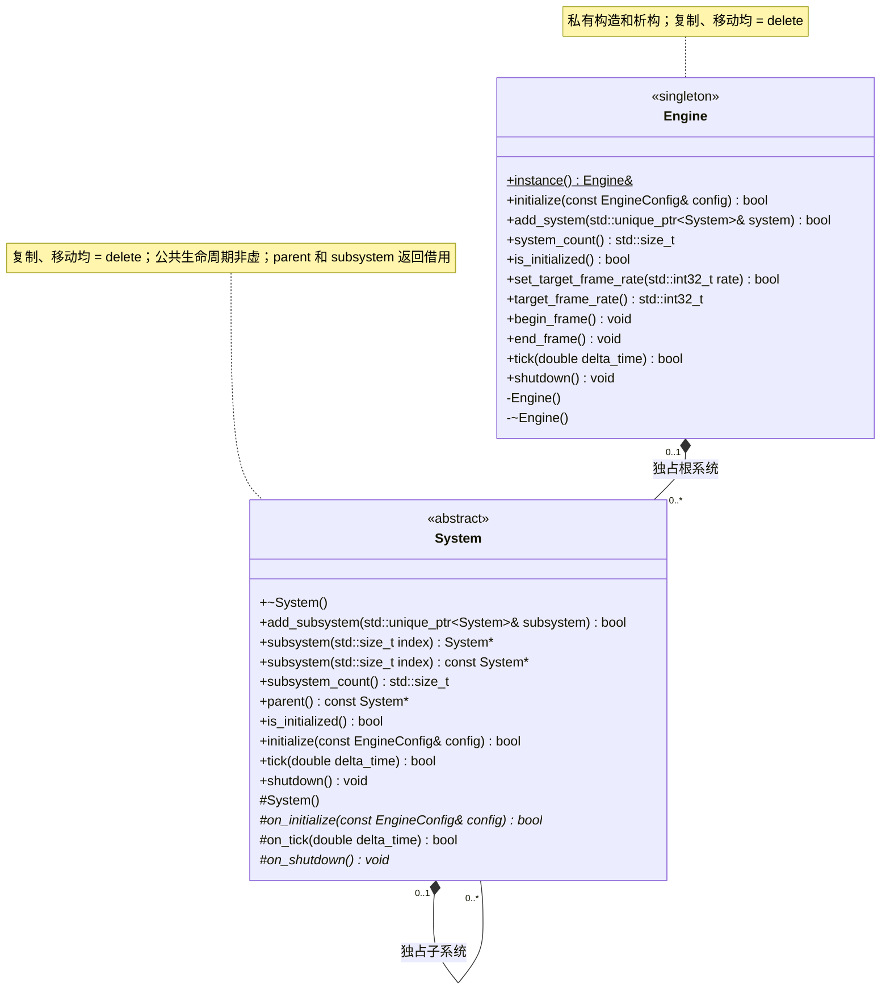

# 引擎与系统

[类图索引](../../class-diagrams/index.md) · [完整引用关系](../../class-diagrams/references.md)

本总图只定义 `Engine` 和 `System`；具体系统各有独立类图。

## C++ 限定符

图中按 Mermaid UML 语法写“方法(参数) 返回类型”，不把 `noexcept` 或 `override` 当作返回类型。

- `Engine` 为 `final`；`instance()` 为 `static` 且 `noexcept`。私有构造、析构、`system_count()`、`is_initialized()` 和 `shutdown()` 为 `noexcept`。`system_count()` 和 `is_initialized()` 为 `const`；单例访问、挂接、状态查询、初始化和更新返回值均标注 `[[nodiscard]]`。
- `System` 构造、公共虚析构、关闭和只读访问器均为 `noexcept`；`subsystem()` 同时提供普通重载与 `const` 重载，计数、父节点和初始化状态查询均为 `const`。
- `System` 的初始化、更新、挂接及访问器返回值标注 `[[nodiscard]]`；受保护 `on_initialize()` 和 `on_shutdown()` 为纯虚函数，`on_tick()` 为有默认实现的虚函数；`on_shutdown()` 为 `noexcept`。

## 接口约定

- Engine 负责根系统的所有权、初始化、逐帧更新、帧调度和反序关闭，编译在纯标准库核心目标中，不依赖窗口、渲染、脚本、场景或编辑器。
- Engine 值持有轻量 [FrameLimiter](frame-limiter.md)，不额外注册限帧系统。`set_target_frame_rate()`、`target_frame_rate()` 与 `begin_frame()` 为 `noexcept`，前两者为 `[[nodiscard]]`，查询方法为 `const`。`end_frame()` 执行标准库休眠。
- `target_frame_rate` 默认 `-1` 表示不限帧，正整数表示每秒最大帧数。`0` 和小于 `-1` 的值被拒绝且不修改原设置；初始化配置同样校验。宿主在完整帧开始、结束调用 `begin_frame()` / `end_frame()`，包含事件、编辑器处理、系统更新和渲染提交；等待计入下一帧的时间差。框架不判断调用方模式，编辑器和项目业务选择当前上限。
- `add_system()` 只能在引擎未初始化且未执行生命周期回调时调用。对象必须是未初始化的独立根系统；成功后转移所有权并清空输入，失败保持输入和系统列表不变。
- `initialize()` 要求至少一个根系统，按添加顺序初始化。重复初始化被拒绝；失败反序关闭并销毁已装配系统，允许重新装配。
- `tick()` 要求已初始化，时间为有限且非负的秒数。非法时间只拒绝本次调用；系统更新失败则保持失败状态，必须关闭后重新装配。系统按注册顺序更新，失败停止本帧后续调度。
- `shutdown()` 反序关闭并销毁根系统，清除正在计时的帧并恢复不限帧，重复调用安全。生命周期回调中不允许重入初始化、更新、关闭或装配操作。
- `system_count()` 与 `is_initialized()` 只查询框架自身状态，不汇总任何具体模块数据。
- 窗口配置校验属于 WindowSystem，运行宿主 [RuntimeHost](runtime-host.md) 负责具体系统装配、窗口事件、暂停和帧提交；[GameplaySession](gameplay-session.md) 负责玩法启停与场景、GPU、项目定义的释放。
- Engine 不要求项目，不拥有 ProjectSystem；编辑器项目路径与平台目录由 EditorEnvironment 和 App 管理。
- LogSystem 是宿主独立管理的进程单例；具体系统不可同时由 Engine 和其他父系统拥有。所有入口使用同一运行线程，公共接口不承诺跨线程安全。

## 子系统约定

- 公开 `initialize / tick / shutdown` 仅由宿主调用根系统。附属子系统的公开初始化和更新返回 `false`，公开关闭不执行；父系统通过私有递归方法统一调度子树，防止外部绕过父系统生命周期。
- `add_subsystem()` 只允许在当前系统及其祖先、待加入子树均未初始化且没有正在执行生命周期方法时调用；运行中不支持添加、移除或重新挂接。
- 调用方用 `std::unique_ptr<System>` 持有待加入对象，传入引用。成功后所有权转入父系统，调用方指针置空；失败时调用方所有权和现有系统树保持不变。
- 空指针、自身、已有父系统的对象以及会形成环的关系均返回 `false`。系统树只有一个拥有者；`parent()` 是只读借用，根系统返回 `nullptr`。
- `subsystem(index)` 返回借用指针，越界返回 `nullptr`；索引按添加顺序确定。系统关闭后保留父子结构，子对象在所属树销毁时释放。
- 初始化先执行当前系统 `on_initialize()`，再按添加顺序初始化子系统。任一步失败，反序关闭已初始化子系统，再清理当前系统的部分资源。
- 更新先执行当前系统 `on_tick()`，再按添加顺序更新子系统。失败立即向上返回，停止本帧后续调度；不会撤销已经发生的帧更新。未初始化或时间无效时返回 `false`。
- 具体更新顺序由宿主登记子系统时确定。运行宿主将脚本和玩家意图放在物理之前，物理之后依次为动画、独立相机和音频；装配期的 `RuntimeStage` 不进入 Engine/System，不形成新的逐帧调度机制。详见[运行宿主时序](runtime-host.md)。
- 关闭时先逆序关闭子系统，再执行当前系统 `on_shutdown()`。清理支持部分初始化，已关闭的系统不重复执行钩子；重复调用 `shutdown()` 安全。

配置和返回状态定义见[配置与状态](types.md)，跨图类型依赖见[完整引用关系](../../class-diagrams/references.md)。
