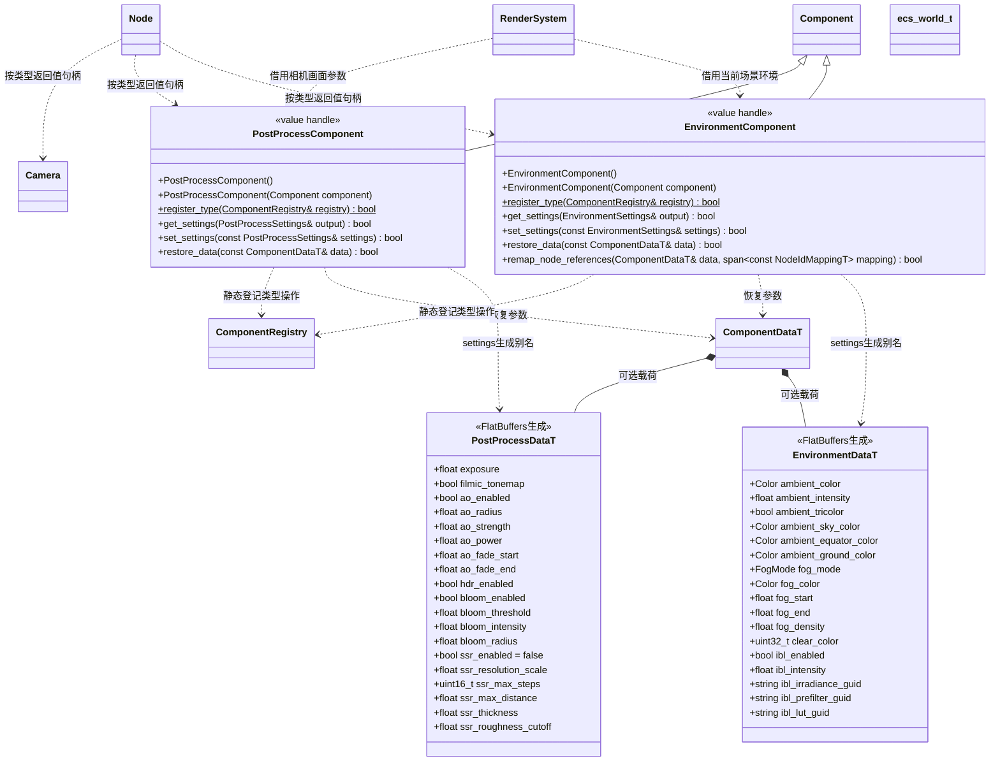

# 场景环境与后处理组件

[类图索引](../../class-diagrams/index.md) · [基础组件](component.md)

环境属于普通节点的 `EnvironmentComponent`，相机画面参数属于相机节点的 `PostProcessComponent`。两者直接使用 FlatBuffers 生成载荷，不增加环境系统或 Scene 专用字段。

- `EnvironmentSettings` 与 `PostProcessSettings` 分别是生成的 `EnvironmentDataT` 和 `PostProcessDataT` 的别名。组件不复制另一份持久数据。
- 颜色通道范围为 0..1，环境强度为 0..1000；雾模式为 none、linear、exponential、exponential_squared，距离满足 0 <= start < end，密度非负。曝光范围为 (0,100]，默认 1；色调映射默认关闭。
- 每个场景最多一个启用环境；后处理与 Camera 挂同一节点。场景导入拒绝重复环境和孤立后处理。渲染每帧读取组件，缺省使用生成数据的默认值，切场景不继承上一个场景的状态。
- 环境承载环境光、三色环境光、雾、清屏色、IBL 纹理引用及大气配置。大气字段和显式太阳引用完整维护在[大气与材质类图](atmosphere-hex-material.md)；关闭大气时仍可用场景 MeshRenderer 表达天空几何。IBL 默认关闭、强度默认 1，允许范围 0..1000。三个结果分别为 RGBA16F 漫反射立方图、RGBA16F 预过滤反射立方图、RG16F BRDF 查找表，保持独立资源并进入场景依赖树。
- IBL 尚未烘焙时三个 GUID 可以全空，启用开关不会使场景加载失败；只要存在任一引用就必须三项齐全且资源格式正确。编辑器烘焙插件负责生成资源、meta 和更新场景引用，组件不包含烘焙工具或目录策略。资源代际切换后渲染器加载新结果，场景停止释放 GPU 与资源借用。
- 阴影设置由 `LightDataT` 保存。方向光、点光和聚光均支持投影；方向光仍最多一个，局部光共享 atlas 并遵守预算。分辨率为 128..8192 的 2 次幂，偏移为 0..0.1；级联仅用于方向光。详细分配和失败规则见[分簇光照与反射](forward-lighting-reflections.md)。
- `set_settings` 先验证全部参数再整体提交，失败保持原值；`restore_data` 成功后才恢复 enabled。设置查询返回独立值，方法均遵循无异常和返回状态约定。

## 屏幕空间环境遮蔽

AO 参数归相机节点的 PostProcessDataT：ao_enabled 默认 false；ao_radius 默认 1，范围 (0,100]；ao_strength 默认 1，范围 [0,2]；ao_power 默认 1.5，范围 [0.1,8]；ao_fade_start/ao_fade_end 默认 80/150，满足 0 <= start < end <= 100000。与曝光同样由活动场景相机提供配置，隐藏预览相机只提供本帧投影。场景保存、热重载、MCP 撤销重做和脚本绑定操作相同的生成数据。AO 依赖本帧视图深度，实时计算，不保存为美术资源。

## HDR 与泛光参数

HDR 与 Bloom 同属 PostProcessDataT：`hdr_enabled` 和 `bloom_enabled` 默认 false，保持旧场景的默认路径；`bloom_threshold` 默认 1、范围 `[0,100]`，`bloom_intensity` 默认 0.15、范围 `[0,10]`，`bloom_radius` 默认 1、范围 `[0.25,4]`，所有数值必须有限。Bloom 开启要求 HDR 已开启，关闭 HDR 要求 Bloom 已关闭。组件只验证显式请求，不自动修改另一开关；跨字段不一致时整份状态保持不变。调用者可一次提交两项关闭或开启，也可按先 HDR 后 Bloom 开启、先 Bloom 后 HDR 关闭的顺序提交。曝光与 AO 方法保留这组参数。

本页组件均为可复制值句柄，生成设置唯一存于 `ComponentStorage<Data>` 的 ECS 列；`get_settings(output)` 返回独立值并明确报告失败，失败输出安全默认值；不保留吞掉失败的 settings() 包装。Runtime 为 ECS 中的领域运行列，资源引用、请求和缓存归该列或所属 System；句柄不拥有这些数据。Runtime 定义与可变访问仅供所属模块内部实现使用，公开组件不提供 `runtime()`；原生系统的 ECS 列借用仅在当前结构稳定阶段有效，不能跨结构修改留存。类型注册、失效身份与查询规则见 [ECS 场景](ecs-scene.md)。
