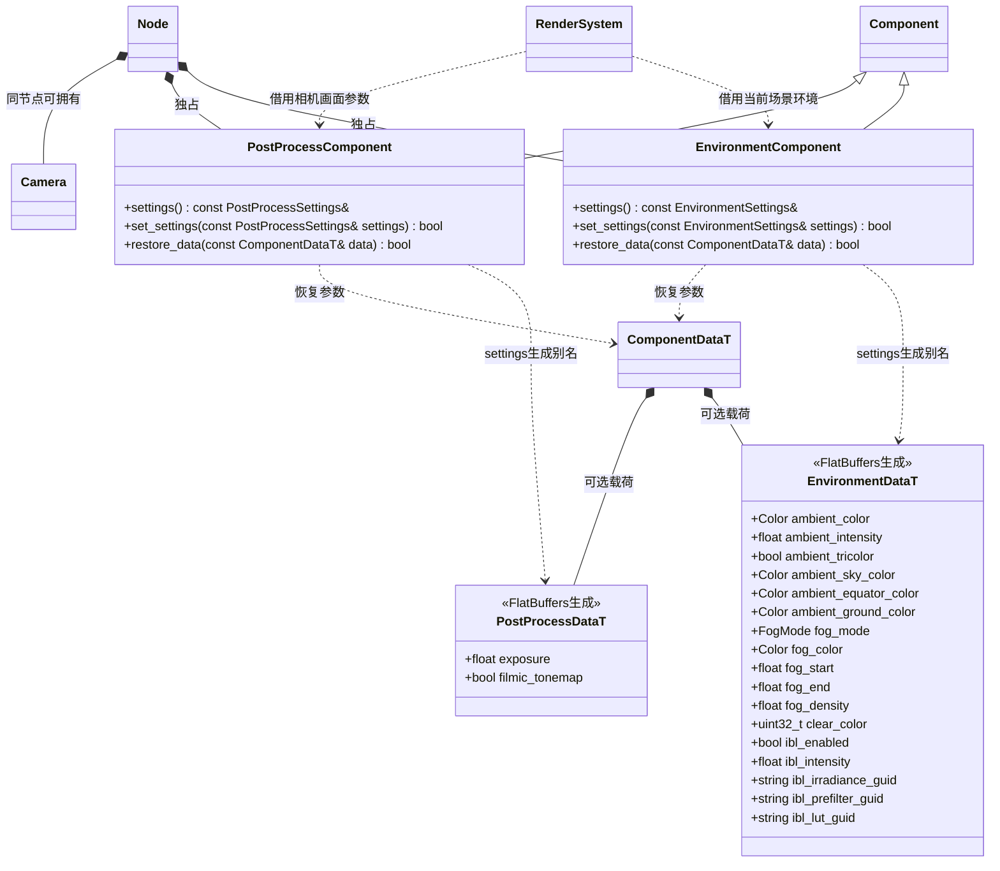

# 场景环境与后处理组件

[类图索引](../../class-diagrams/index.md) · [基础组件](component.md)

环境属于普通节点的 `EnvironmentComponent`，相机画面参数属于相机节点的 `PostProcessComponent`。两者直接使用 FlatBuffers 生成载荷，不增加环境系统或 Scene 专用字段。

- `EnvironmentSettings` 与 `PostProcessSettings` 分别是生成的 `EnvironmentDataT` 和 `PostProcessDataT` 的别名。组件不复制另一份持久数据。
- 颜色通道范围为 0..1，环境强度为 0..1000；雾模式为 none、linear、exponential、exponential_squared，距离满足 0 <= start < end，密度非负。曝光范围为 (0,100]，默认 1；色调映射默认关闭。
- 每个场景最多一个启用环境；后处理与 Camera 挂同一节点。场景导入拒绝重复环境和孤立后处理。渲染每帧读取组件，缺省使用生成数据的默认值，切场景不继承上一个场景的状态。
- 环境承载环境光、三色环境光、雾、清屏色和 IBL 纹理引用；天空几何仍由场景 MeshRenderer 表达。IBL 默认关闭、强度默认 1，允许范围 0..1000。三个结果分别为 RGBA16F 漫反射立方图、RGBA16F 预过滤反射立方图、RG16F BRDF 查找表，保持独立资源并进入场景依赖树。
- IBL 尚未烘焙时三个 GUID 可以全空，启用开关不会使场景加载失败；只要存在任一引用就必须三项齐全且资源格式正确。编辑器烘焙插件负责生成资源、meta 和更新场景引用，组件不包含烘焙工具或目录策略。资源代际切换后渲染器加载新结果，场景停止释放 GPU 与资源借用。
- 阴影设置由 `LightDataT` 的 cast_shadows、shadow_resolution、shadow_bias 保存；当前仅方向光支持投影，每个场景最多一个启用且投影的方向光，分辨率为 128..8192 的 2 次幂，偏移为 0..0.1。非方向光开启投影明确返回失败。
- `set_settings` 先验证全部参数再整体提交，失败保持原值；`restore_data` 成功后才恢复 enabled。设置查询为 const 借用，方法均遵循无异常和返回状态约定。
