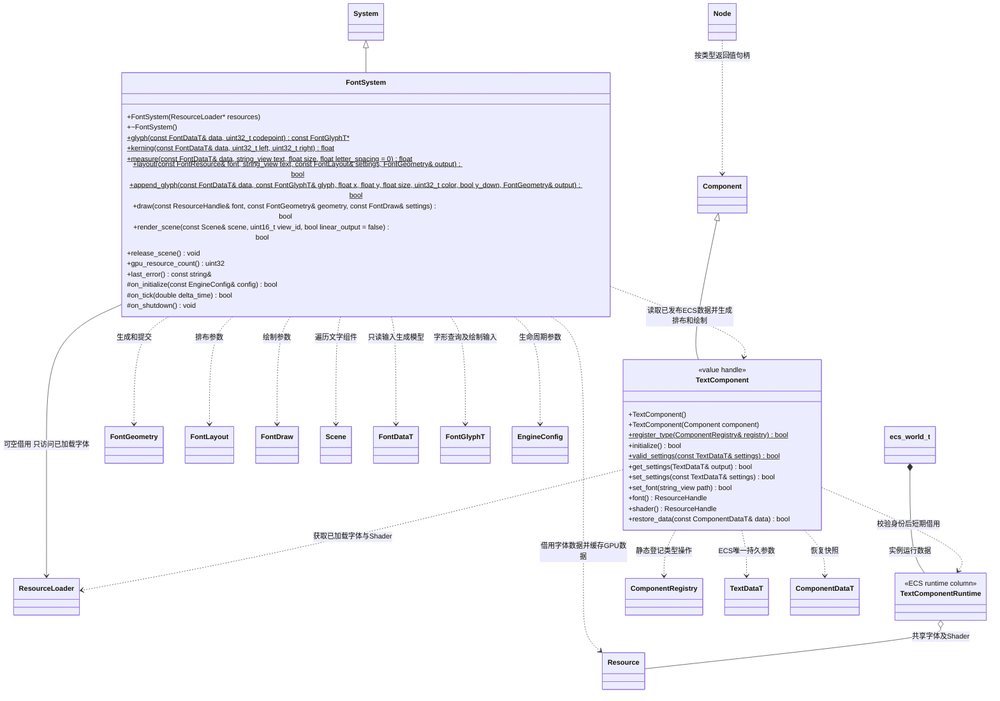
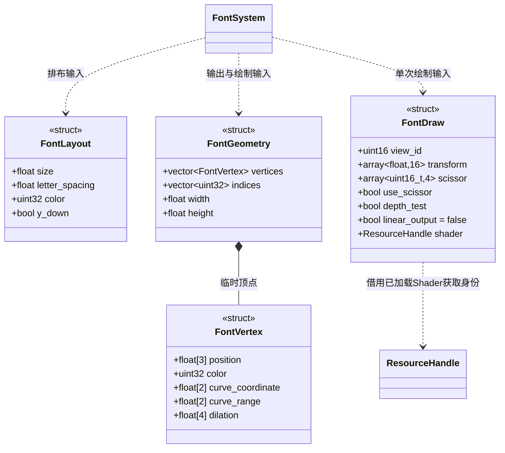

# 字体系统

[类图索引](../../class-diagrams/index.md) · [完整引用关系](../../class-diagrams/references.md#字体与场景-ui)

字体运行时属于核心。字体导入由编辑器插件完成；此系统只消费已转换的独立字体资源，不读取 TTF，不依赖 FreeType 或编辑器。

- 字体与 Shader 由组件或 UI 文档独立 retain。GPU 缓存保存借用身份及 GPU 副本，每次 tick 通过加载器检查身份并回收失效条目；缓存不持有 CPU 数据裸指针。字号不产生新字体资源，完整停止使用 `release_scene()`。
- `FontGeometry` 是临时绘制数据，顶点保存位置、预乘颜色、字形坐标与曲线范围；不成为新的持久资源模型。
- `FontVertex.dilation` 保存局部向外方向与字体 XY 缩放的倒数，公开 Slug 顶点算法据此在透视与正交视图中扩张像素边界，保持曲线覆盖率抗锯齿。
- `FontDraw` 保存当前帧的视图、模型矩阵与裁剪信息，借用调用方已加载的 Shader 获取身份；绘制不重新查询目录，目录更新不会把旧字体和新 Shader 混用。UI 和 3D 共用同一绘制能力。RmlUi 在正常渲染顺序中调用，排版阶段不提交 GPU 命令。
- 默认 `builtin://shaders/font` Shader 由引擎提供；项目 Shader 通过标准资源目录加载并遵守相同顶点、曲线纹理及预乘颜色契约。
- `TextComponent` 是普通节点组件；宿主协调场景停止和 GPU 释放，不向 Engine 增加字体专用接口。

HDR 绘制契约：`FontDraw.linear_output` 默认 false，表示既有显示色预乘输出。`render_scene` 接受同名参数，由场景渲染调用方按目标明确传入；UI 保持 false。为 true 时，字体 Shader 使用 `u_font_texture.z=1` 将预乘显示色先解预乘、按精确 sRGB 曲线转换线性再预乘，字形覆盖率与 alpha 不进行颜色转换。字体仍进入场景深度目标，参与最终曝光和色调映射；不按 view 编号猜测调用方。

本页组件均为可复制值句柄，生成设置唯一存于 `ComponentStorage<Data>` 的 ECS 列；`get_settings(output)` 返回独立值并明确报告失败，失败输出安全默认值；不保留吞掉失败的 settings() 包装。Runtime 为 ECS 中的领域运行列，资源引用、请求和缓存归该列或所属 System；句柄不拥有这些数据。Runtime 定义与可变访问仅供所属模块内部实现使用，公开组件不提供 `runtime()`；原生系统的 ECS 列借用仅在当前结构稳定阶段有效，不能跨结构修改留存。类型注册、失效身份与查询规则见 [ECS 场景](ecs-scene.md)。
