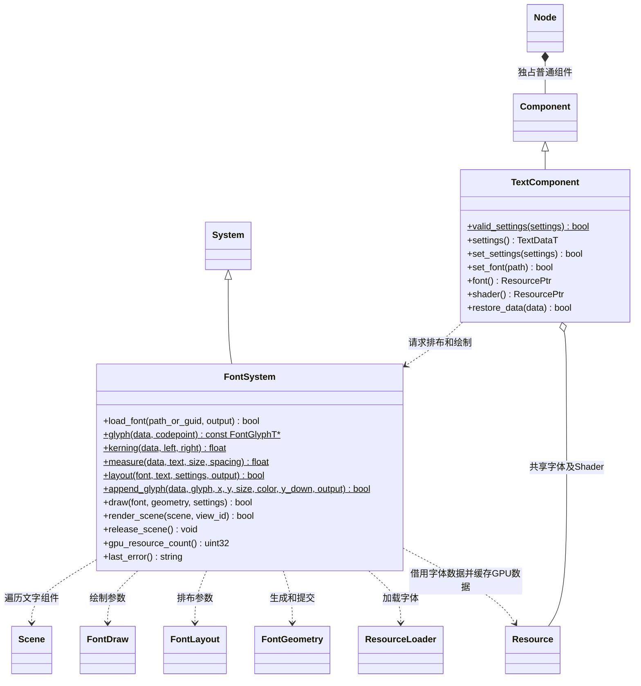
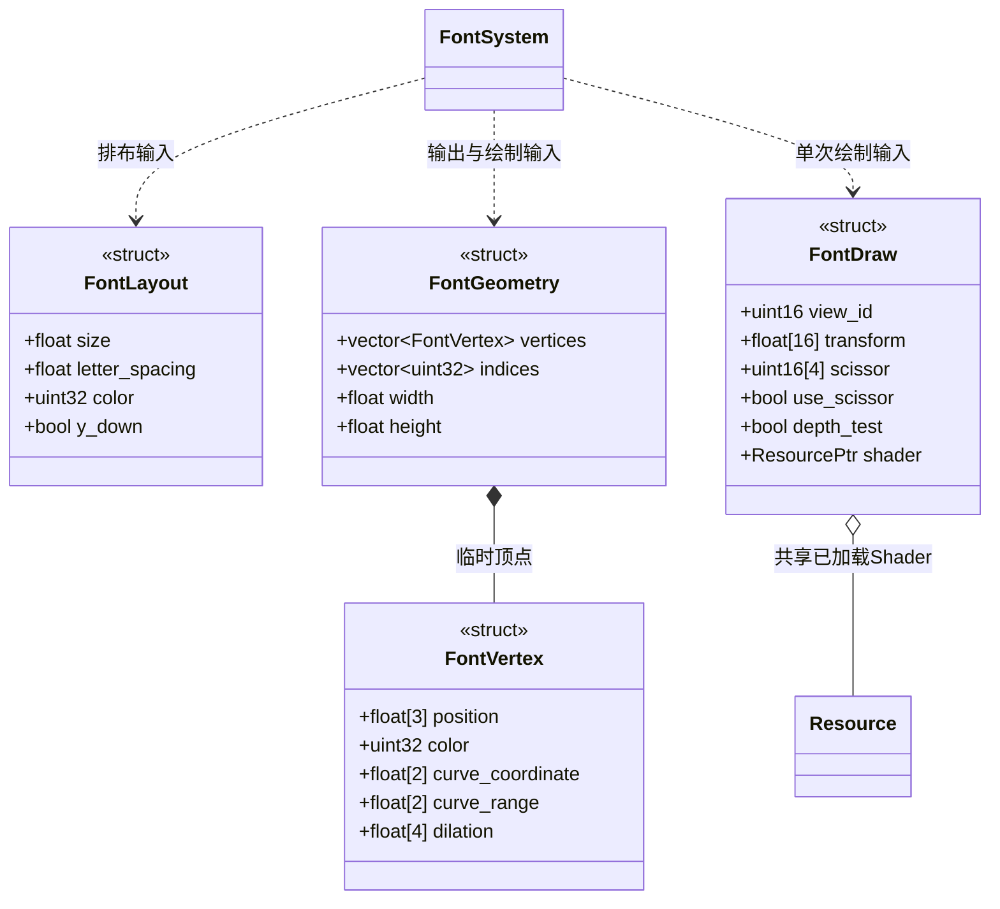

# 字体系统

[类图索引](../../class-diagrams/index.md) · [完整引用关系](../../class-diagrams/references.md#字体与场景-ui)

字体运行时属于核心。字体导入由编辑器插件完成；此系统只消费已转换的独立字体资源，不读取 TTF，不依赖 FreeType 或编辑器。

- `ResourcePtr` 表达共享 CPU 资源；字体 GPU 曲线纹理按资源身份和代际共享，字号不产生新字体资源。
- `FontGeometry` 是临时绘制数据，顶点保存位置、预乘颜色、字形坐标与曲线范围；不成为新的持久资源模型。
- `FontVertex.dilation` 保存局部向外方向与字体 XY 缩放的倒数，公开 Slug 顶点算法据此在透视与正交视图中扩张像素边界，保持曲线覆盖率抗锯齿。
- `FontDraw` 保存当前帧的视图、模型矩阵与裁剪信息，持有调用方已加载的 Shader 引用；绘制不重新查询目录，目录更新不会把旧字体和新 Shader 混用。UI 和 3D 共用同一绘制能力。RmlUi 在正常渲染顺序中调用，排版阶段不提交 GPU 命令。
- 默认 `builtin/shaders/font` Shader 由引擎提供；项目 Shader 通过标准资源目录加载并遵守相同顶点、曲线纹理及预乘颜色契约。
- `TextComponent` 是普通节点组件；宿主协调场景停止和 GPU 释放，不向 Engine 增加字体专用接口。
