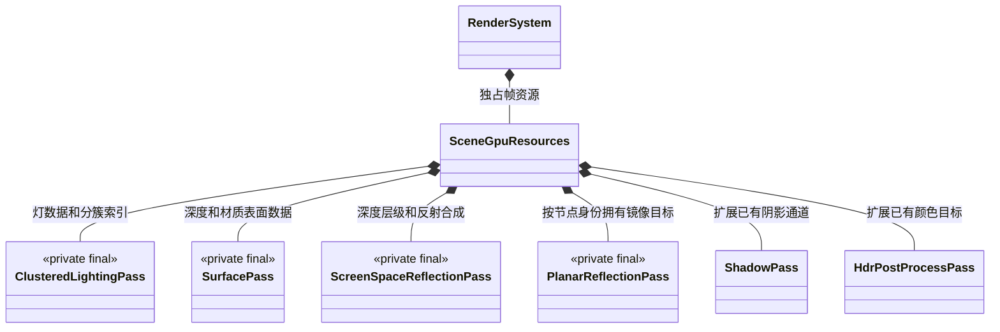
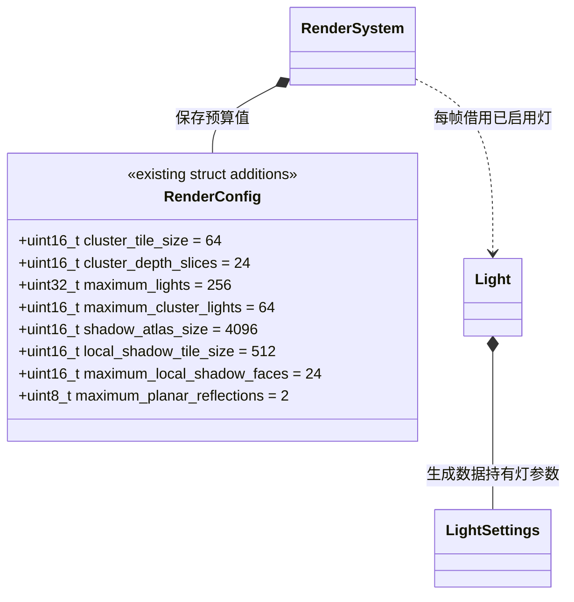
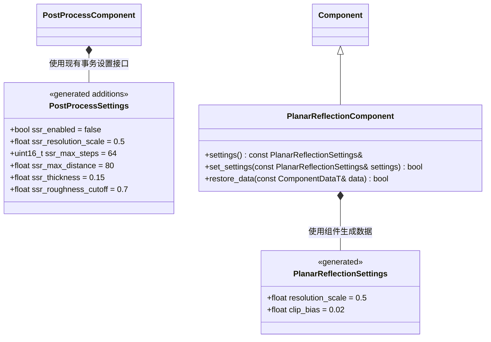
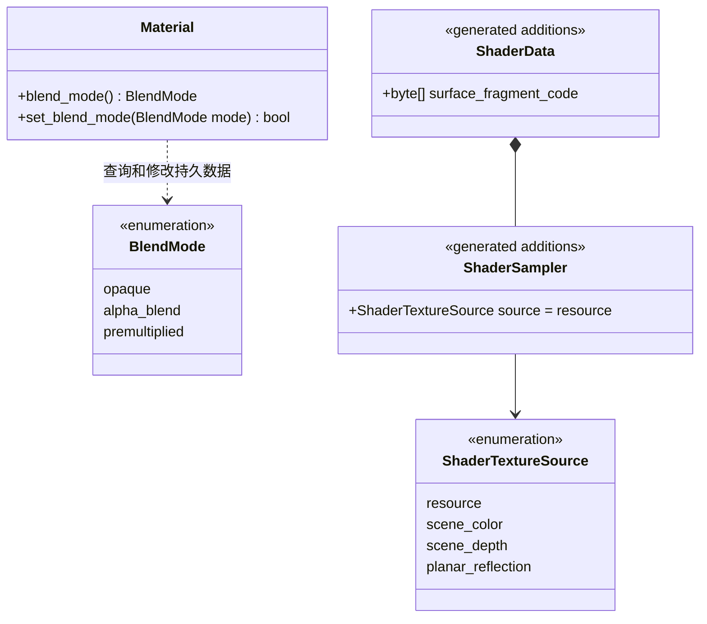
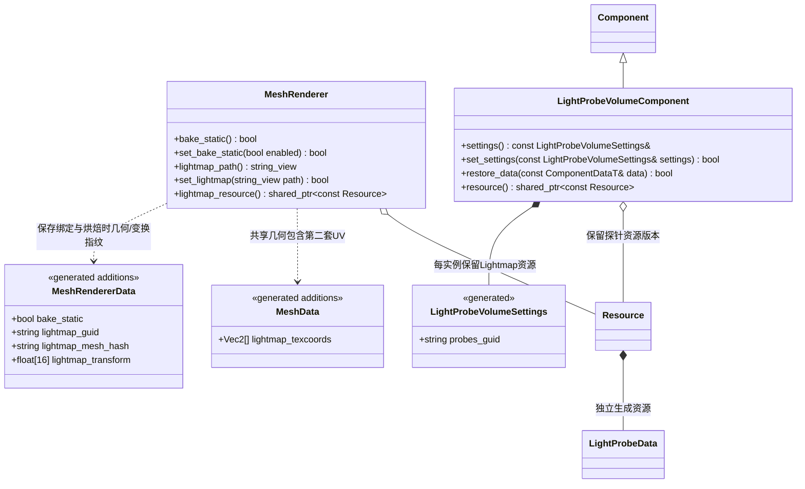
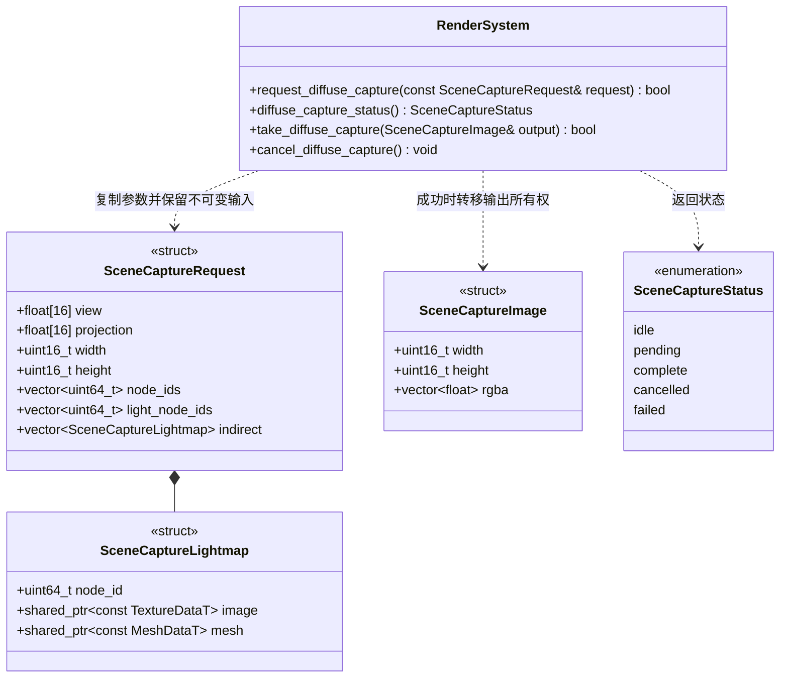

# 分簇前向、反射与间接光

[类图索引](../../class-diagrams/index.md) · [现有渲染系统](render-system.md) · [上游实现与适配](../rendering-upstream-plan.md) · [编辑器光照烘焙](../../plugins/editor/class-diagrams/scene-lighting-bake.md)

**状态：接口已评审通过，实现与验证中。** 本图集中列出本轮新增及改变的契约；现有方法仍以所属类图为准。实现继续使用当前工作分支。目标包括分簇前向光照、SSR、平面反射、透明与折射、点光/聚光阴影、静态 Lightmap 和动态对象的光照探针。

## 运行时归属

沿用 `RenderSystem` 和已有 `passes/`，不增加渲染管理器或另一套图形后端。以上私有通道只拥有 GPU 资源，不拥有 Scene、Node 或 Component；输入只在帧提交期间借用。初始化失败清理已创建部分；窗口尺寸改变时重新准备受影响目标，关闭效果、换场景和关闭设备时释放。GPU 拥有者不可复制，析构兜底。

内部组织仍采用各通道的 `prepare(...) -> bool`、`release() noexcept`、`resource_count() const noexcept -> uint32_t` 契约。具体提交保持在渲染模块内部，不向脚本暴露 GPU handle：

- 分簇通道接收当前视图/投影、近远裁面和只读灯数据，上传灯/阴影记录并 dispatch 簇索引；不持有灯组件指针。
- 表面通道绘制材质自己的可选表面程序，输出可采样深度、法线/粗糙度及 F0/有效标记；AO 复用深度，SSR 不能用几何法线冒充法线贴图的结果。
- SSR 通道借用当帧不透明线性颜色及表面输入，输出独立反射结果和合成颜色；不读取自身输出。
- 支持 SSR 的不透明主程序同时以第二个 MRT 保存实际已加入颜色的 IBL 镜面贡献（RGB）及其材质遮蔽、AO、雾等合成衰减（A）。合成直接扣除这份真实贡献，并以相同权重加入 SSR；不能仅凭 F0 推算旧值，避免与材质逻辑漂移。
- 平面通道借用当前反射组件及镜头，生成镜像视图，提交同一套场景绘制；按组件身份拥有纹理，不通过共享 Material 保存场景节点引用。

## 预算与灯光

预算接入已有汇总运行设置：编辑器读取项目 TOML，宿主传入 `RenderConfig`，运行包不引入 TOML。参数须校验乘积、设备资源上限及视图编号上限；不能依赖分配失败才判定非法预算。

- 分簇采用全视锥 XY 网格和深度分层。透明物体按自身深度取簇，不按不透明深度范围剔除灯。方向灯独立于局部灯剔除。
- 单簇超预算标记为溢出，该簇遍历完整灯列表，保证不漏光；零灯帧清空计数。超出全局 `maximum_lights` 返回失败并给出原因，不静默截断。
- `Light::set_settings()` 与 TS `Light.SetShadows(enabled, resolution, bias)` 保持签名，扩展为三种灯都可投影。CSM 参数仅对方向灯有效，仍最多一个方向光投影。
- CSM、聚光单面和点光六面写同一 atlas。点光六面分别使用 90 度投影，统一深度编码；PCF 处理 tile 边界与立方体面接缝。复用现有蒙皮、alpha 裁切和投射物可见性规则。
- CSM 的 `shadow_resolution` 仍表示其完整区域边长。局部灯每面有效边长为 `min(shadow_resolution, local_shadow_tile_size)`。atlas 先保留 CSM，再分配局部区域；空间不足或超面数时按镜头距离和稳定节点 ID 选择，输出明确的预算不足诊断。不能把没有得到 atlas 的灯标成有阴影。
- 平面反射超数量预算时按可见距离和稳定身份选择，未捕获的面退回 IBL，不能复用其他反射面的纹理。

## SSR 与平面组件

SSR 参数扩展现有 `PostProcessData` 和渲染设置快照；`set_settings()` 整体校验后提交。分辨率比例 `[0.25,1]`，步数 `[8,256]`，距离 `(0,100000]`，厚度 `(0,10]`，粗糙度截止值 `[0,1]`。本轮 SSR 使用确定性层级深度遍历，尚不包含随机射线、运动矢量和时序降噪。法线、粗糙度和 F0 来自真实材质；有效命中替换 IBL 镜面项，未命中保留 IBL，避免重复叠加高光。

平面组件挂在拥有 MeshRenderer 的普通节点上，局部 XZ 平面和 +Y 法线经 Transform 定义反射平面；无需在节点里增加专用字段。开关使用已有 Component.enabled；比例范围同 SSR，裁剪偏移 `[0,1]`。同一节点的子网格共用该平面。首版按平面捕获不透明/裁切建筑及蒙皮角色，排除反射面和依赖场景颜色的透明对象，关闭递归反射；反射镜头独立计算可见性、灯簇和方向光阴影范围，不能拿主镜头可见列表代替。

## 材质和 Shader

`MaterialData.blend_mode` 默认 opaque，沿用现有 Material 的资源与覆盖值生命周期。现有 alpha cutoff 仍负责裁切；本次不将水参数改成材质固定字段。水波法线、IOR、吸收距离/颜色、流速、粗糙度继续通过具名参数设置。

水面根据采样深度估算水层法线厚度，以 `refract` 和 `waterIor` 求折射方向及穿透距离，再投影出口位置采样冻结的不透明颜色；屏外或前景命中退回原始背景采样。`refractionStrength` 默认 1、范围 0..1，控制原始与折射 UV 的混合。吸收根据折射路程计算 Beer–Lambert 衰减，`waterIor` 同时决定 Fresnel 基础反射率。平面倒影使用镜像相机的实际场景，未分配捕获时使用已配置 IBL；不递归捕获其他透明水面。

- `.shader` 可指定 `surface_fragment` 源文件，导入后编译为 `surface_fragment_code`，与原 vertex 程序共用顶点布局、蒙皮/变形、UV 和 alpha 裁切；声明表面程序也要求主 fragment 程序输出上述镜面 MRT。内置 PBR 与其表面程序共用材质采样函数。没有表面程序的自定义 Shader 正常绘制，表面通道写入其遮挡深度和无效标记，使其不可成为 SSR 接收面，不能漏深度而露出后方材质数据。
- ShaderSampler 默认 resource，沿用资源路径与 GUID 依赖。动态来源不创建资源 GUID，`default_texture` 为空；导入器验证来源、固定槽及重复绑定。运行时只在当前 draw 借用帧纹理；不可用时绑定明确定义的回退纹理并提供有效性参数。
- 一次升级全局绑定契约为 16 槽；标准材质纹理使用 0–4，其他槽见下表。同步内置和项目 Shader；冲突在导入时给出错误，不静默覆盖、不提高 bgfx 槽上限、不保留第二套旧光照管线。

| 槽 | 帧资源 |
| --- | --- |
| 0–4 | 材质资源，内置 PBR 为颜色、法线、ORM、Specular、Emission |
| 5 | 灯与阴影记录，只读 buffer |
| 6 | 实例 Lightmap |
| 7 | 分簇计数和索引 buffer |
| 8 | 当前面的平面反射 |
| 9–10 | 冻结的不透明场景颜色、可采样深度 |
| 11 | AO |
| 12–14 | IBL irradiance、prefilter、BRDF LUT |
| 15 | 统一阴影 atlas |

不透明颜色 alpha 保存色调映射权重：内置 PBR/Blinn 为 1，unlit 与清屏背景为 0；SSR 保留此权重。透明输出 alpha 仍为覆盖度，RGB 使用所选混合方式；受光照表面的 alpha 用 `ONE / INV_SRC_ALPHA`，unlit 与 3D 字体用 `ZERO / INV_SRC_ALPHA`，只衰减背景权重。HDR 开启时全场景统一曝光/映射；关闭时按权重保留旧 unlit 线性色彩，再统一执行 gamma 转换。项目自定义不透明 Shader 可显式输出 0 保留 unlit 外观，默认输出 1 表示参与映射；自定义透明表面通过既有 `u_material.z` 的标量参数声明光照模式（1 为 unlit）。

透明按子网格视空间深度稳定排序，使用顺序提交，开启深度测试、关闭深度写入。alpha_blend 使用直通 alpha，premultiplied 的输出必须已预乘；内置表面和水 Shader 根据 `u_surface.y` 的混合模式（0 不透明、1 直通、2 预乘）完成输出转换。透明面不进入不透明预通道；默认不投射实体阴影。首版不支持相交透明面的逐像素排序或多层折射。

固定流程：蒙皮 → 每个镜像各自的阴影/分簇/捕获 → 主镜头阴影与分簇 → 表面预通道/AO → 不透明线性颜色及镜面贡献 MRT → SSR → 冻结颜色快照 → 排序透明/水 → 现有特效扩展 → HDR/Bloom/最终输出 → UI。需要屏幕采样时准备线性中间目标，即使没有开启 Bloom；是否使用中间目标与是否开 Bloom 分离。

场景颜色快照与透明颜色输出不是同一纹理；可采样场景深度与透明 framebuffer 的深度附件也分离，禁止读写反馈。每个镜像和主镜头的阴影、分簇、颜色提交为完整有序组；atlas 只在前组绘制后才由下一组覆盖。每组灯/阴影记录及簇 buffer 保留独立内容，不能同帧反复 CPU 更新同一 handle 导致所有视图读到最后一份。所有 view ID 统一在 `render_constants.hpp` 分区；主渲染在 144 前完成，144–191 保留给烘焙的阴影和分簇，UI 200、编辑器 IBL 240/241、漫反射捕获 242/243。入参预算须确保所有组都放得下，不能复用同一 view ID 提交不同相机状态。

## Lightmap 与探针消费

`bake_static=false` 默认不参与静态烘焙。`set_lightmap("")` 清除绑定；非空路径必须解析为有效线性纹理且网格具备合格 UV2，失败保持原状态。绑定保存在 MeshRendererData 而不是共享材质；同时保存编译网格内容哈希和烘焙时 16 元素世界矩阵。恢复时保留原指纹，不能按当前变换重新绑定。网格或实例变换变化后旧绑定失效并退回探针/IBL，不能将另一份几何的光照套上去。具体版本指纹和发布数据见烘焙图。

探针资源保存体积局部边界、规则网格、有效性及 RGB SH9；组件 Transform 放置体积，按网格包围盒中心插值，每次 draw 通过 uniform 传入。无有效探针时退回环境光；重叠体积按较小覆盖体积及节点 ID 稳定选择，仅在选定体积内插值。房间可配置独立体积；首版不提供可见性驱动的隔墙漏光抑制。体积移动或资源与烘焙定位不匹配视为失效。大型跨房间动态对象的单点采样是首版限制。

烘焙与探针贡献替代该对象的漫反射环境项，保留实时直射和 IBL 镜面项。可破坏结构、动态地形、角色与碎片默认不作为静态遮挡/反弹来源，只接收实时光及探针；静态 GI 不会随破坏动态重算。

## 给烘焙调用方的最小离屏接口

该入口是通用线性漫反射捕获，不判断调用方身份。仅允许一个活动请求，使用已准备场景；节点列表定义参与几何，灯节点列表定义参与光源，空灯列表只包含天空及所选几何的发光，不隐式捕获其他玩法对象或动态灯。矩阵遵守核心相机约定，数据校验失败不创建请求。捕获保留所选光源和环境的不可变快照，只渲染直射漫反射、发光和显式提供的上一轮间接光；关闭镜面、雾、AO、后处理和自动读取旧 Lightmap。

`request` 成功复制描述并持有中间纹理和可选 UV2 网格的只读共享引用；网格覆盖仅供捕获使用，使 xatlas 生成的接缝/UV2 在发布前即可参与反弹，不能修改活动场景。跨帧不保存 Node 指针；场景身份或输入版本变化时取消，在途读回结束后转 cancelled。内部由 `render()` 推进 GPU 提交和读回。`take` 只在 complete 时移动线性 RGBA float 输出并回到 idle；失败清空 output。取消停止新提交，已在途 readback 缓冲等 GPU 完成后才释放并转 cancelled，不能立即销毁内存；场景释放自动取消，设备关闭先排空 GPU 再销毁 CPU 读回缓冲。状态查询为 `const noexcept`，取消为 `noexcept`，所有可能失败返回值为 `[[nodiscard]]`。

## 脚本、资源与验证边界

公开组件加入既有逐类型注册、TOML 编解码、FlatBuffers 生成、TS 绑定和编辑命令；不增加项目专用类型。TS 采用 `PostProcessComponent.SetScreenSpaceReflections(...)`、`Material.SetBlendMode(...)`、`PlanarReflectionComponent.SetSettings(...)`、`MeshRenderer.SetBakeStatic(...) / SetLightmap(...)`、`LightProbeVolumeComponent.SetResource(path)`，统一返回 bool；仍可通过 `Node.AddComponent(Type)` 组合。设置读取保持相同字段含义，声明只随对应实现落地。

验证围绕功能：Debug/Release 受影响构建及 CTest；验证多个局部光源遮挡、透明排序、离屏角色平面倒影、SSR 命中/缺失回退、烘焙颜色反弹、动态对象穿过探针体积、取消与切场景释放。实际画面首先在 macOS/Metal 检查；其他后端离线 Shader 编译不等于真机已通过。不开展无关模块优化或压力测试。
