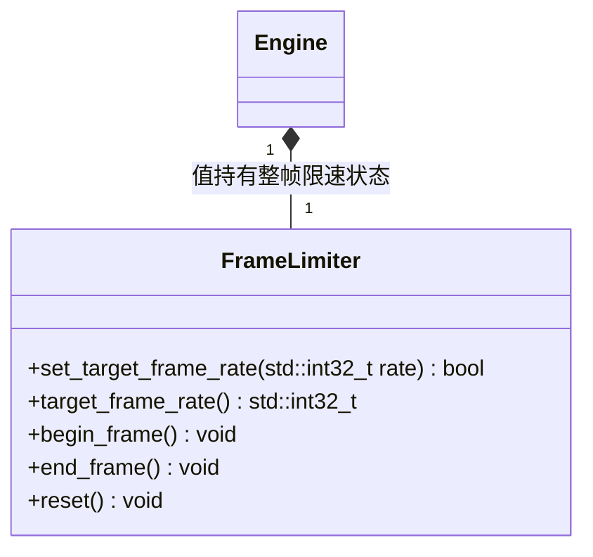

# 帧率限制

[类图索引](../../class-diagrams/index.md) · [完整引用关系](../../class-diagrams/references.md)

- `FrameLimiter` 属于运行时核心，只依赖标准库，不继承 System。Engine 提供对应公共方法，宿主在整帧边界调用，脚本绑定仅调用 Engine 的设置和查询接口。
- `set_target_frame_rate()` 返回状态：`-1` 关闭限制，正整数设置上限，其他值返回 `false` 且保留当前值。设置和查询均为 `[[nodiscard]]`、`noexcept`，查询为 `const`；`begin_frame()` 和 `reset()` 为 `noexcept`。
- `begin_frame()` 使用单调时钟记录当前帧开始时间。`end_frame()` 仅在帧预算有余量时使用 `std::this_thread::sleep_until()` 等待，不忙等；超预算、未开始帧或不限帧时立即返回。每帧重新计算截止时间，不累计欠帧、不追赶。
- 一次 `begin_frame()` 最多对应一次等待。`reset()` 取消未结束帧并恢复 `-1`。系统休眠精度和渲染同步可能使实际帧率低于上限，上限不是固定步长模拟或精确帧率保证。
- 编辑器默认值、玩法开始前暂存与结束后恢复均由编辑器组织；运行包默认不限帧。核心不读取项目配置，不认识编辑器、预览或游戏模式。
- 所有调用由同一个运行线程串行执行，不提供跨线程修改保证。
