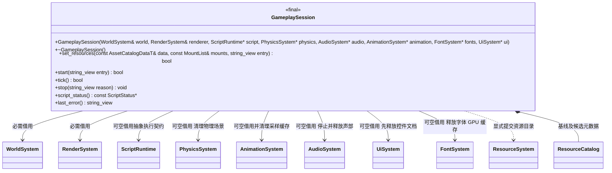
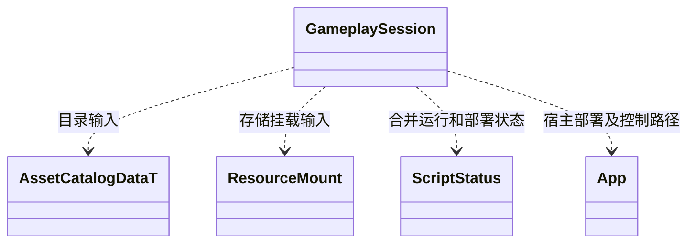

# 玩法运行会话

[类图索引](../../class-diagrams/index.md) · [脚本运行契约](script-runtime.md) · [运行宿主](runtime-host.md)

- 会话是调用方协调对象，不继承 System、不拥有其他系统。RuntimeHost 在系统就绪后创建并独占它，先销毁会话再关闭系统。
- 会话只调用 ScriptRuntime 的预检、启动、停止、重载开关和状态接口，不依赖具体虚拟机或 ScriptSystem 插件。脚本实例为空时仍可关闭场景与渲染，脚本玩法启动返回明确失败。
- `set_resources()` 由编辑器直接提交已导入的完整目录与 content 挂载，入口默认 `scripts/game.js`。运行中拒绝替换；调用方须先停止。未装配脚本时仍可提交资源目录，供原生场景和渲染使用；脚本启动另行报告不可用。无编辑器配置进入资源核心。
- 真机首次 `start()` 读取内置运行清单，随后优先选用宿主明确发布的完整持久候选；正常运行不扫描源项目。Android 核验 APK 清单结构并将其导出为 `assets/builtin.json` 供首次设备同步计算删除项，启动不读取全部实体。
- `start()` 已运行时幂等。先预检候选脚本，再停止旧玩法、销毁场景与 GPU，提交目录、启动已预检脚本并准备 GPU。候选预检失败保留旧玩法；目录应用或新入口失败保持停止并报告。
- `tick()` 由 RuntimeHost 在系统更新后显式调用，处理 `script-control.json` 与 MCP 发布的 `assets/available.json`。这是调用方部署协议，核心不识别这些文件。完整目录元数据与发布文件校验通过后记录候选；热重载关闭只更新可用状态，不切换。
- 持久部署版本位于 `assets/versions/<revision>`，不可原地覆盖。目录中的位置可指向散文件或包成员；清单与存储集合必须一致。发布文件用固定缓冲区流式校验，不解包整个目录。实体只在脚本预检或核心按需加载时读取；包体尺寸不受单实体上限约束。
- 显式 stop 或 Update 失败后不因新候选而自动重启。重新开启重载允许重试最新候选。普通运行集合固定，只有显式发布部署文件才触发候选处理。
- `stop()` 先退出脚本，再停止音频、清理物理、销毁场景和 GPU；资源随共享引用释放，保留资源索引和内置定义以供下次启动。重复关闭安全。
- `script_status()` 返回合并脚本与部署状态的只读借用；无脚本模块返回空。状态原子写入 `script-status.json`，错误仍通过返回值与 last_error 表达。
- 类型不可复制或移动。构造、析构、stop 与查询为 noexcept；查询为 const，可能失败方法与重要查询标注 nodiscard。entry/reason 默认空。
