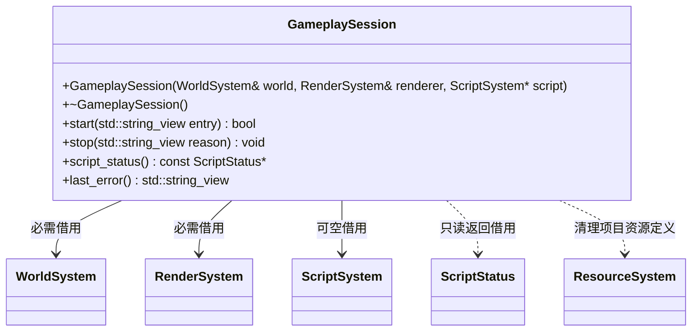

# 玩法运行会话

[类图索引](../../class-diagrams/index.md) · [脚本系统](script-system.md) · [运行宿主](runtime-host.md)

- 会话负责跨模块的项目运行生命周期，不拥有系统、不继承 System。RuntimeHost 在系统就绪后创建并独占会话，在根系统关闭前销毁；被借用系统的生命周期必须覆盖会话。
- `start()` 先由 ScriptSystem 创建 Gameplay 和场景，再准备 GPU 资源。已运行时重复调用成功且保持现有实例；任何一步失败均清理此次运行。入口默认为空，由脚本系统选择发布清单入口。
- `stop()` 默认原因为空，先执行脚本退出回调，再销毁场景、释放场景 GPU 和项目资源定义，保留窗口、设备和内置定义。非空原因记录为会话错误；重复调用安全。析构调用 stop 兜底。
- `script_status()` 在无脚本系统时返回空；返回值与 `last_error()` 均为只读借用，不跨所属对象生命周期使用。热重载的开关、检测和重建仍由 ScriptSystem 实现。
- 类型为 final，禁止复制和移动。构造、析构、stop 与查询为 noexcept，script_status 和 last_error 为 const；可能失败的 start 和查询返回值标注 nodiscard。
