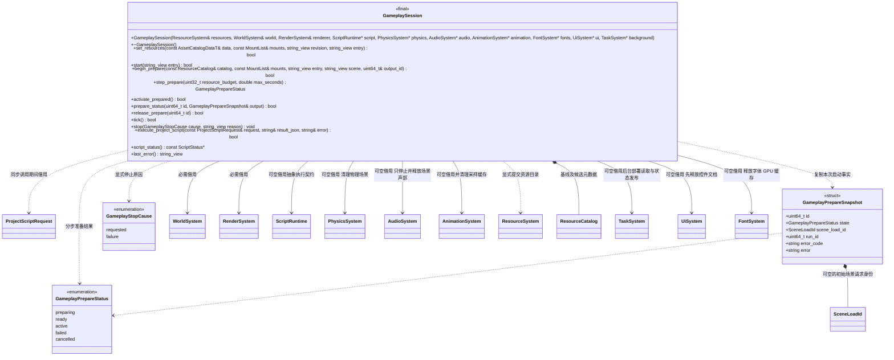
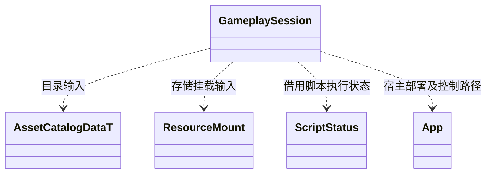

# 玩法运行会话

本页维护启动身份、只读结果查询与释放，以及 stop 的结果保留规则；公开方法与实现保持同一契约。

[场景加载协调](scene-loading.md)维护业务和原生调用共用的加载请求、状态及激活接口；临时脚本执行仅进入显式测试构建，边界见[运行时 MCP](../../plugins/runtime/class-diagrams/mcp-runtime-test.md)。

[类图索引](../../class-diagrams/index.md) · [脚本运行契约](script-runtime.md) · [运行宿主](runtime-host.md)

[分阶段启动](movie-startup.md)先提交真实影片首帧，再准备玩法；ready 包含所请求的 VM、ECS 与 GPU。
场景停止只清理场景声部，Native 影片与共享设备由宿主及调用者管理。

`step_prepare` 复用普通场景请求与[按范围渲染准备](render-readiness.md)，依次完成资源、ECS、领域准备与目标首帧；准备中保留阶段，失败保留原因，完成才允许 `activate_prepared`。同步 `start` 保留显式启动已有玩法的用途，不作为分帧场景加载接口。玩法初始化回调仍不可抢占，业务通过普通 SceneLoadRequest 组织大场景，不能在 OnInitialize 内同步加载整场景后声称启动已分帧。

## 启动请求的身份与结果

沿用会话已有的启动准备操作，只增加结果身份与有界终态记录，不新增启动 System、Manager 或第二套准备算法。普通运行构建提供相同查询，MCP 只做转换。

- `begin_prepare` 成功输出非零 id，拒绝时输出 0 且不覆盖已有结果。id 在进程内单调不复用，查询还须属于本会话；跨进程工具同时核验宿主 session。正在运行或已有在途准备时拒绝新请求，由调用方显式停止后重新发起。
- `step_prepare` 只推进当前受理的准备；`prepare_status` 为 const、nodiscard 的纯查询，失败清空输出，不派发任务或执行 step。`activate_prepared` 成功后将该启动记录转为 active，后续主动停止不改写这个历史成功结果。
- preparing 表示启动准备进行中；ready 表示可以接受玩法激活；active 表示本次玩法激活成功；failed/cancelled 为失败/取消终态。ready 不是整个操作的成功终态。scene_load_id 在显式初始场景请求建立后填入，否则为空；run_id 在实际 Run 建立后填入，无脚本启动或尚未建立时为 0。
- 启动 active 只证明本次玩法入口已经激活，不证明脚本未来动态加载的任意关卡已经就绪。测试指定场景时还须核验对应 SceneLoadSnapshot 和范围帧。宿主世界树尚未完成装配时不存在会话启动记录，该阶段由 RuntimeHostStatus 报告。
- `release_prepare` 只释放 active/failed/cancelled 的结果记录，不停止玩法、不卸载场景、不释放由实际消费者持有的资源；在途请求先通过会话 stop 结束。方法为 nodiscard；未知或已释放身份返回 false。启动结果与场景请求均受会话容量约束，达到上限时拒绝新请求，不静默覆盖旧结果。
- 正常主动停止调用 `stop(GameplayStopCause::requested, reason)`：在途启动和加载请求先转为 cancelled，再释放实际运行内容。故障停止显式传 failure：在途请求先转为 failed，并保留已有的具体领域错误；没有具体原因的记录使用 `session_failed` 与该 reason。reason 仅作诊断文字，可以为空，不能通过文字内容或空值推断停止原因。已经处于终态的结果不被 stop 改写。结果持续可查到显式 release 或 GameplaySession 对象销毁，后续重启不覆盖旧请求错误。
- 关联初始场景请求由调用方分别查询和释放；释放启动结果不隐式释放 scene_load_id。记录只保留身份和诊断值，不因归档结果继续占用 VM、GPU 或 Scene 对象。

## 会话与资源生命周期

- 会话是调用方协调对象，不继承 System、不拥有其他系统。RuntimeHost 在系统就绪后创建并独占它，先销毁会话再关闭系统。
- 会话只调用 ScriptRuntime 的预检、启动、停止和状态接口，不依赖具体虚拟机或 ScriptSystem 插件。热重载许可与可用部署版本由会话独占；脚本实例为空时仍可关闭场景与渲染，脚本玩法启动返回明确失败。
- `set_resources()` 由编辑器直接提交已导入的完整目录与 content 挂载，入口默认 `scripts/game.js`。运行中拒绝替换；调用方须先停止。未装配脚本时仍可提交资源目录，供原生场景和渲染使用；脚本启动另行报告不可用。无编辑器配置进入资源核心。
- 首次 `start()` 先验证宿主发布的完整持久候选；可用时直接选用，不要求先读内置目录。无可用持久候选时才从 `App::assets_path()` 读取 `catalog.bin`，或采用 `set_resources()` 已提交的完整基线。持久清单读取、格式、文件校验或目录错误保留为会话诊断，不阻止有效基线启动；完整版本按批选择，核心不做逐项回退。以目录修订标识包内版本，入口默认 `scripts/game.js`，调用方可显式覆盖。Android 不再生成或读取额外包内 JSON，也不导出首次同步基线。正常运行不扫描源项目；仅持久候选校验完整发布文件，内置目录不预读全部实体。
- `start()` 已运行时幂等。先预检选定完整版本的脚本，再停止旧玩法、销毁场景与 GPU，提交目录、启动已预检脚本并准备 GPU。候选预检失败保留旧玩法；目录应用或新入口失败保持停止并报告。热重载候选的发布校验失败保留活动版本，不切换到内置版本。
- background 非空时，control、manifest、目录读取和完整文件 hash 由后台任务域执行，保持一个在途候选。任务只接路径和旧标识快照，不访问 App、Scene、VM 或会话对象；完成委托标记私有结果，tick 在所属线程应用。目录替换/启停递增请求代际，旧候选不再应用。
- 状态文本按最新值合并，写入与部署读取共用一个串行后台作业，避免旧状态晚到覆盖新状态。显式 start 保留同步语义；析构关闭可等待后台收尾并发布最后状态。扫描和流式 hash 仍使用同步文件工具，但限为后台域中的单个任务，不占主线程；后续可迁移为原生分块异步 I/O。
- `tick()` 由 RuntimeHost 在系统更新后显式调用，处理 `script-control.json` 与 MCP 发布的 `assets/available.json`。这是调用方部署协议，核心不识别这些文件。完整目录元数据与发布文件校验通过后记录候选；热重载关闭只更新可用状态，不切换。
- 持久部署版本位于 `assets/versions/<revision>`，不可原地覆盖。目录中的位置可指向散文件或包成员；清单与存储集合必须一致。发布文件用固定缓冲区流式校验，不解包整个目录。实体只在脚本预检或核心按需加载时读取；包体尺寸不受单实体上限约束。
- 显式 stop 或 Update 失败后不因新候选而自动重启。重新开启重载允许重试最新候选。普通运行集合固定，只有显式发布部署文件才触发候选处理。
- `stop()` 先按上述原因语义锁存启动及加载结果，再退出脚本、停止音频、清理物理、销毁场景和 GPU；资源随共享引用释放，保留资源索引和内置定义以供下次启动。重复关闭安全，不清除仍由调用方观察的结果记录。
- `script_status()` 直接返回脚本执行状态的只读借用，不复制或覆盖插件状态；无脚本模块返回空。会话发布 `script-status.json` 时组合执行状态、自身热重载许可及可用版本；部署错误通过会话 `last_error()` 报告，发布时优先于执行错误。
- 类型不可复制或移动。构造、析构、stop、script_status 与 last_error 为 noexcept；状态查询为 const，可能失败方法与重要查询标注 nodiscard。停止原因必须由调用方明确给出；入口和诊断文字允许为空。

发布版本身份由调用方显式传入 `revision`，不可为空；包内启动使用 catalog.revision，持久版本启动使用已校验 available.json 的 revision。目录内容身份与发布版本身份可以不同，准备和激活必须保留传入的发布身份，避免重启后误报版本或进行无效重复重载；不通过路径猜测版本，也不改变 catalog 元数据。
