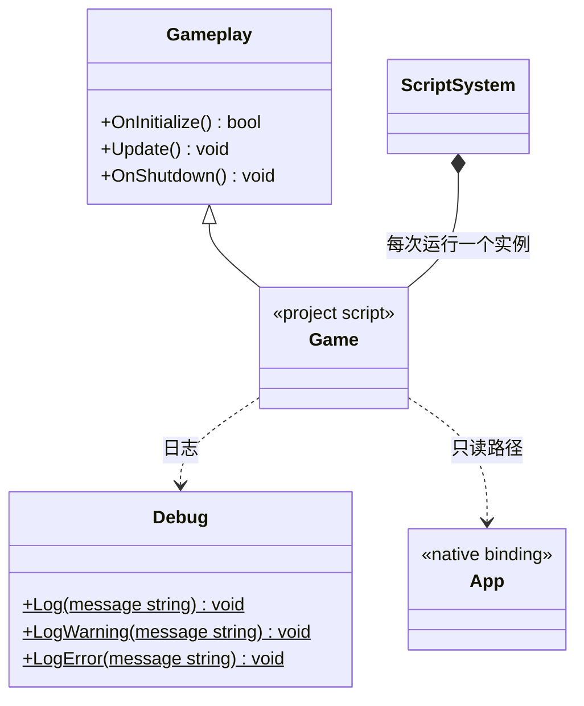

# 项目玩法入口与脚本 SDK

[类图索引](../../class-diagrams/index.md) · [脚本系统](script-system.md)

状态：桌面入口已实现，本轮接入 Android，复用相同脚本接口与生命周期。Gameplay、Debug 是虚拟 `engine` 模块的脚本接口，Game 是项目默认导出的类型，不增加同名 C++ 所有者。

- 项目写 `export default class Game extends Gameplay`，可直接承载业务或组织业务对象，不挂到节点。一个运行中的项目只有一个入口实例。
- `OnInitialize(): boolean` 在模块执行和构造后调用；必须返回布尔值，基类默认 true。`Update(): void` 每帧一次；`OnShutdown(): void` 在停止、重载或部分初始化失败清理时调用；基类后二者为空实现。
- 入口预留先于场景启动、跨场景存活的职责。本轮尚无场景加载、Node、Component 脚本接口，不声明不能使用的 API。
- `Debug.Log`、`Debug.LogWarning`、`Debug.LogError` 分别绑定 C++ 日志 info、warning、error，参数为字符串，默认落盘。
- App 暴露静态只读字符串 `builtinAssetsPath`、`persistentDataPath`、`cachePath`，对应 C++ App 路径。宿主初始化，脚本不能改写；不提供脚本文件写入 API。
- 声明统一位于 [include/engine.d.ts](../../../include/engine.d.ts)。TS 配置在项目 settings，源码在 assets，生成 JS 在 cache 并保持相对路径；运行时执行 JS。
- 热重载重建 Context、模块和 Game，JS 实例及闭包重新开始；不承诺任意状态保留。预检失败保留旧运行，执行失败明确报告。
