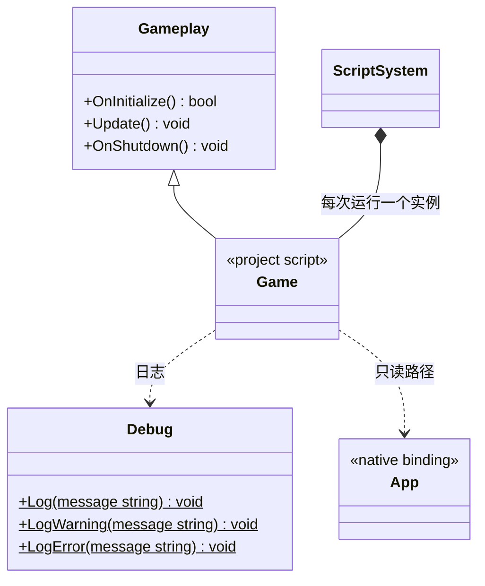
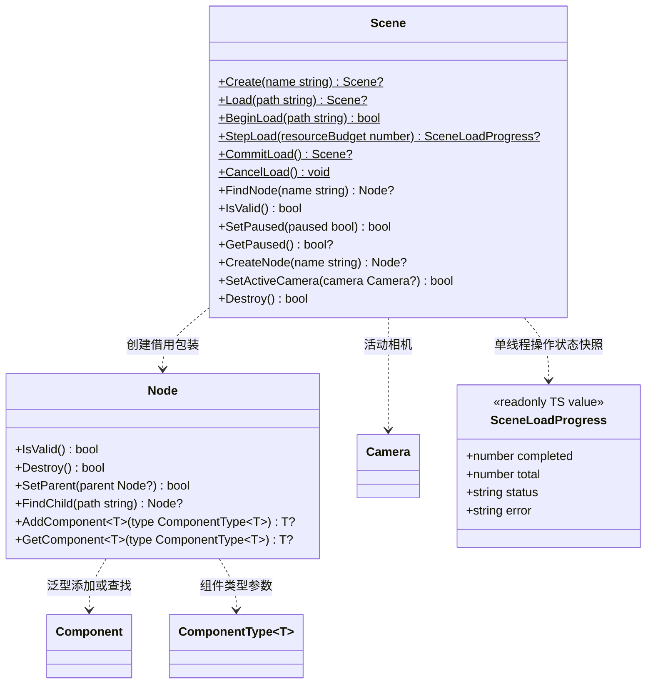
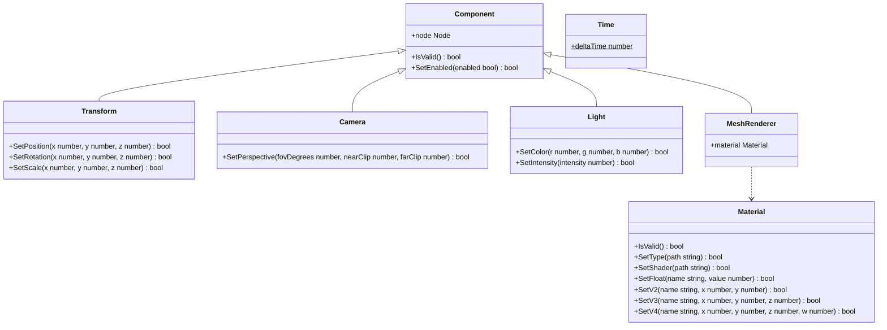

# 项目玩法入口与脚本 SDK

[类图索引](../../class-diagrams/index.md) · [脚本系统](../../plugins/runtime/class-diagrams/script-system.md)

桌面与 Android 共用这些脚本接口。Gameplay、Debug 是虚拟 `engine` 模块的脚本接口，Game 是项目默认导出的类型，不增加同名 C++ 所有者。

- 项目写 `export default class Game extends Gameplay`，可直接承载业务或组织业务对象，不挂到节点。一个运行中的项目只有一个入口实例。
- `OnInitialize(): boolean` 在模块执行和构造后调用；必须返回布尔值，基类默认 true。`Update(): void` 每帧一次；`OnShutdown(): void` 在停止、重载或部分初始化失败清理时调用；基类后二者为空实现。
- 入口在 OnInitialize 通过 Scene.Load 加载编译场景，也可显式创建 Scene；所有可见对象、相机与灯光都由 Node 持有对应 Component，自定义脚本组件尚未实现。
- `Debug.Log`、`Debug.LogWarning`、`Debug.LogError` 分别绑定 C++ 日志 info、warning、error，参数为字符串，默认落盘。
- App 暴露静态只读字符串 `assetsPath`、`persistentDataPath`、`cachePath`，对应 C++ App 路径。宿主初始化，脚本不能改写；低频用户数据通过 [Storage 字符串 KV](../../plugins/runtime/class-diagrams/storage-script-api.md) 读写和显式保存，尚无通用脚本文件接口。
- `App.RequestQuit` 和新的 Window 脚本入口由现有原生系统提供，具体方法与关系只在[运行时控制脚本接口](../../plugins/runtime/class-diagrams/runtime-controls-script-api.md)定义；不新增原生平台或窗口系统。
- 声明统一位于 [include/engine.d.ts](../../../include/engine.d.ts)。TS 配置在项目 settings，源码在 assets，生成 JS 沿用源 TS 的 GUID 并写入 cache/gen/<GUID>；catalog 的 module_path 保留相对 import 语义，运行时执行 JS。
- 热重载重建 Context、模块和 Game，JS 实例及闭包重新开始；不承诺任意状态保留。预检失败保留旧运行，执行失败明确报告。

## 脚本场景接口

这些是虚拟 `engine` 模块的 PascalCase 绑定，原生所有权与方法在 [Scene](scene.md)、[Node](node.md) 等原生类图维护。

## 脚本组件接口

- Scene、Node 与具体组件不能由脚本直接构造；Create/Add 失败返回 null，修改和有效性检查返回 bool。每个 Node 每类组件最多一个。CreateNode 自动添加 Transform；通过 `node.GetComponent(Transform)` 取得变换，通过 `node.AddComponent(Camera)` 添加相机。泛型推导返回具体组件类型，重复添加返回 null，缺失或非法类型查询返回 null。类型注册与转换在脚本绑定层，原生 Node 不枚举具体组件。
- `Component.node` 与 `Time.deltaTime` 只读；组件引用和节点引用在节点销毁、场景销毁或玩法退出后失效。
- SetParent 保留局部变换，null 解除父子关系，拒绝循环和跨场景关系；Destroy Node 同时销毁其子树。旋转使用度，前向为 -Z。
- 持久数据模型由 `include/schemas/runtime/scene.fbs` 定义，原生组件持有生成的对象数据；脚本 API 是行为绑定，材质命名参数经验证写入生成数据，不作为另一套磁盘格式。
- `MeshRenderer.material` 返回该组件所属材质的借用包装；材质和 Shader 各自通过唯一资源路径字符串指定，分别由 SetType 与 SetShader 选择。内置 builtin://materials/default-pbr 引用 builtin://shaders/pbr，声明 baseColor（V4）、metallic（Float）、roughness（Float），builtin://materials/default-unlit 引用 builtin://shaders/unlit，声明 baseColor（V4）。SetV2/SetV3 是统一类型接口，只有材质声明相应参数时可写入；未知名字、错误类型和无效数值返回 false 并保留原值。变更材质类型或 Shader 重建所选定义的默认参数，同路径设置保持原值；未知路径返回 false。MeshRenderer 通过资源路径选择内置或项目网格。
- 示例项目的 **PBR essentials** 模块在 OnInitialize 加载包含方块 MeshRenderer、相机 Camera、定向灯 Light 的场景；通过 FindNode 找到方块，Update 使用 Time.deltaTime 旋转。默认入口先打开场景菜单，各模块的 OnShutdown 由菜单协调调用；项目停止后的场景及 GPU 释放由玩法会话与脚本运行生命周期协调。

`Scene.Load(path)` 从当前 Run 已激活的 GUID catalog 读取已编译场景；输入使用 assets 相对逻辑资源路径，例如 scenes/main.scene，成功替换活动场景，失败返回 null 且保留原场景。运行时不解析源 TOML、不访问 SQLite。

## 暂停和单线程分步加载

上图的 SetPaused/GetPaused、BeginLoad/StepLoad/CommitLoad/CancelLoad 已按评审契约实现；
现有 Scene.Load 继续保留同步语义。实现仍归既有 SceneBinding，不增加项目专用原生系统。

- `scene.SetPaused(value)` 与 `scene.GetPaused()` 只操作当前 Run 拥有的活动场景，逐次校验
  场景身份及活动回调。设置返回 bool，查询失败返回 null。暂停值由 WorldSystem 持有，
  不加入 Scene 持久模型；成功切场景或释放场景后复位。完整语义见[世界暂停](../world-pause.md)。
- `Scene.BeginLoad(path)` 解析当前目录中的场景 GUID，向已注入 ResourceLoader 请求单线程操作；
  成功后由当前 BindingContext 独占。每个 Run 同时最多一个，重复 begin 返回 false；缺少分步
  加载实现、非法路径、错误资源类型或非活动回调也返回 false。它不读取实体、不替换旧场景。
- `Scene.StepLoad(resourceBudget)` 要求预算为非负 uint32 整数；0 只查询，正数最多完成该数量的
  唯一必要资源。无操作、非法参数或失效回调返回 null；操作存在时返回完整快照，status 为
  loading/ready/failed，error 在失败时为非空。百分比由 completed/total 计算，只表示目录
  声明的资源计数，不表示耗时，也不包含项目稍后动态创建的角色、武器或 UI 资源。
- `Scene.CommitLoad()` 只在操作 ready 且目录代际未改变时同步调用既有 WorldSystem::load_scene；
  始终持有 ready 根资源，复用同代缓存。成功后返回新场景并释放操作；失败返回 null，旧场景
  及其暂停值保留。提交发生的代际/场景恢复错误由 BindingContext 保存，将场景请求置为 failed
  并释放候选引用；随后 StepLoad(0) 仍返回最后计数和 failed/error，直到 CancelLoad 清理。
  失败请求不能再次 commit；先 cancel 再 begin 才能重试。未 ready 时误调用 commit 仅返回 null，
  不结束仍在进行的请求。场景节点/组件恢复本轮仍同步，不在中途发布部分 Scene。
- `Scene.CancelLoad()` 仅释放当前 Run 的操作和候选引用，重复调用安全，不卸载其他使用者资源。
  取消在两次 step 之间生效，不能中断正在解码的单项资源或已经开始的 CommitLoad。
- 成功使用其他入口更换或销毁活动场景，以及 Run 停止/重载时，清理该 Run 的待提交操作。
  候选预检不得启动操作，不得取消旧活动 Run 的操作或改变其世界暂停。
- 项目在原有主循环每帧显式调用 StepLoad，不启用后台线程、不重入 tick/render。Commit 前
  保留旧场景读取 UI；Commit 后旧控件失效，在新场景绑定同一 UI 文档。资源完成后显示
  PREPARING SCENE / PREPARING GRAPHICS，等成功渲染新场景一帧后显示 READY，再进入 HUD。
  单项大资源、场景恢复和 GPU 准备仍可能占用较长一帧，不能承诺全过程持续动画或毫秒预算。

资源操作的原生方法只在[资源加载契约](resource-loader.md)定义，依赖策略只在
[资源依赖图插件](../../plugins/runtime/class-diagrams/resource-graph.md)维护。
