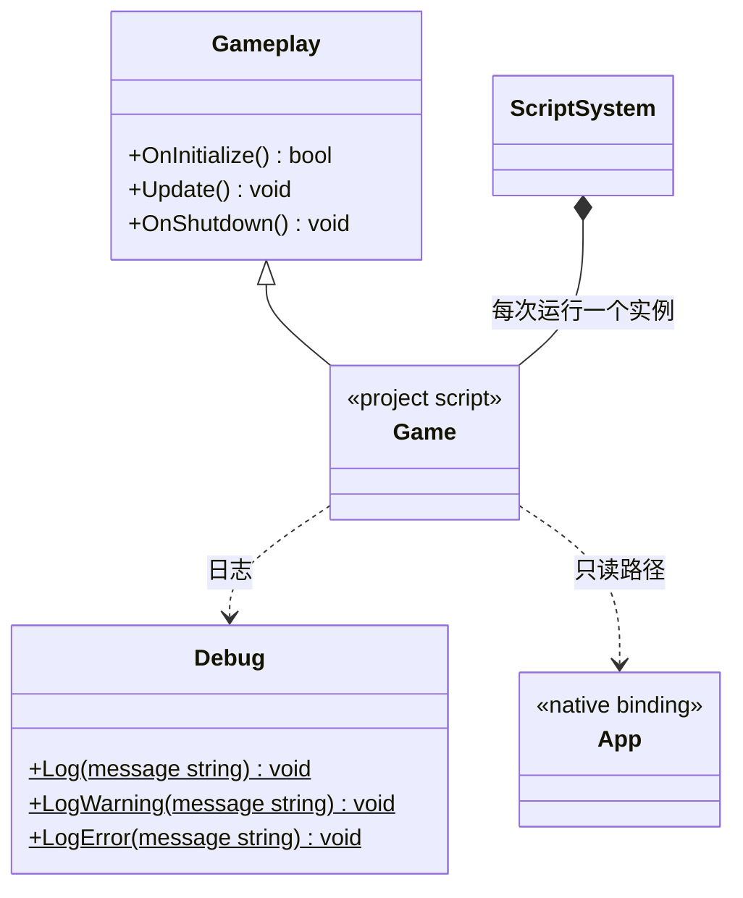
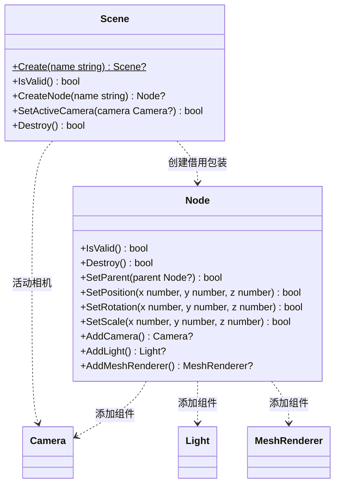
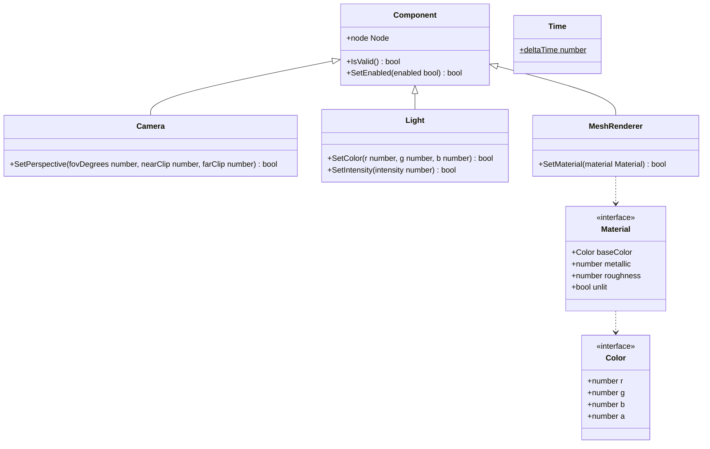

# 项目玩法入口与脚本 SDK

[类图索引](../../class-diagrams/index.md) · [脚本系统](script-system.md)

状态：现有入口增加桌面 Scene / Node / Component 绑定，Android 本轮不打包验证。Gameplay、Debug 是虚拟 `engine` 模块的脚本接口，Game 是项目默认导出的类型，不增加同名 C++ 所有者。

- 项目写 `export default class Game extends Gameplay`，可直接承载业务或组织业务对象，不挂到节点。一个运行中的项目只有一个入口实例。
- `OnInitialize(): boolean` 在模块执行和构造后调用；必须返回布尔值，基类默认 true。`Update(): void` 每帧一次；`OnShutdown(): void` 在停止、重载或部分初始化失败清理时调用；基类后二者为空实现。
- 入口在 OnInitialize 显式创建一个 Scene，所有可见对象、相机与灯光都由 Node 持有对应 Component；本轮不实现场景文件加载或自定义脚本组件。
- `Debug.Log`、`Debug.LogWarning`、`Debug.LogError` 分别绑定 C++ 日志 info、warning、error，参数为字符串，默认落盘。
- App 暴露静态只读字符串 `builtinAssetsPath`、`persistentDataPath`、`cachePath`，对应 C++ App 路径。宿主初始化，脚本不能改写；不提供脚本文件写入 API。
- 声明统一位于 [include/engine.d.ts](../../../include/engine.d.ts)。TS 配置在项目 settings，源码在 assets，生成 JS 在 cache 并保持相对路径；运行时执行 JS。
- 热重载重建 Context、模块和 Game，JS 实例及闭包重新开始；不承诺任意状态保留。预检失败保留旧运行，执行失败明确报告。

## 脚本场景接口

这些是虚拟 `engine` 模块的 PascalCase 绑定，原生所有权与方法在 [Scene](scene.md)、[Node](node.md) 等原生类图维护。

## 脚本组件接口

- Scene、Node 与具体组件不能由脚本直接构造；Create/Add 失败返回 null，修改和有效性检查返回 bool。每个 Node 每类组件最多一个。
- `Component.node` 与 `Time.deltaTime` 只读；组件引用和节点引用在节点销毁、场景销毁或玩法退出后失效。
- SetParent 保留局部变换，null 解除父子关系，拒绝循环和跨场景关系；Destroy Node 同时销毁其子树。旋转使用度，前向为 -Z。
- Material 是普通参数数据；范围和有限数值由原生接口校验，修改失败保留原值。首版 MeshRenderer 使用内置立方体。
- 本轮样例在 OnInitialize 创建方块 MeshRenderer、相机 Camera、定向灯 Light；Update 使用 Time.deltaTime 旋转，OnShutdown 结束后由 ScriptSystem 统一释放场景。
