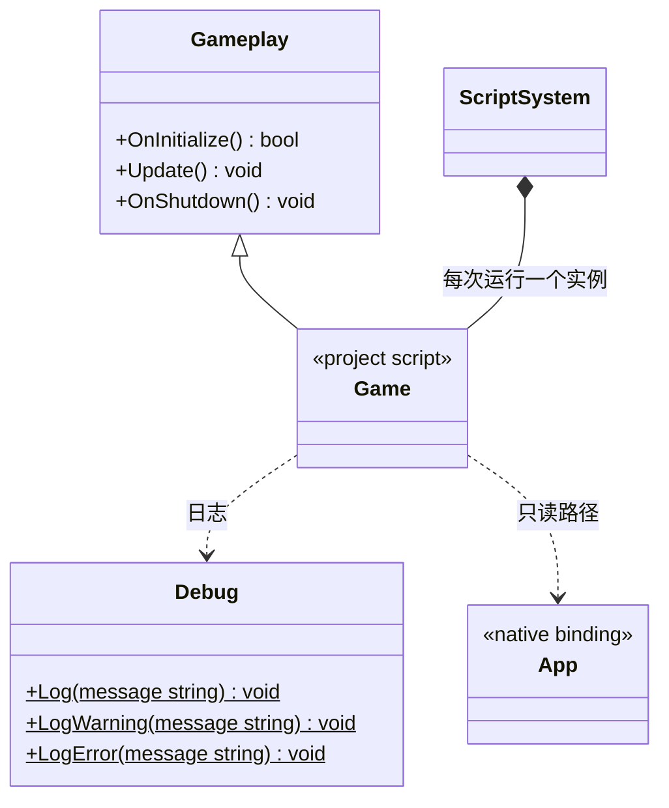
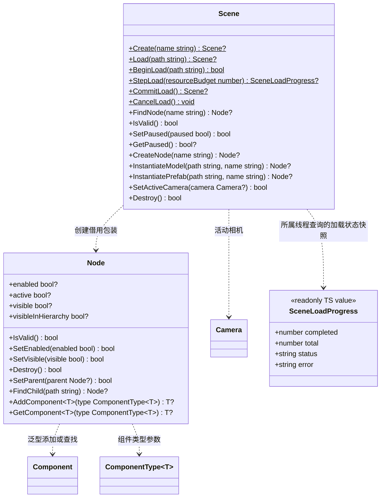
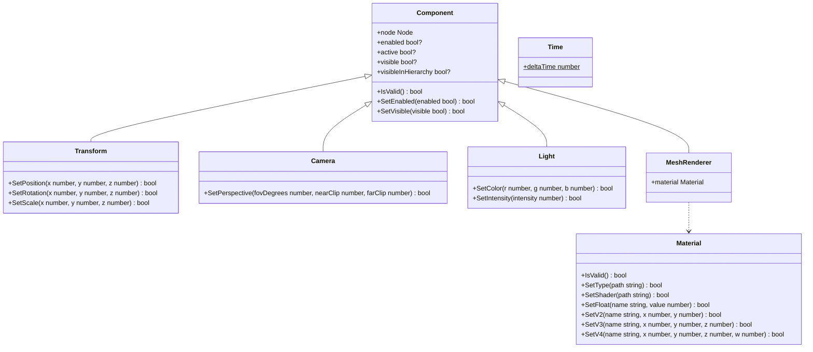

# 项目玩法入口与脚本 SDK

[类图索引](../../class-diagrams/index.md) · [脚本系统](../../plugins/runtime/class-diagrams/script-system.md)

桌面与 Android 共用这些脚本接口。Gameplay、Debug 是虚拟 `engine` 模块的脚本接口，Game 是项目默认导出的类型，不增加同名 C++ 所有者。

- 项目写 `export default class Game extends Gameplay`，可直接承载业务或组织业务对象，不挂到节点。一个运行中的项目只有一个入口实例。
- `OnInitialize(): boolean` 在模块执行和构造后调用；必须返回布尔值，基类默认 true。`Update(): void` 每帧一次；`OnShutdown(): void` 在停止、重载或部分初始化失败清理时调用；基类后二者为空实现。
- 入口在 OnInitialize 通过 Scene.Load 加载编译场景，也可显式创建 Scene；所有可见对象、相机与灯光都由 Node 持有对应 Component，自定义脚本组件尚未实现。
- `Debug.Log`、`Debug.LogWarning`、`Debug.LogError` 分别绑定 C++ 日志 info、warning、error，参数为字符串，默认落盘。
- App 暴露静态只读字符串 `assetsPath`、`persistentDataPath`、`cachePath`，对应 C++ App 路径。宿主初始化，脚本不能改写；低频用户数据通过 [Storage 字符串 KV](../../plugins/runtime/class-diagrams/storage-script-api.md) 读写和显式保存，尚无通用脚本文件接口。
- `App.RequestQuit` 和新的 Window 脚本入口由现有原生系统提供，具体方法与关系只在[运行时控制脚本接口](../../plugins/runtime/class-diagrams/runtime-controls-script-api.md)定义；不新增原生平台或窗口系统。
- 声明统一位于 [include/engine.d.ts](../../../include/engine.d.ts)。TS 配置在项目 settings，源码在 assets，生成 JS 沿用源 TS 的 GUID 并写入 cache/gen/<GUID>；catalog 的 module_path 保留相对 import 语义，运行时执行 JS。
- 热重载重建 Context、模块和 Game，JS 实例及闭包重新开始；不承诺任意状态保留。预检失败保留旧运行，执行失败明确报告。

## 脚本场景接口

这些是虚拟 `engine` 模块的 PascalCase 绑定，原生所有权与方法在 [Scene](scene.md)、[Node](node.md) 等原生类图维护。

## 脚本组件接口

- Scene、Node 与具体组件不能由脚本直接构造；Create/Add 失败返回 null，修改和有效性检查返回 bool。每个 Node 每类组件最多一个。CreateNode 自动添加 Transform；通过 `node.GetComponent(Transform)` 取得变换，通过 `node.AddComponent(Camera)` 添加相机。泛型推导返回具体组件类型，重复添加返回 null，缺失或非法类型查询返回 null。类型注册与转换在脚本绑定层，原生 Node 不枚举具体组件。
- `Component.node` 与 `Time.deltaTime` 只读；组件引用同时捕获组件实例身份，在组件移除、节点销毁、场景销毁或玩法退出后失效。同节点重新添加同类组件不会恢复旧引用；所有组件共享这一规则。
- Node 与 Component 的 enabled/visible 是本地设置，active/visibleInHierarchy 分别报告父链合成后的有效激活与可见状态。SetEnabled 影响逻辑系统参与，SetVisible 只影响显示；修改失败返回 false，失效状态查询返回 null。禁用或隐藏不销毁对象，也不使实例句柄失效。UiComponent 继承同一接口，文档实际显示由 UiSystem 按有效状态同步，不另存一份组件可见开关。
- SetParent 保留局部变换，null 解除父子关系，拒绝循环和跨场景关系；Destroy Node 同时销毁其子树。旋转使用度，前向为 -Z。
- 持久数据模型由 `include/schemas/runtime/scene.fbs` 定义，原生组件持有生成的对象数据；脚本 API 是行为绑定，材质命名参数经验证写入生成数据，不作为另一套磁盘格式。
- `MeshRenderer.material` 返回该组件所属材质的借用包装；材质和 Shader 各自通过唯一资源路径字符串指定，分别由 SetType 与 SetShader 选择。内置 builtin://materials/default-pbr 引用 builtin://shaders/pbr，声明 baseColor（V4）、metallic（Float）、roughness（Float），builtin://materials/default-unlit 引用 builtin://shaders/unlit，声明 baseColor（V4）。SetV2/SetV3 是统一类型接口，只有材质声明相应参数时可写入；未知名字、错误类型和无效数值返回 false 并保留原值。变更材质类型或 Shader 重建所选定义的默认参数，同路径设置保持原值；未知路径返回 false。MeshRenderer 通过资源路径选择内置或项目网格。
- 示例项目的 **PBR essentials** 模块在 OnInitialize 加载包含方块 MeshRenderer、相机 Camera、定向灯 Light 的场景；通过 FindNode 找到方块，Update 使用 Time.deltaTime 旋转。默认入口先打开场景菜单，各模块的 OnShutdown 由菜单协调调用；项目停止后的场景及 GPU 释放由玩法会话与脚本运行生命周期协调。

`Scene.Load(path)` 从当前 Run 已激活的 GUID catalog 读取已编译场景；输入使用 assets 相对逻辑资源路径，例如 scenes/main.scene，成功替换活动场景，失败返回 null 且保留原场景。运行时不解析源 TOML、不访问 SQLite。

## 暂停与后台资源加载

以下接口由 SceneBinding 实现，`Scene.Load` 保留同步语义。

- `scene.SetPaused(value)` 与 `scene.GetPaused()` 只操作当前 Run 拥有的活动场景，逐次校验
  场景身份及活动回调。设置返回 bool，查询失败返回 null。暂停值由 WorldSystem 持有，
  不加入 Scene 持久模型；成功切场景或释放场景后复位。完整语义见[世界暂停](../world-pause.md)。
- `Scene.BeginLoad(path)` 请求当前目录中的场景，由 BindingContext 独占加载操作。每个 Run
  最多一个；重复请求、非法路径、错误资源类型、缺少分步加载实现或非活动回调返回 false。
  成功后旧场景继续有效。
- `Scene.StepLoad(resourceBudget)` 要求预算为非负 uint32 整数。无操作、非法参数或失效回调
  返回 null；否则返回 completed、total、status 和 error 快照。status 为 loading/ready/failed，
  失败时 error 非空。先推进后台资源链，资源 ready 后在主线程分帧恢复候选场景；只有候选恢复完成才返回 ready。completed/total 仅统计资源，节点恢复阶段可能 completed 等于 total 而 status 仍为 loading。预算及计数含义见[资源加载契约](resource-loader.md#分步与后台加载操作)。
- `Scene.CommitLoad()` 提交已恢复的候选，成功返回新场景并释放操作；失败返回 null，保留旧场景及暂停值。
  未 ready 时不结束请求；目录、加载器或所属场景变化以及恢复失败，将请求置为 failed。
  错误和最后计数仍可由 StepLoad(0) 查询，重试须先 CancelLoad 再 BeginLoad。
- `Scene.CancelLoad()` 释放当前 Run 的操作和候选引用，重复调用安全。
- 成功使用其他入口更换或销毁活动场景，以及 Run 停止/重载时，清理该 Run 的待提交操作。
  候选预检不得启动操作，不得取消旧活动 Run 的操作或改变其世界暂停。
- Commit 后旧场景与控件句柄失效，项目须在新场景重新取得所需引用。

加载、场景恢复、图形准备的完成依据与取消边界统一见[加载阶段与限制](resource-loader.md#加载阶段与限制)；
依赖遍历和缓存发布见[资源依赖图插件](../../plugins/runtime/class-diagrams/resource-graph.md)。

当前 showcase 场景入口仍使用同步 Scene.Load。异步加载由调用方组合 Begin/Step/Commit。脚本无需管理线程，但必须选择合适的同步或分步入口。
