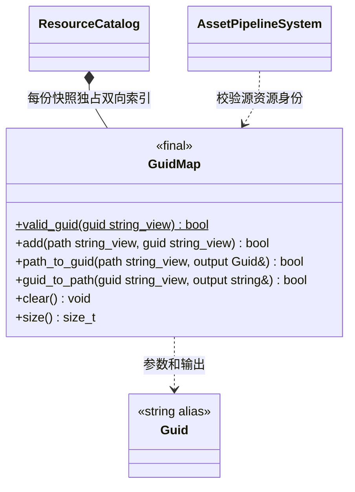

# GUID 与逻辑路径映射

[类图索引](../../class-diagrams/index.md) · [资源系统](resource-system.md)

核心模块提供平台无关的双向映射，编辑器、桌面运行时与真机共享同一实现；不依赖编辑器、SQLite、SDL 或文件系统。Guid 是规范完整 UUID 文本，生成缓存文件名直接使用这个值，不添加任何后缀。

- Guid 为 `std::string` 别名；合法值是小写、带连字符的 36 字符 UUID，拒绝全零身份。GUID 生成由导入端负责，映射类仅校验和保存。
- 逻辑路径以 `builtin/` 或 `project/` 开头；使用 `/`，拒绝空段、`.`、`..`、反斜杠、冒号和控制字符。路径不包含项目的本机根目录。
- `add` 深拷贝路径与 GUID。路径、GUID 任一已存在都返回 false，失败不改变已有映射。
- 两种查询成功时返回对应完整值，失败清空输出。输入可以与输出指向同一个字符串。
- `valid_guid`、`clear`、`size` 为 noexcept；查询和 size 为 const。返回状态标注 nodiscard。值类型可以复制，快照之间不共享可变索引。
- 实际资源文件由资源模块根据目录和 GUID 解析；正式项目缓存是 `cache/gen/<完整GUID>`。
