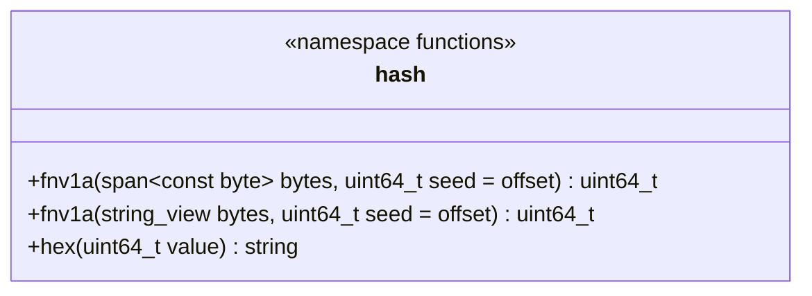

# 字节哈希工具

[类图索引](../../class-diagrams/index.md)

`runtime/utils/hash_utils.hpp` 提供 `engine::hash` 普通函数，不定义类或系统。

- FNV-1a 固定为 64 位；默认种子 `14695981039346656037`，乘数 `1099511628211`。空输入返回种子；分块调用传入上一块结果，与连续计算一致。字符串按原始无符号字节计算，不进行编码转换。
- `hex` 返回恰好 16 个小写十六进制字符，包括前导零。函数均为 `[[nodiscard]]`，字节计算为 `noexcept`；不保存输入，不执行文件读取或资源加载。
- ResourceSystem、VirtualFileSystem、编辑器资源管线、EditorEnvironment、PrefabImporter、资源同步插件与渲染 LOD 复用计算。Prefab 的身份掩码、同步清单排序和分隔、LOD 输入组装保持各自定义；内容校验仍由资源模块负责。
