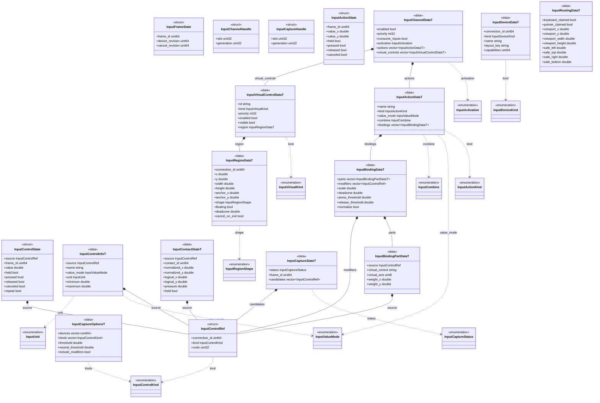

# 输入数据契约

[输入系统](input-system.md) · [完整设计](../input.md)

全部类型由 `include/schemas/runtime/input.fbs` 生成，位于 `engine::schema`；它们是值、枚举或配置记录，没有独立生命周期方法。C++ 表的对象模型后缀为 T，脚本 SDK 的同字段接口不带该后缀。SDK 可省略的标量沿用 schema 默认值，不维护另一份核心持久模型。

## 枚举与默认值

| 类型 | 按数值从 0 起排列的成员 |
| --- | --- |
| `InputDeviceKind` | `keyboard` / `mouse` / `gamepad` / `joystick` / `touch` |
| `InputControlKind` | `key` / `mouse_button` / `mouse_position` / `mouse_delta` / `mouse_relative` / `mouse_wheel` / `gamepad_button` / `gamepad_axis` / `joystick_button` / `joystick_axis` / `joystick_hat` / `touch` / `gamepad_touch` |
| `InputActionKind` | `button` / `axis1d` / `axis2d` |
| `InputValueMode` | `state` / `delta` |
| `InputCombine` | `maximum` / `sum_clamped` |
| `InputActivation` | `wait_for_neutral` / `use_current_state` |
| `InputVirtualKind` | `button` / `stick` / `drag` |
| `InputCaptureStatus` | `waiting` / `completed` / `canceled` |
| `InputUnit` | `none` / `normalized` / `logical` / `relative` / `wheel` |
| `InputRegionShape` | `rectangle` / `circle` |

- 通道默认 enabled=true、priority=0、consume_inputs=false、activation=wait_for_neutral。动作默认 button / state / maximum；列表默认空，空通道可用于等待配对。
- 绑定默认 scale=1、deadzone=0、press_threshold=0.5、release_threshold=0.4、normalize=true。分量默认 weight_x=1、weight_y=0、virtual_axis=0；virtual_axis 的 0 / 1 / 2 分别为按钮 / x / y。
- 虚拟控件默认 button、enabled=true、visible=true；区域默认 rectangle、floating=false、deadzone=0.1、cancel_on_exit=false。width / height 必须为正，区域必须指定非零屏幕触摸连接身份。
- 捕获默认 threshold=0.5、neutral_threshold=0.2、include_modifiers=true，devices / kinds 空列表表示不加对应过滤。

## 身份与字段语义

- DeviceId 是当前连接身份，uint64，0 无效；不同设备类别不冲突。断开后旧身份不再产生输入，重连使用新身份；名字与 layout_key 只是设备提示，不是玩家身份。连接身份、帧号与句柄不保存到玩家长期覆盖数据。
- 设备 capabilities 当前为 InputDeviceKind 对应的类别位；具体可用按键、轴、触摸板与范围以 controls() 返回的元数据为准，不把该字段解释成震动或传感器能力。
- 键鼠除平台可区分的物理来源外，也提供明确的聚合来源；来源由 connection_id 指定，不会按动作名自动跨设备合并。键盘 code 为 SDL scancode；鼠标按钮从 1 起，位置 / 位移 / 滚轮的 code 0 / 1 为 x / y。原始 Joystick hat 的 code 为 hat_index*2+x_or_y。
- InputControlInfoT 把稳定编码与展示名分开，给出 value_mode、unit 和范围。normalized 用于按钮和归一化轴，logical 为窗口逻辑坐标或位移，relative 为 SDL 相对鼠标单位，wheel 为浮点滚动量；不得将这些 delta 单位隐含合成。
- 原始持续状态与动作状态均带 frame_id；ControlState 的 repeat 表达设备重复事实，不重复生成玩法 pressed。同帧短按可同时 pressed=true、released=true；canceled 与正常 released 分开。普通查询只读完整发布快照。
- 每个 InputBindingDataT 是一套完整来源方案，例如一组 WASD 或一个摇杆。parts 先按 weight_x / weight_y 合成，再做死区、比例及 normalize，最后与其他绑定按 maximum / sum_clamped 合成；modifiers 全部须保持。
- 每个 part 的物理 source 与 virtual_control 二选一。虚拟 id 仅在本通道解析；button 取 virtual_axis=0，stick / drag 取 1 或 2。错误枚举、空分量、缺失引用、混合单位与非有限数值拒绝整份配置。
- 区域左上角为 viewport_origin + safe_left_or_top + anchor*safe_extent + x_or_y；width / height 为窗口逻辑尺寸，anchor 可表达相对安全区域的位置。圆形半径取 min(width,height)/2；floating 使用首次触点作中心，固定中心为区域中心。cancel_on_exit 决定移出后取消还是保持原占用。
- visible=false 或 enabled=false 不参与虚拟命中和值输出，布局替换会取消旧触点占用。InputSystem 负责输入求值，不渲染可见控件，也不从 UI DOM 读取布局。
- InputContactStateT 保留触摸设备和 contact_id、归一化坐标、窗口逻辑坐标、压力及保持状态。屏幕触摸与 gamepad_touch 按 source.kind 分开；手柄触摸板不命中屏幕虚拟区域。
- InputRoutingDataT 是宿主提交的持续占用、viewport 与安全区事实。viewport_width / height 为 0 时采用窗口逻辑尺寸，safe_* 非负；本事件是否已认领另由 process_event 的 bool 表达。它不包含菜单、编辑器或玩家策略。
- 捕获保留 waiting / completed / canceled 状态、发布帧和候选控件列表。每通道一个 waiting 捕获；候选中的修饰键与最终控件是连接会话数据，TS 负责转换为自己的持久格式。

## 提交预算

原生最多 4096 个存活通道；每个配置列表、捕获 devices / kinds 列表各最多 4096 项。单个动作名、虚拟控件 id 及其引用最多 4096 字节，每份通道配置的 parts 与 modifiers 合计最多 65536 项。超限返回 false，保留当前与上一份成功待生效配置。脚本 JSON 桥另限制单次输入 4 MiB，并严格检查未知字段与数据类型。

这些数据只表达明确请求和设备事实；TS 的默认配置、玩家覆盖版本、逻辑设备槽、绑定冲突和重连策略不进入原生 schema。
