# 输入系统

[设计与边界](../input.md) · [数据契约](input-data.md) · [脚本接口](../../plugins/runtime/class-diagrams/input-script-api.md) · [类图索引](../../class-diagrams/index.md)

本图对应 `runtime/input/input_system.hpp` 的当前接口。命名空间为 `engine`，输入数据由 `include/schemas/runtime/input.fbs` 生成，脚本外观见 `include/engine.d.ts`。

图中 InputSystem 属于 engine，BindingContext 属于脚本插件；各 Input 数据与句柄短名代表 engine::schema 中的生成类型，不在 engine 根添加兼容别名。DeviceId 在签名中表示 uint64 连接身份。

```mermaid
classDiagram
    direction TB
    class InputSystem {
        <<final>>
        +InputSystem(WindowSystem& window)
        +~InputSystem()
        +begin_frame() bool
        +set_routing_state(const InputRoutingDataT& routing) bool
        +owns_pointer(const SDL_Event& event) bool
        +process_event(const SDL_Event& event, bool event_claimed) bool
        +frame_state() const InputFrameState&
        +devices() span~const InputDeviceDataT~
        +controls(DeviceId device, vector~InputControlInfoT~& output) bool
        +read_control(const InputControlRef& control, InputControlState& output) bool
        +read_contacts(vector~InputContactStateT~& output) bool
        +create_channel(InputChannelHandle& output) bool
        +configure_channel(InputChannelHandle channel, const InputChannelDataT& data) bool
        +set_channel_enabled(InputChannelHandle channel, bool enabled, InputActivation activation) bool
        +destroy_channel(InputChannelHandle channel) bool
        +read_action(InputChannelHandle channel, string_view name, InputActionState& output) bool
        +begin_capture(InputChannelHandle channel, const InputCaptureOptionsT& options, InputCaptureHandle& output) bool
        +read_capture(InputCaptureHandle capture, InputCaptureStateT& output) bool
        +cancel_capture(InputCaptureHandle capture) bool
        +last_error() const string&
        #on_initialize(const EngineConfig& config) bool
        #on_tick(double delta_time) bool
        #on_shutdown() void
    }
    class System
    class WindowSystem
    class RuntimeHost
    class BindingContext
    class EngineConfig
    class SDL_Event {
        <<external>>
    }
    class SDL_Gamepad {
        <<external>>
    }
    class SDL_Joystick {
        <<external>>
    }
    class InputRoutingDataT
    class InputFrameState
    class InputDeviceDataT
    class InputControlInfoT
    class InputControlRef
    class InputControlState
    class InputContactStateT
    class InputChannelHandle
    class InputChannelDataT
    class InputActivation
    class InputActionState
    class InputCaptureOptionsT
    class InputCaptureHandle
    class InputCaptureStateT
    System <|-- InputSystem
    RuntimeHost *-- InputSystem : 独占，暂停前仍更新
    InputSystem --> WindowSystem : 构造借用，窗口最后关闭
    BindingContext --> InputSystem : 可空借用，生命周期覆盖 Run
    InputSystem *-- SDL_Gamepad : 已打开标准手柄，负责关闭
    InputSystem *-- SDL_Joystick : 仅非标准设备，负责关闭
    InputSystem ..> SDL_Event : 宿主同步传入，调用结束后不保留指针
    InputSystem ..> EngineConfig : 初始化参数，不读取项目策略
    InputSystem ..> InputRoutingDataT : 外部认领事实参数
    InputSystem *-- InputFrameState : 帧与修订值
    InputSystem *-- InputDeviceDataT : 当前连接清单
    InputSystem ..> InputControlInfoT : 元数据输出
    InputSystem ..> InputControlRef : 查询参数
    InputSystem ..> InputControlState : 查询输出
    InputSystem ..> InputContactStateT : 触点输出
    InputSystem ..> InputChannelHandle : 创建输出、配置和查询参数
    InputSystem *-- InputChannelDataT : 当前及待生效配置深拷贝
    InputSystem ..> InputActivation : 重新启用参数
    InputSystem ..> InputActionState : 动作输出
    InputSystem ..> InputCaptureOptionsT : 捕获参数
    InputSystem ..> InputCaptureHandle : 捕获输出和查询参数
    InputSystem *-- InputCaptureStateT : 候选结果与捕获状态
```

## 生命周期与帧

- RuntimeHost 单独初始化并独占本系统，窗口已初始化且必须活到 InputSystem 关闭之后。输入不加入 World，设备不会因切场景重开。System 的公共 tick 由宿主在窗口事件泵之后、暂停判断之前调用。
- `begin_frame()` 每宿主帧调用一次，应用待生效配置、清工作缓冲的边沿和增量；`process_event()` 只接收当前泵的事件，不调用 SDL_PollEvent。System tick 完成动作求值并发布快照。未初始化或时序错误返回 false，不发布半帧。
- 宿主在每次开帧后、事件泵前无条件调用 `set_routing_state()` 提交持续占用状态，即使没有事件也执行；UI 在泵内改变占用时，在交付对应事件前再次提交。占用变化取消工作缓冲中的相关贡献并等待回中；`process_event()` 的 bool 只表达当前事件是否已被认领。两者均限开帧到 tick 发布之间调用。
- `owns_pointer()` 是宿主即时路由检查，读取工作缓冲中当前的 capture 归属，能识别同一泵中新建的 capture；它不创建 capture。宿主先处理该归属，再对未占用的新指针进行 UI 命中，并将单事件认领事实传回 `process_event()`。
- `frame_state` 包含 frame_id、device_revision、cancel_revision；版本在 InputSystem 存活期间单调递增。设备连接变化可在后台继续产生，TS 恢复后重新读取清单。安全取消版本供调用方识别失焦等边界，不让输入核心直接清理 CharacterMotor。
- 初始化发布 frame_id 为 0 的设备与原始状态基线，不产生按下边沿；动作在通道生效后的输入帧才有结果。普通查询只读最近完整快照，事件泵中也不暴露正在积累的半帧；设备清单、device_revision 与动作状态在 tick 一起发布。实际设备关闭和安全取消在工作缓冲立即处理，在玩法更新前发布结果。
- FrameState 和设备清单为本系统的只读借用，下一次 tick 发布或关闭后不能继续持有；脚本绑定返回值副本。其他输出失败清空，错误通过 false 和 last_error 表达。句柄销毁立即失效，不受快照保持规则延迟。

## 通道、数据和查询

- 通道和捕获句柄使用槽位与代次，类型分别定义；销毁、关闭及槽位复用均使旧句柄失效。0 代次为无效，不序列化到长期配置。
- `configure_channel()` 深拷贝并校验完整配置，成功仅表示接受，下一 begin_frame 生效；失败保留当前与上一份成功待生效配置。`set_channel_enabled()` 同样按帧边界生效，激活方式由参数明确给出。两种命令按调用顺序修改同一份待生效状态：完整配置替换全部字段，启停只修改 enabled / activation；任一次失败均不改变待生效状态。
- `destroy_channel()` 立即取消该通道、虚拟控件、捕获及待生效配置并使句柄失效；其他通道不变。设备不随通道删除而关闭。
- `read_action()` 按通道和动作名读取稳定快照；未知动作、失效句柄或首份配置尚未生效返回 false，output 清空。重复读取不消耗边沿。断开最后一个来源产生 canceled；仍有其他来源保持时继续 held。
- 原始查询不受动作消费影响。`controls()` 提供稳定控件编码、展示名、类型和范围，供完整按键选择及重绑定使用；控件编码不是本地化展示字符串。`read_contacts()` 保留不同设备和 contact 的身份。
- 直接查询在已发布清单中断开 / 未知的设备或不支持的控件返回 false 并清空输出；这不等于动作求值失败，已有映射中的离线来源仍按中性处理。无当前触点时 read_contacts 成功返回空列表。
- `InputChannelDataT` 的优先级和消费选项由调用方指定；同优先级按通道创建序号确定求值顺序，不猜测通道用途。UI 外部认领不修改物理事实，过滤和取消只影响相应动作贡献。

## 捕获和错误

- 每通道最多一个 waiting 捕获。begin_capture 受理后在下次 begin_frame 启动，启动事件及此前保持值均进入忽略 / 等待回中集合；当前事件即使尚未交给 InputSystem 也不能成为候选。完成只记录候选，不修改配置。completed / canceled 结果保留到该通道下一次成功 begin_capture 或销毁；新捕获换代，旧 token 不再有效。
- cancel_capture 将 waiting 标记为 canceled，重复取消同一 canceled 捕获幂等；对 completed 或失效句柄返回 false，不影响其他捕获。通道 disabled 时仍可显式捕获，是否阻止其他通道由 TS 决定。
- 捕获候选和状态同样随 tick 发布；取消成功表示已更新工作状态，不能假定紧接着查询就取得下一份发布结果。新捕获立即返回新句柄，替换或销毁导致旧句柄立即失效。
- 设备不存在、暂时断开或不支持某控件，与配置格式错误分开：设备暂不可用使对应来源中性，不使其他来源或通道失败；错误类型、非法范围、冲突动作定义与失效句柄拒绝提交。
- 构造、析构、无分配状态查询为 noexcept，查询为 const；其他接口不默认标 noexcept。bool 和状态查询标注 nodiscard，钩子标注 override。全部接口在宿主主线程串行调用，SDL 头文件和设备操作保持私有；公开头只前置声明宿主接入所需 SDL_Event。

InputSystem 不拥有或依赖 UiSystem、ScriptSystem、Storage、项目配置系统、Scene 或具体角色 / 战斗插件。

原生预算为最多 4096 个存活通道、每列表 4096 项、单 name / id / 引用 4096 字节、每通道配置 parts 与 modifiers 合计 65536 项；捕获设备及控件类型列表各最多 4096 项。所有预算在提交前校验，超限返回 false，不截断应用。脚本桥还有单次 4 MiB 序列化输入限制。
