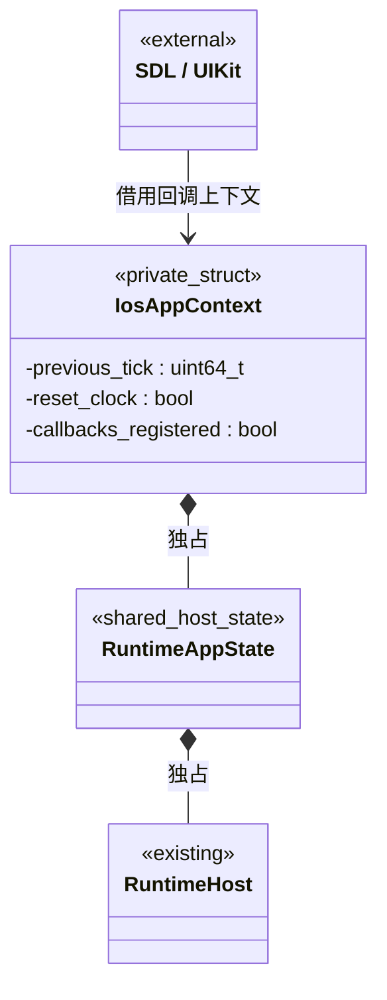
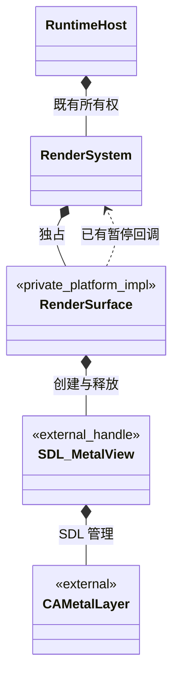

# iOS 原生游戏运行宿主

> **构建与导出已实现。** 原生游戏使用 Metal；已完成真机与 arm64 模拟器的 Debug / Release 编译及公开范例打包。模拟器与真机的实测范围、当前限制统一见[测试文档](../../testing.md#ios-原生运行包)。

[类图索引](../../class-diagrams/index.md) · [iOS 导出](../../editor/class-diagrams/ios-export.md) · [运行宿主](runtime-host.md) · [窗口](window-system.md) · [渲染](render-system.md) · [App](app.md)

## 范围与复用

共享游戏入口复用 `engine::host_detail::RuntimeAppState` 与 initialize / step / shutdown 函数，和原生桌面、Web 使用同一套资源、玩法和任务装配。[共享入口类图](web-host.md#共用游戏入口)维护其方法和服务所有权，本页只引用。

新增一个平台私有数据结构 `IosAppContext`，保存共享入口状态和帧回调登记信息；不继承 System。没有新的场景系统、资源加载器、线程池、脚本虚拟机门面或 iOS 专用玩法基类。

宿主与窗口公开契约增加 `RuntimeHost::set_suspended(bool)` 和 `WindowSystem::safe_area(WindowRect&)`。方法、状态和输出约定分别只定义于[宿主暂停](runtime-host.md#宿主显式暂停)与[窗口安全区域](window-system.md#安全区域查询)；[UI 系统](ui-system.md)补充 release_gpu，让设备重建保留存活的文档和订阅。App 接口、RenderSurface 私有接口、资源 Schema 和组件模型沿用现有契约。

## 入口与所有权

- `platforms/ios/main.cpp` 中的私有拥有者独占 `IosAppContext`，上下文独占一个 RuntimeAppState；SDL 只借用回调上下文，不能销毁它。上下文必须活过所有登记的回调，不能是返回后的 main 栈变量。
- 平台入口调用共享 `initialize_runtime_app(state, config, argc, argv)`，先建立 App、日志、任务域、资源及呈现服务，再登记 `SDL_SetiOSAnimationCallback`；main 随后返回，将应用调度交给 UIKit。
- iOS 宿主通过既有 `WindowSystem::set_mode(borderless)` 请求全屏显示，不裁剪渲染视口；Android、iOS 共用的安全矩形由项目通过 Window 服务查询并处理布局。
- 帧回调使用单调时钟，每帧仅调用一次 `step_runtime_app`；WindowSystem 仍是唯一 SDL 事件队列消费者。这里不启用 SDL_AppEvent / SDL_MAIN_USE_CALLBACKS，不新增转存输入队列；不能同时让两个入口消费事件。
- 回调运行在 SDL / UIKit 主线程；共享 ThreadSystem / TaskSystem 继续承担 CPU 任务。bgfx 的线程配置沿用渲染系统，平台入口不另起渲染线程。
- iOS 原生事件循环已经由 UIKit 驱动；共享 WindowSystem 只消费 SDL 事件。以固定 SDL 版本核对并关闭嵌套 UIKit 事件泵，禁止在一帧内递归进入另一帧。
- 登记失败立即撤销已登记项并反序关闭；正常停止先撤销动画回调及本入口的生命周期观察，再调用共享 shutdown，运行资源关闭后，空上下文继续存活到进程结束，以免释放当前回调栈仍借用的 userdata。停止支持部分初始化与重复调用，不能从活动 Task 完成委托内销毁其拥有者。
- `FrameStatus::failed` 保存现有故障信息后收尾，`exit_requested` 走普通关闭；paused 不推进模拟。正常请求退出只停止引擎并将进程交还 UIKit，不调用进程 exit 模拟用户关闭应用。

入口私有模块函数使用 `initialize_ios_app(int argc, char** argv) -> bool`、`on_frame(void* context) -> void`、`on_lifecycle(void* context, SDL_Event* event) -> bool` 与 `shutdown_ios_app() -> void`；均不进入核心头文件或 TS SDK。`on_lifecycle` 不消费普通输入，登记前后由入口保证上下文生命周期。

## Metal 表面

RenderSystem、WindowSystem 和 RenderSurface 的公开／私有方法继续在[渲染系统](render-system.md)与[窗口系统](window-system.md)定义。本图的反向虚线是已有 SuspendCallback 的调用目标，不是核心包含平台类或平台持有 RuntimeHost 的新依赖。

- 继续使用 `platforms/ios/render/render_surface.cpp`：SDL_Metal_CreateView 取得视图，SDL_Metal_GetLayer 提供借用的 CAMetalLayer，bgfx 后端固定为 Metal。
- WindowSystem 拥有 SDL_Window；RenderSurface 借用窗口并负责释放它创建的 Metal view，RenderSystem 必须先于窗口关闭。bgfx 完成关闭后才能销毁 view / layer。
- iOS RenderSurface 通过事件观察器接入 SDL 的同步应用生命周期事件。WILL_ENTER_BACKGROUND 在 UIKit 主线程调用已有 SuspendCallback，关闭 GPU 设备并等待现有渲染线程收尾；不能只挂一个标记等待下一帧，因为进入后台后可能再无帧回调。
- 暂停收尾先让未完成截图进入明确失败终态，不为完成截图在后台追加提交；普通场景、GPU 上传与截图共用同一个设备代次和失效机制。
- CPU 场景、脚本和资源引用保留；恢复时通过既有 prepare / poll / GPU 资源准备链重建。设备暂不可用返回 deferred，初始化失败返回 failed，不能把后台或新设备未就绪算作已提交。
- 旋转与尺寸变化读取当前像素尺寸；layer 身份变化走既有完整重建，不新增第二套交换链管理。

## 前后台、输入与时钟

| 平台事件 | 调用及完成边界 |
| --- | --- |
| WILL_ENTER_BACKGROUND | 入口立即请求 host.set_suspended(true)，音频及影片时钟停止；RenderSurface 同步完成 GPU 收尾后才允许该生命周期通知返回系统 |
| DID_ENTER_BACKGROUND | 保持暂停；不提交新 GPU 工作，不依赖后续回调执行存档或关闭 |
| WILL_ENTER_FOREGROUND | 保持暂停，等待窗口重新可用 |
| DID_ENTER_FOREGROUND | 请求 host.set_suspended(false)，将入口时钟重置；下一帧从零增量恢复，并走现有设备准备 |
| TERMINATING | 主线程撤销回调并反序关闭；系统强制终止不保证该通知必达 |

生命周期处理只针对 UIKit 主线程通知；工作线程不允许直接释放 GPU 或宿主。入口不在通知内递归调用 tick / poll_events，也不从仍在派发的回调栈中释放其 userdata；初始化和关闭期间的事件由显式就绪标志处理。

触摸、键盘、手柄、UI 认领和后台输入取消继续走 InputSystem / UiSystem 的现有 SDL 路由；恢复首帧先处理已排队的生命周期及输入取消，再推进世界。屏幕安全区域是 Window 服务查询，项目据此调整 UI 资源中的布局；它不改变相机视口、场景状态或渲染分辨率。

音频会话与设备中断继续使用 SDL 音频实现，宿主暂停保证没有额外后台播放；恢复失败必须通过现有错误状态呈现。存档仍由业务显式调用 Storage.Save，同步完成才返回成功，不增加隐式退出存档，也不把后台系统终止通知当作可靠的存档时机。

## 沙盒路径

在 `platforms/ios/app.mm` 实现现有 App，Objective-C++ 与 Foundation 只存在于平台实现。

| App 语义 | iOS 默认位置 |
| --- | --- |
| assets_path | `<bundle>/assets/`，只读；iOS 包体根布局，不使用 macOS 的 Contents/Resources |
| persistent_data_path | `<sandbox>/Library/Application Support/<application_name>/` |
| cache_path | `<sandbox>/Library/Caches/<application_name>/` |

持久目录和缓存按现有 App 契约检查、创建和原子发布配置；不能拼接或保存安装时随机沙盒绝对路径。AppConfig 的显式覆盖仍只接受平台可访问目录。普通存档保留系统持久语义，可重新获得的资源版本按 Apple 文件属性排除备份，不能将全部用户存档一并标记为可丢弃。

宿主继续优先选取完整有效的持久资源版本，否则使用包内版本；选择后不混用其他版本缺失资源。iOS 的目标元数据为 ios，不能把 macOS Metal 缓存当作同一平台包。文件读取、KV 原子替换、目录与加载图沿用普通原生实现，运行时不读取项目 TOML。

## 构建、测试与实现落点

| 位置 | 职责 |
| --- | --- |
| `platforms/ios/main.cpp` | 平台入口、私有 IosAppContext、帧回调及生命周期请求 |
| `platforms/ios/app.mm` | 现有 App 的 iOS 路径实现 |
| `platforms/ios/render/render_surface.cpp` | 扩展已有 Metal 表面与同步后台收尾 |
| `platforms/apple/task/thread_priority.cpp` | 复用 Apple 线程优先级实现 |
| `platforms/ios/templates/`、`platforms/ios/export.py` | 平台清单、启动资源、打包及签名 |
| `platforms/ios/triplets/` | 真机与模拟器各自的依赖目标配置 |
| `cmake/platforms/ios.cmake`、根 Presets | 平台目标装配和独立构建目录 |
| 既有 RuntimeHost、WindowSystem 及窗口脚本绑定 | 两项通用契约扩展与全部调用／声明同步 |

首版原生脚本使用现有 QuickJS，可关闭脚本插件；不引入 iOS 专用 VM。现有 V8 交叉构建只覆盖 Android，iOS 选择 V8 时配置明确报错，不静默切换后端。所有选用的运行插件及依赖必须实际编译链接；不可用插件或资源特性必须显式报告，不能为跑通范例偷偷关掉场景效果。

测试构建通过现有 ENGINE_ENABLE_TEST_SUPPORT 和显式选用的 runtime/mcp 装配文件通道端点，读取普通场景准备状态与截图接口。测试包使用独立的 .test bundle identifier；桌面工具通过 iOS 平台工具读写沙盒通道与截图，不增加网络权限或 IosMcpSystem。正式包排除测试声明、源码与链接依赖。

验收门槛：真机与 arm64 模拟器的 Debug 编译、Release 编译；Release 下公开范例首帧、标准 PBR、UI 触摸／安全区域、音频中断、前后台恢复、旋转、显式存档重启与截图回读。真机后台时不得继续提交 Metal；模拟器通过不能代表真机通过。复用现有模块用例，并验证所选插件确实参与链接，不新建一套 iOS 场景测试框架。

## 上游依据

入口与即时生命周期回调按 [SDL iOS 指南](https://wiki.libsdl.org/SDL3/README-ios) 和 [SDL_SetiOSAnimationCallback](https://wiki.libsdl.org/SDL3/SDL_SetiOSAnimationCallback) 适配；该方式可以保留现有事件消费顺序。后台 GPU 边界依据 [Apple Metal 后台说明](https://developer.apple.com/documentation/metal/preparing-your-metal-app-to-run-in-the-background)。安全区域使用 [SDL_GetWindowSafeArea](https://wiki.libsdl.org/SDL3/SDL_GetWindowSafeArea)，不自行维护机型刘海尺寸表。

设备资源同步由桌面 editor/mcp 通过 iOS 应用容器完成，不依赖本机运行端点；完整目录、原子发布、状态和热重载契约统一见[资源同步](../../plugins/editor/resource-sync.md#ios-资源同步与热重载)。
